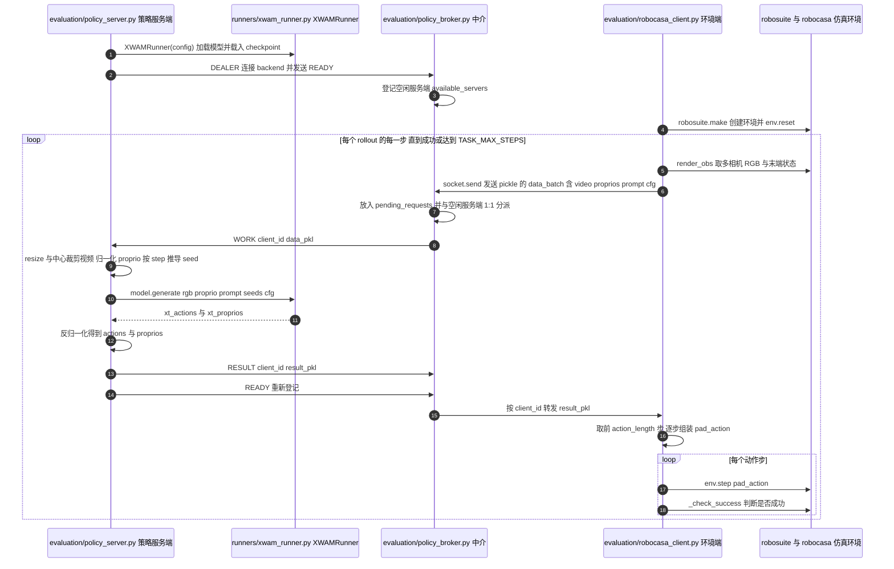

# X-WAM

## 一句话定义

**X-WAM** 是 [小米集团](https://github.com/XiaomiRobotics) 公开的 **世界模型** 开源项目：模型联合学习视频世界变化与机器人动作，在共享表征中支持跨本体操作和未来预测；项目用于检查世界模型输出怎样与动作头连接。

## 英文缩写速查

| 缩写 | 英文全称 | 简要说明 |
|------|----------|----------|
| SDK | Software Development Kit | 真机控制与状态读取接口 |
| RL | Reinforcement Learning | 强化学习训练与策略优化 |
| VLA | Vision-Language-Action | 视觉–语言–动作统一策略 |
| Sim2Real | Simulation to Real | 仿真策略迁移真机 |
| URDF | Unified Robot Description Format | 机器人描述与仿真资产 |

## 为什么重要

- 收录于 [国内具身智能开源全景（76 家 · 424 项）](../overview/china-domestic-embodied-opensource-76-companies-technology-map.md) 的 **第一层** 分组。
- 与 [Humanoid Motion Intelligence](../entities/humanoid-motion-intelligence.md) 同源策展；本页为 **独立详情节点**，便于从公司清单跳到机制与入口说明。

## 核心原理

| 字段 | 内容 |
|------|------|
| 机构 | 小米集团 |
| 类别 | 世界模型 |
| 官方组织 | https://github.com/XiaomiRobotics、https://github.com/sharinka0715 |

## 工程实践

1. 从官方 GitHub/Gitee 组织检索 `X-WAM` 仓库并核对 README 许可与依赖。
2. 对照本库 [424 项覆盖索引](../queries/china-domestic-opensource-424-coverage.md) 查看同公司其它入口是否共用训练/部署链路。
3. 若与既有方法页（如 RL 框架、VLA、SDK）主题相同，优先读关联页中的「开源入口」小节，避免重复维护平行叙事。

## 局限与风险

- 公众号清单为 **策展快照**（2026-09-06）；仓库更名、归档或许可证变化须回官方组织页核实。
- **开源状态**：以仓库 README 与 release 为准（入库日按文章描述归纳，未逐仓 clone 验证）。

## 源码运行时序图

入口（评测为三个进程）：`python evaluation/policy_broker.py --frontend_port 10086 --backend_port 10087`；`CUDA_VISIBLE_DEVICES=0 python evaluation/policy_server.py --exp_path checkpoints/robocasa_sft --wan_checkpoint_dir <wan22_5b 路径> --broker_port 10087 --denoise_steps 50 --action_denoise_steps 10`；环境端 `python evaluation/robocasa_client.py`（参数见 `evaluation/README.md`）。

图依据：sharinka0715/X-WAM@72cfb86，实际读过 `README.md`、`evaluation/README.md`（前 80 行，启动命令段）、`evaluation/policy_broker.py`、`evaluation/policy_server.py`、`evaluation/robocasa_client.py`（`main` 与 `render_obs` 相关段）。`runners/xwam_runner.py` 内部未读，`XWAMRunner.generate` 仅据 `policy_server.py` 中的调用名标注；RoboTwin 客户端与训练流程未画。未运行代码。

## 关联页面

- [国内具身开源全景技术地图](../overview/china-domestic-embodied-opensource-76-companies-technology-map.md)
- [HMI 开源项目主表导读](../queries/hmi-opensource-projects-coverage.md)
- [Humanoid Motion Intelligence](../entities/humanoid-motion-intelligence.md)

## 参考来源

- [X-WAM 源码归档](../../sources/repos/x-wam.md)（<https://github.com/sharinka0715/X-WAM>）

- [国内具身智能开源全景（微信公众号）](../../sources/blogs/wechat_embodied_station_domestic_opensource_panorama_2026-09-06.md)
- 源码核对（2026-11-02）：sharinka0715/X-WAM@72cfb86，读过 README.md、evaluation/README.md（前 80 行）、evaluation/policy_broker.py、evaluation/policy_server.py、evaluation/robocasa_client.py；时序图依据以上文件，未运行代码。

## 推荐继续阅读

- [小米集团 官方组织](https://github.com/XiaomiRobotics)
