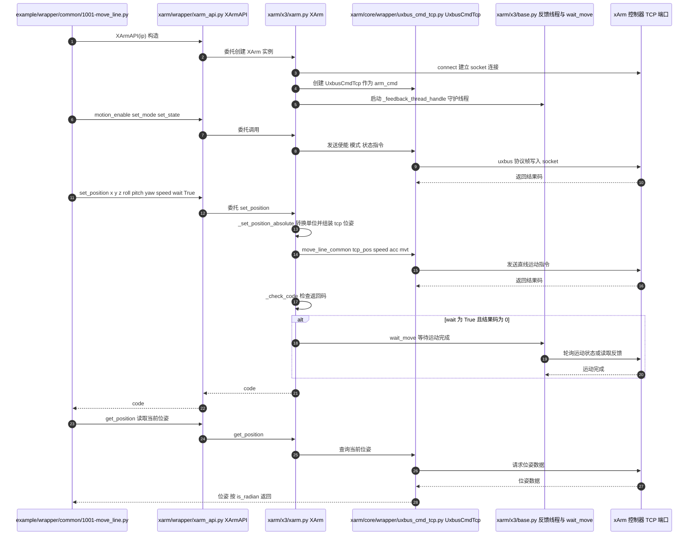

# xArm-Python-SDK

## 一句话定义

**xArm-Python-SDK** 是 [众为创造](https://github.com/xArm-Developer) 公开的 **SDK/驱动** 开源项目：提供UFACTORY系列机械臂的官方Python API，覆盖连接、状态读取、关节与笛卡尔运动及IO控制。

## 英文缩写速查

| 缩写 | 英文全称 | 简要说明 |
|------|----------|----------|
| SDK | Software Development Kit | 真机控制与状态读取接口 |
| RL | Reinforcement Learning | 强化学习训练与策略优化 |
| VLA | Vision-Language-Action | 视觉–语言–动作统一策略 |
| Sim2Real | Simulation to Real | 仿真策略迁移真机 |
| URDF | Unified Robot Description Format | 机器人描述与仿真资产 |

## 为什么重要

- 收录于 [国内具身智能开源全景（76 家 · 424 项）](../overview/china-domestic-embodied-opensource-76-companies-technology-map.md) 的 **第五层** 分组。
- 与 [Humanoid Motion Intelligence](../entities/humanoid-motion-intelligence.md) 同源策展；本页为 **独立详情节点**，便于从公司清单跳到机制与入口说明。

## 核心原理

| 字段 | 内容 |
|------|------|
| 机构 | 众为创造 |
| 类别 | SDK/驱动 |
| 官方组织 | https://github.com/xArm-Developer |

## 工程实践

1. 从官方 GitHub/Gitee 组织检索 `xArm-Python-SDK` 仓库并核对 README 许可与依赖。
2. 对照本库 [424 项覆盖索引](../queries/china-domestic-opensource-424-coverage.md) 查看同公司其它入口是否共用训练/部署链路。
3. 若与既有方法页（如 RL 框架、VLA、SDK）主题相同，优先读关联页中的「开源入口」小节，避免重复维护平行叙事。

## 局限与风险

- 公众号清单为 **策展快照**（2026-09-06）；仓库更名、归档或许可证变化须回官方组织页核实。
- **开源状态**：以仓库 README 与 release 为准（入库日按文章描述归纳，未逐仓 clone 验证）。

## 源码运行时序图

入口：`python example/wrapper/common/1001-move_line.py <机械臂 IP>`（需可连接的 xArm 控制器；示例先 `motion_enable`、`set_mode(0)`、`set_state(0)`、`move_gohome`，再执行直线运动。真机运动前请确认周围安全）。

图依据：xArm-Developer/xArm-Python-SDK@8a6fa5c，实际读过 `README.md`、`example/wrapper/common/1001-move_line.py`、`xarm/wrapper/xarm_api.py`（`XArmAPI.__init__`、`set_position` 委托段）、`xarm/x3/xarm.py`（`set_position` 与 `_set_position_absolute` 相关段）、`xarm/x3/base.py`（`connect` 的 socket 与 `UxbusCmdTcp` 创建段、`wait_move` 签名）、`xarm/core/wrapper/uxbus_cmd.py`（`move_line_common` 段）。`_feedback_thread_handle` 与 `get_position` 的内部细节、串口分支未逐行读，仅据函数名标注；未运行代码。

## 关联页面

- [国内具身开源全景技术地图](../overview/china-domestic-embodied-opensource-76-companies-technology-map.md)
- [HMI 开源项目主表导读](../queries/hmi-opensource-projects-coverage.md)
- [Humanoid Motion Intelligence](../entities/humanoid-motion-intelligence.md)

## 参考来源

- [xArm-Python-SDK 源码归档](../../sources/repos/xarm-python-sdk.md)（<https://github.com/xArm-Developer/xArm-Python-SDK>）

- [国内具身智能开源全景（微信公众号）](../../sources/blogs/wechat_embodied_station_domestic_opensource_panorama_2026-09-06.md)
- 源码核对（2026-11-02）：xArm-Developer/xArm-Python-SDK@8a6fa5c，读过 README.md、example/wrapper/common/1001-move_line.py、xarm/wrapper/xarm_api.py、xarm/x3/xarm.py、xarm/x3/base.py、xarm/core/wrapper/uxbus_cmd.py；时序图依据以上文件，未运行代码。

## 推荐继续阅读

- [众为创造 官方组织](https://github.com/xArm-Developer)
