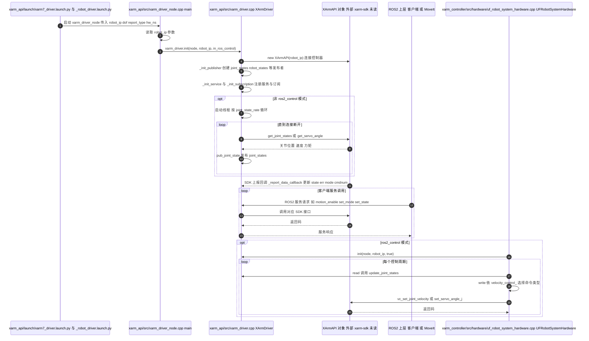

# xarm_ros2

## 一句话定义

**xarm_ros2** 是 [众为创造](https://github.com/xArm-Developer) 公开的 **仿真环境** 开源项目：为xArm、UFACTORY 850和Lite6提供ROS2模型、硬件接口、MoveIt规划、Gazebo仿真和真机控制示例。

## 英文缩写速查

| 缩写 | 英文全称 | 简要说明 |
|------|----------|----------|
| SDK | Software Development Kit | 真机控制与状态读取接口 |
| RL | Reinforcement Learning | 强化学习训练与策略优化 |
| VLA | Vision-Language-Action | 视觉–语言–动作统一策略 |
| Sim2Real | Simulation to Real | 仿真策略迁移真机 |
| URDF | Unified Robot Description Format | 机器人描述与仿真资产 |

## 为什么重要

- 收录于 [国内具身智能开源全景（76 家 · 424 项）](../overview/china-domestic-embodied-opensource-76-companies-technology-map.md) 的 **第五层** 分组。
- 与 [Humanoid Motion Intelligence](../entities/humanoid-motion-intelligence.md) 同源策展；本页为 **独立详情节点**，便于从公司清单跳到机制与入口说明。

## 核心原理

| 字段 | 内容 |
|------|------|
| 机构 | 众为创造 |
| 类别 | 仿真环境 |
| 官方组织 | https://github.com/xArm-Developer |

## 工程实践

1. 从官方 GitHub/Gitee 组织检索 `xarm_ros2` 仓库并核对 README 许可与依赖。
2. 对照本库 [424 项覆盖索引](../queries/china-domestic-opensource-424-coverage.md) 查看同公司其它入口是否共用训练/部署链路。
3. 若与既有方法页（如 RL 框架、VLA、SDK）主题相同，优先读关联页中的「开源入口」小节，避免重复维护平行叙事。

## 局限与风险

- 公众号清单为 **策展快照**（2026-09-06）；仓库更名、归档或许可证变化须回官方组织页核实。
- **开源状态**：以仓库 README 与 release 为准（入库日按文章描述归纳，未逐仓 clone 验证）。

## 源码运行时序图

入口：`ros2 launch xarm_api xarm7_driver.launch.py robot_ip:=<机械臂 IP>`（驱动节点 `xarm_driver_node`，入口 `xarm_api/src/xarm_driver_node.cpp`）。ros2_control 模式由 `xarm_controller` 中的硬件插件 `UFRobotSystemHardware` 调用同一驱动对象（`in_ros_control=true`）。

图依据：xArm-Developer/xarm_ros2@ac736c9，实际读过 `README.md`、`xarm_api/launch/xarm7_driver.launch.py`（前段）、`xarm_api/launch/_robot_driver.launch.py`（节点定义）、`xarm_api/src/xarm_driver_node.cpp`（`main`）、`xarm_api/src/xarm_driver.cpp`（`init`、`_init_publisher`、`_report_data_callback` 及非 ros2_control 线程段）、`xarm_controller/src/hardware/uf_robot_system_hardware.cpp`（`read`、`write` 段）。`XArmAPI` 为外部 SDK（xarm-sdk 子模块）内部实现，未读，仅据调用名标注；服务与上报回调的注册位置未逐行核对。未运行代码。

## 关联页面

- [国内具身开源全景技术地图](../overview/china-domestic-embodied-opensource-76-companies-technology-map.md)
- [HMI 开源项目主表导读](../queries/hmi-opensource-projects-coverage.md)
- [Humanoid Motion Intelligence](../entities/humanoid-motion-intelligence.md)

## 参考来源

- [xarm_ros2 源码归档](../../sources/repos/xarm_ros2.md)（<https://github.com/xArm-Developer/xarm_ros2>）

- [国内具身智能开源全景（微信公众号）](../../sources/blogs/wechat_embodied_station_domestic_opensource_panorama_2026-09-06.md)
- 源码核对（2026-11-02）：xArm-Developer/xarm_ros2@ac736c9，读过 ReadMe.md、xarm_api/launch/xarm7_driver.launch.py、xarm_api/launch/_robot_driver.launch.py、xarm_api/src/xarm_driver_node.cpp、xarm_api/src/xarm_driver.cpp、xarm_controller/src/hardware/uf_robot_system_hardware.cpp；时序图依据以上文件，未运行代码。

## 推荐继续阅读

- [众为创造 官方组织](https://github.com/xArm-Developer)
