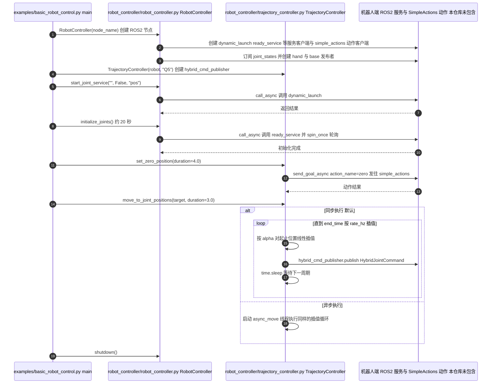

# RobotEra SDK API：真机应用控制接口

## 一句话定义

通过 ROS 2 Python 封装初始化、状态读取、轨迹、ServoPose、手与底盘控制。

## 英文缩写速查

| 缩写 | 英文全称 | 简要说明 |
| --- | --- | --- |
| ROS | Robot Operating System | 机器人通信与软件中间件 |
| SDK | Software Development Kit | 对接机器人运行环境的开发工具 |
| VLA | Vision-Language-Action | 由视觉和语言生成动作的策略 |
| MPC | Model Predictive Control | 基于预测模型优化控制目标 |

## 为什么重要

这一入口补足[星动纪元](./robotera.md)研究与产品之间的工程接口；读者可核对公开代码和厂商运行环境的边界，避免仅凭仓库名推断完整复现能力。

## 核心结构

| 机构 | 星动纪元（ROBOTERA） |
| --- | --- |
| 官方仓 | [roboterax/xbot_sdk_api](https://github.com/roboterax/xbot_sdk_api) |

| 类 | 作用 |
| --- | --- |
| RobotController | 启动关节服务、初始化、状态监控、控制权限、手/底盘命令 |
| TrajectoryController | Q5 / L3 / L7 预定义姿态与关节目标轨迹 |
| MPCController | 调用底层 MPC 服务、查询状态与发送 ServoPose |

## 工程实践

README 要求厂商 developer 环境，或 ROS 2 Humble + CycloneDDS；先构建 `teleop_client` 消息定义，设置 `ROS_DOMAIN_ID=211`。基本生命周期是创建控制器、启动关节服务、初始化、检查就绪、执行轨迹、shutdown。MPC 路径另需激活算法控制权限、启动控制服务、发送目标、停止并释放权限。

## 局限与风险

截至 2026-10-08，接口示例可公开阅读，但消息和下层服务需配套环境；`MPCController` 封装不能证明 MPC 求解器或完整全身策略源码开放。厂商机型与控制模式不能跨本体直接套用。本页未操作真机，首发日期未确认。

## 源码运行时序图

入口：`python examples/basic_robot_control.py`（需厂商 developer 环境，或 ROS 2 Humble + CycloneDDS 并已构建 `teleop_client` 消息定义、设置 `ROS_DOMAIN_ID=211`）。Q5 之外的机型需在示例中改 `TrajectoryController(robot, "L3")` 等参数。

图依据：roboterax/xbot_sdk_api@f542ed2，实际读过 `README.md`、`examples/basic_robot_control.py`、`robot_controller/robot_controller.py`（`__init__`、`start_joint_service`、`initialize_joints` 段）、`robot_controller/trajectory_controller.py`（`__init__` 发布者段、`set_zero_position` 动作段、`move_to_joint_positions_sync` 插值循环）。机器人端服务与动作服务端不在本仓库，图中只标注客户端调用名；`MPCController` 与 `robot_controller` 其余方法未读。未运行代码。

## 关联页面

- [星动纪元](./robotera.md)
- [M7 VLA 基线](./cn-os-robotera-vla.md)、[遥操作入口](./cn-os-teleop-client.md)
- [VLA](../methods/vla.md)、[Humanoid-Gym](./humanoid-gym.md)

## 公司路线日期口径

默认分支根提交 34512a0：2026-01-17，含控制器与 Python 示例；提交时间不证明首次公开，不代表底层算法全开源。 [日期证据](https://github.com/roboterax/xbot_sdk_api/commit/34512a0338416f42024e2a7bb021b4766a545086)。详见[本轮日期核查](../../sources/sites/company-roadmap-date-audit-2026-10-08.md)；版本事件与原始产品首发分别记录。

## 参考来源

- [公司路线日期核查](../../sources/sites/company-roadmap-date-audit-2026-10-08.md)

- [官方 README 补核](../../sources/repos/xbot_sdk_api.md)
- [既有国内具身开源策展](../../sources/blogs/wechat_embodied_station_domestic_opensource_panorama_2026-09-06.md)
- 源码核对（2026-11-02）：roboterax/xbot_sdk_api@f542ed2，读过 README.md、examples/basic_robot_control.py、robot_controller/robot_controller.py、robot_controller/trajectory_controller.py；时序图依据以上文件，未运行代码。

## 推荐继续阅读

- [官方 README](https://github.com/roboterax/xbot_sdk_api/blob/main/README.md)
