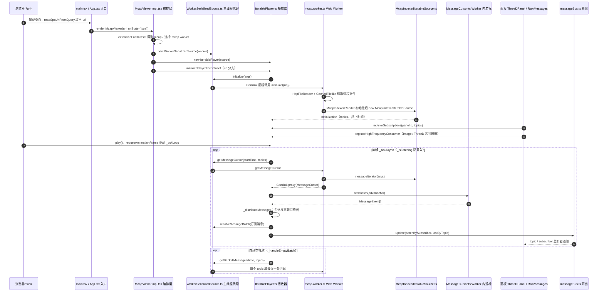

# xense-mcap-viewer

## 一句话定义

**xense-mcap-viewer** 是 [千觉机器人](https://github.com/XenseRobotics-AI) 公开的 **工程与工具** 开源项目：触觉数据 MCAP 可视化工具

## 英文缩写速查

| 缩写 | 英文全称 | 简要说明 |
|------|----------|----------|
| SDK | Software Development Kit | 真机控制与状态读取接口 |
| RL | Reinforcement Learning | 强化学习训练与策略优化 |
| VLA | Vision-Language-Action | 视觉–语言–动作统一策略 |
| Sim2Real | Simulation to Real | 仿真策略迁移真机 |
| URDF | Unified Robot Description Format | 机器人描述与仿真资产 |

## 为什么重要

- 收录于 [国内具身智能开源全景（76 家 · 424 项）](../overview/china-domestic-embodied-opensource-76-companies-technology-map.md) 的 **第三层** 分组。
- 与 [Humanoid Motion Intelligence](../entities/humanoid-motion-intelligence.md) 同源策展；本页为 **独立详情节点**，便于从公司清单跳到机制与入口说明。

## 核心原理

| 字段 | 内容 |
|------|------|
| 机构 | 千觉机器人 |
| 类别 | 工程与工具 |
| 官方组织 | https://github.com/XenseRobotics-AI、https://github.com/XenseRobotics |

## 工程实践

1. 从官方 GitHub/Gitee 组织检索 `xense-mcap-viewer` 仓库并核对 README 许可与依赖。
2. 对照本库 [424 项覆盖索引](../queries/china-domestic-opensource-424-coverage.md) 查看同公司其它入口是否共用训练/部署链路。
3. 若与既有方法页（如 RL 框架、VLA、SDK）主题相同，优先读关联页中的「开源入口」小节，避免重复维护平行叙事。

## 局限与风险

- 公众号清单为 **策展快照**（2026-09-06）；仓库更名、归档或许可证变化须回官方组织页核实。
- **开源状态**：以仓库 README 与 release 为准（入库日按文章描述归纳，未逐仓 clone 验证）。

## 源码运行时序图

入口：`npm install` 后执行 `npm run dev`（Vite 开发服务器，默认 http://localhost:5173），再访问 `/?url=<recording.mcap 地址>`。

图依据：xense-mcap-viewer@b31b2ef，实际读过 README.md、package.json、docs/internals/RUNTIME_PIPELINE.md、docs/internals/IMPORTANT_FILES.md、src/entrypoints/{main.tsx,App.tsx,index.ts}、src/features/viewer/McapViewerImpl.tsx（编排段）、src/core/players/IterablePlayer.ts（生命周期、tick、分发段）、src/core/pipeline/messageBus.ts、src/infra/workers/{mcap.worker.ts,WorkerSerializedSource.ts,MessageCursor.ts}（关键段）、src/infra/workers/transports/createWorkerTransport.ts、src/features/panels/ThreeD/ThreeDPanel.tsx 与 RawMessages/Component.tsx（订阅段）；McapIndexedIterableSource.ts 仅 grep 到 messageIterator 与 getBackfillMessages。

## 关联页面

- [国内具身开源全景技术地图](../overview/china-domestic-embodied-opensource-76-companies-technology-map.md)
- [HMI 开源项目主表导读](../queries/hmi-opensource-projects-coverage.md)
- [Humanoid Motion Intelligence](../entities/humanoid-motion-intelligence.md)

## 参考来源

- [xense-mcap-viewer 源码归档](../../sources/repos/xense-mcap-viewer.md)（<https://github.com/XenseRobotics-AI/xense-mcap-viewer>）

- [国内具身智能开源全景（微信公众号）](../../sources/blogs/wechat_embodied_station_domestic_opensource_panorama_2026-09-06.md)

- 源码核对（2026-11-02）：XenseRobotics-AI/xense-mcap-viewer@b31b2ef，读过 README.md、package.json、docs/internals/{RUNTIME_PIPELINE,IMPORTANT_FILES}.md、src/entrypoints/{main.tsx,App.tsx,index.ts}、src/features/viewer/McapViewerImpl.tsx、src/core/players/IterablePlayer.ts、src/core/pipeline/messageBus.ts、src/infra/workers/{mcap.worker.ts,WorkerSerializedSource.ts,MessageCursor.ts,transports/createWorkerTransport.ts}、src/features/panels/ThreeD/ThreeDPanel.tsx、src/features/panels/RawMessages/Component.tsx；时序图依据以上文件，未运行代码。

## 推荐继续阅读

- [千觉机器人 官方组织](https://github.com/XenseRobotics-AI)
