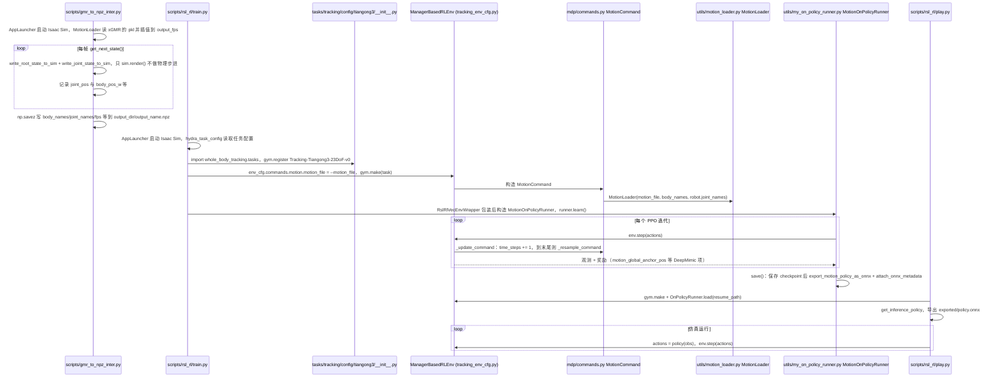

# xMimic

## 一句话定义

**xMimic** 是 [北京人形机器人创新中心](https://github.com/Open-X-Humanoid) 公开的 **全身动作跟踪/技能训练** 开源项目：BVH动作由xGMR重定向为机器人PKL，再转换成含最大坐标信息的NPZ；Isaac Sim 5.1中以4096环境训练PPO跟踪器，随后通过MuJoCo和ROS 2检查策略，并把ONNX模型放入Deploy_Tienkung的BeyondMimic配置完成真机入口。

## 英文缩写速查

| 缩写 | 英文全称 | 简要说明 |
|------|----------|----------|
| SDK | Software Development Kit | 真机控制与状态读取接口 |
| RL | Reinforcement Learning | 强化学习训练与策略优化 |
| VLA | Vision-Language-Action | 视觉–语言–动作统一策略 |
| Sim2Real | Simulation to Real | 仿真策略迁移真机 |
| URDF | Unified Robot Description Format | 机器人描述与仿真资产 |

## 为什么重要

- 收录于 [国内具身智能开源全景（76 家 · 424 项）](../overview/china-domestic-embodied-opensource-76-companies-technology-map.md) 的 **第一层** 分组。
- 与 [Humanoid Motion Intelligence](../entities/humanoid-motion-intelligence.md) 同源策展；本页为 **独立详情节点**，便于从公司清单跳到机制与入口说明。

## 核心原理

| 字段 | 内容 |
|------|------|
| 机构 | 北京人形机器人创新中心 |
| 类别 | 全身动作跟踪/技能训练 |
| 官方组织 | https://github.com/Open-X-Humanoid |

## 工程实践

1. 从官方 GitHub/Gitee 组织检索 `xMimic` 仓库并核对 README 许可与依赖。
2. 对照本库 [424 项覆盖索引](../queries/china-domestic-opensource-424-coverage.md) 查看同公司其它入口是否共用训练/部署链路。
3. 若与既有方法页（如 RL 框架、VLA、SDK）主题相同，优先读关联页中的「开源入口」小节，避免重复维护平行叙事。

## 局限与风险

- 公众号清单为 **策展快照**（2026-09-06）；仓库更名、归档或许可证变化须回官方组织页核实。
- **开源状态**：以仓库 README 与 release 为准（入库日按文章描述归纳，未逐仓 clone 验证）。

## 源码运行时序图

入口：先 `python scripts/gmr_to_npz_inter.py --input_file <gmr.pkl> --robot tiangong3_23dof ...` 把 xGMR 输出转成 NPZ，再 `python scripts/rsl_rl/train.py --task=Tracking-Tiangong3-23DoF-v0 --motion_file <npz> --headless`（评估为 `scripts/rsl_rl/play.py`）。训练与评估依赖 Isaac Lab / Isaac Sim，MuJoCo 仿真与真机部署在 README 所指的其它仓库（xSIM_MUJOCO、Deploy_Tienkung），不在本仓库内。

图依据：Open-X-Humanoid/xMimic@0385122，读过 `README.md`、`scripts/gmr_to_npz_inter.py`、`scripts/rsl_rl/train.py`、`scripts/rsl_rl/play.py`、`whole_body_tracking/tasks/tracking/config/tiangong3/__init__.py`、`tracking_env_cfg.py`、`mdp/commands.py`、`utils/my_on_policy_runner.py`。

## 关联页面

- [国内具身开源全景技术地图](../overview/china-domestic-embodied-opensource-76-companies-technology-map.md)
- [HMI 开源项目主表导读](../queries/hmi-opensource-projects-coverage.md)
- [Humanoid Motion Intelligence](../entities/humanoid-motion-intelligence.md)

## 参考来源

- [xMimic 源码归档](../../sources/repos/xmimic.md)（<https://github.com/Open-X-Humanoid/xMimic>）

- [国内具身智能开源全景（微信公众号）](../../sources/blogs/wechat_embodied_station_domestic_opensource_panorama_2026-09-06.md)
- 源码核对（2026-11-02）：Open-X-Humanoid/xMimic@0385122，读过 README.md、scripts/gmr_to_npz_inter.py、scripts/rsl_rl/train.py、scripts/rsl_rl/play.py、whole_body_tracking/tasks/tracking/config/tiangong3/__init__.py、tracking_env_cfg.py、mdp/commands.py、utils/my_on_policy_runner.py；时序图依据以上文件，未运行代码。

## 推荐继续阅读

- [北京人形机器人创新中心 官方组织](https://github.com/Open-X-Humanoid)
