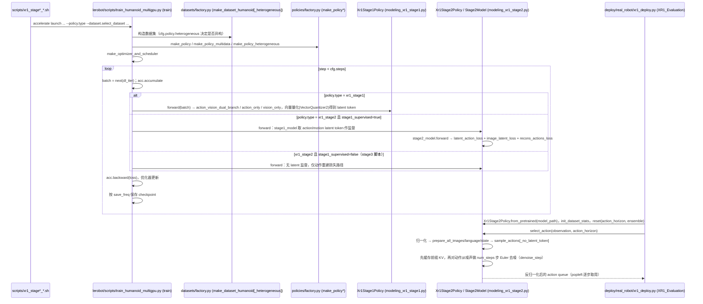

# XR-1

## 一句话定义

**XR-1** 是 [北京人形机器人创新中心](https://github.com/Open-X-Humanoid) 公开的 **VLA/操作模型** 开源项目：三阶段流程先学习统一视觉—运动离散表征，再在异构视觉与机器人数据上预训练，最后按具体本体微调动作策略；官方实现统一LeRobot 2.1数据加载、跨数据集训练、权重和Franka/UR/AgileX部署脚本，并给出天工2.0适配入口。

## 英文缩写速查

| 缩写 | 英文全称 | 简要说明 |
|------|----------|----------|
| SDK | Software Development Kit | 真机控制与状态读取接口 |
| RL | Reinforcement Learning | 强化学习训练与策略优化 |
| VLA | Vision-Language-Action | 视觉–语言–动作统一策略 |
| Sim2Real | Simulation to Real | 仿真策略迁移真机 |
| URDF | Unified Robot Description Format | 机器人描述与仿真资产 |

## 为什么重要

- 收录于 [国内具身智能开源全景（76 家 · 424 项）](../overview/china-domestic-embodied-opensource-76-companies-technology-map.md) 的 **第一层** 分组。
- 与 [Humanoid Motion Intelligence](../entities/humanoid-motion-intelligence.md) 同源策展；本页为 **独立详情节点**，便于从公司清单跳到机制与入口说明。

## 核心原理

| 字段 | 内容 |
|------|------|
| 机构 | 北京人形机器人创新中心 |
| 类别 | VLA/操作模型 |
| 官方组织 | https://github.com/Open-X-Humanoid |

## 工程实践

1. 从官方 GitHub/Gitee 组织检索 `XR-1` 仓库并核对 README 许可与依赖。
2. 对照本库 [424 项覆盖索引](../queries/china-domestic-opensource-424-coverage.md) 查看同公司其它入口是否共用训练/部署链路。
3. 若与既有方法页（如 RL 框架、VLA、SDK）主题相同，优先读关联页中的「开源入口」小节，避免重复维护平行叙事。

## 局限与风险

- 公众号清单为 **策展快照**（2026-09-06）；仓库更名、归档或许可证变化须回官方组织页核实。
- **开源状态**：以仓库 README 与 release 为准（入库日按文章描述归纳，未逐仓 clone 验证）。

## 源码运行时序图

入口：`bash scripts/xr1_stage1_pretrain.sh`（Stage 1，`--policy.type=xr1_stage1`）→ `bash scripts/xr1_stage2_pretrain.sh`（Stage 2，`xr1_stage2`，`stage1_supervised=true`）→ `bash scripts/xr1_stage3_finetune.sh [--debug] [--dataset ...]`（脚本里 `--policy.type=xr1_stage2`、`stage1_supervised=false`）；推理示例 `python deploy/real_robot/xr1_deploy.py`、`python deploy/real_robot/xr1_inference.py`。三个训练脚本都是 `accelerate launch lerobot/scripts/train_humanoid_multigpu.py`。

图依据：Open-X-Humanoid/XR-1@0141fc6，读过 `README.md`、`scripts/xr1_stage1_pretrain.sh`、`xr1_stage2_pretrain.sh`、`xr1_stage3_finetune.sh`、`lerobot/scripts/train_humanoid_multigpu.py`、`lerobot/common/policies/factory.py`（`get_policy_class`）、`modeling_xr1_stage1.py`（方法清单、`forward`、量化器构造）、`modeling_xr1_stage2.py`（`__init__`、`forward`、`select_action`、`Stage2Model.sample_actions` 等）、`deploy/real_robot/xr1_deploy.py`、`xr1_inference.py`。Stage 1 各分支内部损失、数据集工厂实现与 `cross_stage_function/` 未细读；`stage2_model.forward` 内部的流匹配损失构成未逐行读。注意 `xr1_deploy.py` 用随机伪造观测演示，且 `__main__` 中只设了变量、未调用 `xr1_deploy()`（见源码）。

## 关联页面

- [国内具身开源全景技术地图](../overview/china-domestic-embodied-opensource-76-companies-technology-map.md)
- [HMI 开源项目主表导读](../queries/hmi-opensource-projects-coverage.md)
- [Humanoid Motion Intelligence](../entities/humanoid-motion-intelligence.md)

## 参考来源

- [XR-1 源码归档](../../sources/repos/xr-1.md)（<https://github.com/Open-X-Humanoid/XR-1>）

- [国内具身智能开源全景（微信公众号）](../../sources/blogs/wechat_embodied_station_domestic_opensource_panorama_2026-09-06.md)
- 源码核对（2026-11-02）：Open-X-Humanoid/XR-1@0141fc6，读过 README.md、scripts/xr1_stage1_pretrain.sh、xr1_stage2_pretrain.sh、xr1_stage3_finetune.sh、lerobot/scripts/train_humanoid_multigpu.py、lerobot/common/policies/factory.py、modeling_xr1_stage1.py、modeling_xr1_stage2.py、deploy/real_robot/xr1_deploy.py、xr1_inference.py；时序图依据以上文件，未运行代码。

## 推荐继续阅读

- [北京人形机器人创新中心 官方组织](https://github.com/Open-X-Humanoid)
