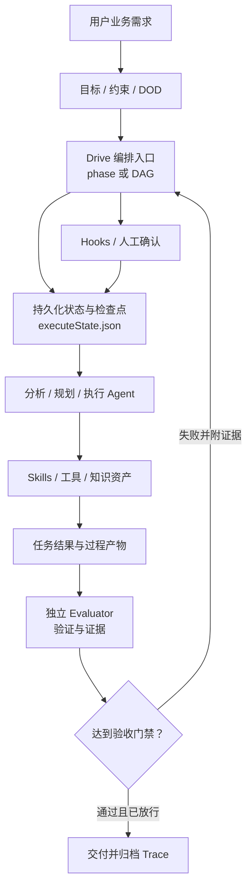
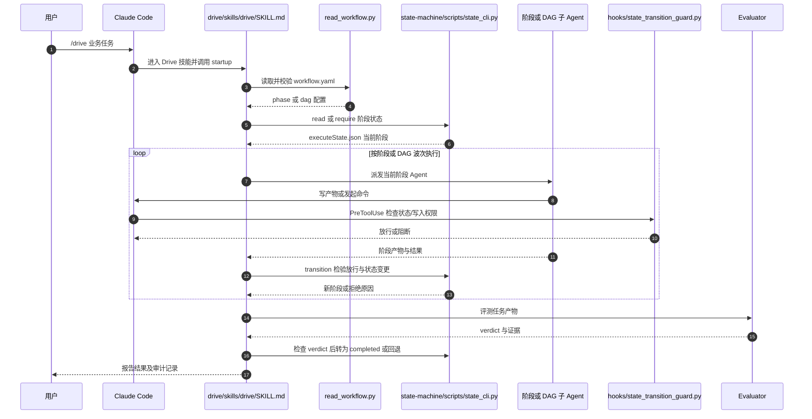

# Co-Sight Harness Studio｜中兴开源 Agent 运行时控制工作台

## 一句话定义

**Co-Sight Harness Studio** 是中兴 ZTE-AICloud 开源的**本地优先 Agent 宿主与控制结构**：统一容纳 Claude Code、Codex、DSH 等运行时，并用目标、状态、权限、工具、验收与证据约束长链路任务。其 `Drive` 插件负责多 Agent 编排，**Harness Studio 并非 DSH 本身**，也不是同仓库的 Co-Sight Agent 平台。

## 英文缩写速查

| 缩写 | 英文全称 | 简要说明 |
|---|---|---|
| LLM | Large Language Model | 概率式生成核心，Harness 将约束与状态从模型上下文外置 |
| DAG | Directed Acyclic Graph | Drive 的依赖式多 Agent 编排模式 |
| HITL | Human-in-the-Loop | 阶段或节点验收的人工放行关口 |
| DOD | Definition of Done | 阶段完成所需的明确、可检查交付条件 |
| API | Application Programming Interface | Studio 的 Fastify 与模块面接口 |
| DSH | DeepSeek Harness | 本项目可以托管/兼容的一个运行时，不等同 Studio |

## 为什么重要

长任务中的目标漂移、上下文丢失和“执行者自己打分”无法仅靠更长的提示词解决。官方将**业务、执行、资产、证据**划成四个控制面：模型负责生成，Harness 负责显式约束、状态恢复与独立验收。

机器人知识库的借鉴点是**研发自动化的流程可审计性**：例如文献 ingest、代码变更和仿真实验记录可以参考阶段门禁与回归验证。但这套软件面向通用业务/Coding Agent，**不直接提供机器人实时控制或运动策略**。

## 核心原理与结构

| 控制面 / 组件 | 主要职责 | 核对依据 |
|---|---|---|
| 业务控制面 | `Goal / Constraint / Acceptance / Risk`，把验收口径显式化 | Harness README |
| 执行控制面 | `Orchestrator / Loop / Graph / State / Checkpoint`，失败回流、状态跨会话 | Harness README；Drive README |
| 资产控制面 | `Knowledge / Memory / Tool / Skill / Policy`，沉淀可复用知识与工具 | Harness README |
| 证据控制面 | `Trace / Eval / Review / Version / Rollback`，生成与评测隔离 | Harness README；Drive evaluator |
| `framework/` | React + Fastify + 共享契约；模块导航、配置、iframe 宿主 | `framework/README.md`、`server/src/app.ts` |
| `drive/` | `phase` / `dag` 编排，任务状态存盘、Agent 调度及 Hook 强制门禁 | `drive/skills/drive/SKILL.md`、`state_cli.py`、`hooks.json` |
| 插件与服务 | Agent Genesis、Evaluator、Skill Optimizer、CoSightBot、Viewer、Smart Factory、DSH 兼容层 | Harness 组件清单 |

### 流程总览

以下是官方控制面、Drive 插件文档共同支撑的任务闭环；工作台 iframe 宿主与 Drive 工作流是**不同模块**，图中不假设每一次网页交互都会自动调用 Drive。



Drive 有内置顺序阶段，也支持自定义 `workflow.yaml` 的 DAG，默认需逐阶段人工确认；`auto_mode` 可以改变确认行为，不应把每个任务理解为一定“全自动”。

### 核心代码的边界

- **Studio 服务端路径：** `framework/server/src/index.ts` 顺序调用 `loadConfig()`、`createServices()`、`seedPresetExperts()`、`buildApp()` 和 `app.listen()`；`app.ts` 装配工作区、模型、代理、模块、知识库和桥接 API。
- **模块宿主：** `routes/modules.ts` 用模块清单发现服务；`framework/` 只托管与连接 UI 模块，业务页面属于各子模块。
- **Drive 调度与状态：** `drive/skills/drive/SKILL.md` 解析 `phase/dag`；`drive/skills/state-machine/scripts/state_cli.py` 管理 `.drive/<plan_dir>/executeState.json` 的合法流转、`verdict` 和 `confirmed_stages`；`drive/hooks/hooks.json` 在 `PreToolUse` / `SubagentStop` 注册守卫。

## 源码运行时序图

下图依据 **官方 Drive 运行入口** `/drive` 以及实际 `drive/skills/drive/SKILL.md`、`state_cli.py`、`state_transition_guard.py` 和 `hooks.json`；不把 Studio Web API 臆造成插件调用方。



**可追溯数据：** `.drive/<plan_dir>/` 下的 `intent.md`、`manifest.md`、`taskRecord.yaml`、`waves.yaml`、`artifacts/`、`evaluation/`、`run-log.jsonl`。这是源码静态核对得到的逻辑时序，未运行 Claude Code 插件实测。

## 工程实践

源码路径（官方 `QUICKSTART.md`；当前环境**未实际执行**）：

```bash
git clone https://github.com/ZTE-AICloud/Co-Sight.git
cd "Co-Sight/Co-Sight Harness"
corepack enable
pnpm install
pnpm dev
# 访问 http://localhost:4310
# 接入 Viewer / Smart Factory 前需分别安装其依赖，再用 pnpm dev:all
# pnpm verify   # typecheck + lint + tests
```

- **依赖：** Node.js `^22.19.0 || >=24.0.0`、pnpm `11.28.5`；分发包与源码安装是不同路径。
- **验收：** 后端 4300 的 `/api/health`、`/api/modules`，开发前端 4310；产物态同源入口 4300。
- **源码与发行边界：** 官方公开 TypeScript/React 框架、Python/Markdown Agent 插件、运行脚本和文档；实际调用 Claude Code/Codex/DSH 要额外准备对应运行时、凭据与权限。官方明确分发包**不包含 Claude Code CLI / Claude Agent SDK**。
- **效果声明：** README 自述需求分析耗时 169→56.4 分钟、子系统设计 114→26.5 分钟、任务完成率 50%→100%；缺乏本次可独立复核的评测样本与运行记录，**只可视为项目方报告，不可视为普遍保证或本站复现结果**。

## 局限与风险

1. **默认监听安全风险：** `COSIGHT_HOST=0.0.0.0` 且官方源码 `index.ts` 明确标注**无登录鉴权**。本地开发应绑定 `COSIGHT_HOST=127.0.0.1`；生产或远程共享须另加网络隔离与可靠鉴权。
2. **模块密钥权限：** `routes/module-face.ts` 在 `/api/framework/v1/*` 检查回环地址、Origin 与 Bearer token；仍无法隔离相同系统用户下能直接读取凭据的进程，不能据此宣称完整沙箱。
3. **自动验收不等于安全认证：** `Drive` 的 DOD、Hook、Evaluator 属于软件工作流约束；机器人实机仍需设备侧实时控制器、限位、急停与独立安全机制。
4. **开源不等于独立测试通过：** 本次已查阅官方文档、主要入口与状态机源码，**未运行 `pnpm verify`、E2E 任务或业务指标复现**；各子模块成熟度与外部模型依赖需分项验证。

## 关联页面

- [Claude Code 动态工作流](../methods/claude-code-dynamic-workflows.md) — 对照任务专用 Harness、Agent 编排方式与成本。
- [Coding Agent 验证闭环](../methods/coding-agent-verification-loops.md) — 对照独立验收、真实行为证据与回归门禁。
- [Agnes Harness](./agnes-harness.md) — 对照会话/工具接入与设备能力的边界
- [DeepSeek Harness](./deepseek-harness.md) — 被 Co-Sight 兼容层适配的独立运行时
- [Agent Lightning](./agent-lightning.md) — 真实 Agent 轨迹训练而非业务编排
- [LLM Wiki（Karpathy）](../concepts/llm-wiki-karpathy.md) — 与本库知识资产/验证闭环的组织方式相联系

## 参考来源

- [官方仓库、完整 README / Quickstart 和主要源码核对记录](../../sources/repos/co-sight-harness.md)

## 推荐继续阅读

- [Co-Sight Harness 官方中文 README](https://github.com/ZTE-AICloud/Co-Sight/blob/master/Co-Sight%20Harness/README.md)
- [官方 Quickstart](https://github.com/ZTE-AICloud/Co-Sight/blob/master/Co-Sight%20Harness/QUICKSTART.md)
- [Drive 插件 README](https://github.com/ZTE-AICloud/Co-Sight/blob/master/Co-Sight%20Harness/drive/README.md)
- [Framework 服务端入口源码](https://github.com/ZTE-AICloud/Co-Sight/blob/master/Co-Sight%20Harness/framework/server/src/index.ts)
