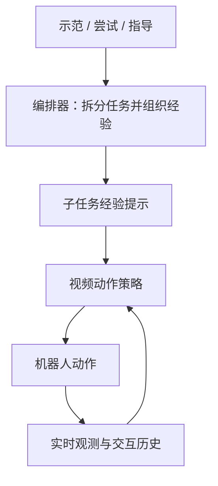

# CO01：经验作为提示

## 一句话定义

CO01 是可可矩阵（COCO Matrix）提出的机器人系统：把示范、尝试和指导放入上下文，使策略在不更新权重的情况下调整操作行为。

## 英文缩写速查

| 缩写 | 英文全称 | 简要说明 |
|------|----------|----------|
| ICL | In-Context Learning | 通过上下文适应，部署时不更新权重 |
| VLM | Vision-Language Model | 编排器使用的视觉语言模型 |
| UMI | Universal Manipulation Interface | 手持夹爪数据来源之一 |

## 核心机制

视觉语言编排器负责长期记忆、规划、进度检查与子任务拆分，将示范、相关尝试、指导和目标图像组成经验提示。视频动作策略读取提示、实时相机、交互历史与机器人元数据，输出动作块；训练时预测视频和动作，部署时不生成视频。

训练数据按任务组织为会话：配对示范、多次尝试、交互指导和单次轨迹。采样时将相关历史和跨来源示范置于预测目标之前，有时加入无关任务，并随机丢弃元数据。视觉骨干同时学习视频预测与几何、分割、光流和姿态等感知任务。

## 评测与工程读法

以下为官方自报结果，条件不同的数字不应直接横比：

| 测试 | 结果与条件 |
|------|------------|
| 示范适应 | 未见任务中，单示范、约 1 分钟达到平均 52%；同一预训练模型微调约 180 条示范、约 9 小时达到相近水平；800 条微调达到 66%。 |
| 尝试历史 | 首次常失败的真机任务，最多五次尝试：自身历史 84%，无历史 56%，无关失败历史 58%；每点 100 次试验。 |
| 感知 | 同一骨干八项基准中五项领先、深度基本持平；相机位姿和光流落后专用模型。 |
| 跨机体与长任务 | 跨三种机体的技能接力在仿真中展示；奶茶制作是早期概念验证，不能视作稳定量产能力。 |

现场应用应分别衡量示范采集时间、单次及多次尝试成功率、干预成本与安全边界。上下文适应不等于权重持续学习：当前纠正随上下文结束而消失，跨会话偏好由编排器记忆；将技能持续写入共享权重是未来目标。

## 局限与风险

- 截至 2026-10-28，官方页面未列代码、权重或数据下载链接；可复现性和开放状态尚待核实。
- 官方指出长任务存在误差累积，编排器有时选择错误示范；单示范策略可靠性尚不及充分数据微调。
- 页面未提供足以直接部署的推理频率、算力及安全接口；实机接入前需另行验证。

## 关联页面

- [机器人 In-Context Learning](../concepts/robot-in-context-learning.md) — 部署期上下文适应的判别与方法。
- [GEN-1.5](./generalist-gen15-one-shot.md) — 单次示范具身学习的相关工作。
- [Skild S1](./skild-s1.md) — 机器人上下文学习的另一系统。

## 参考来源

- [CO01 官方博客归档](../../sources/sites/coco-matrix-co01.md)

## 推荐继续阅读

- [Experience is the Prompt: Introducing CO01](https://www.ccmtrx.com/research/co01/)
