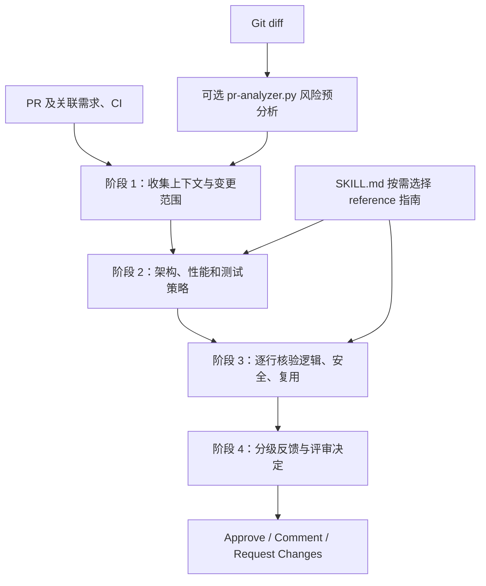
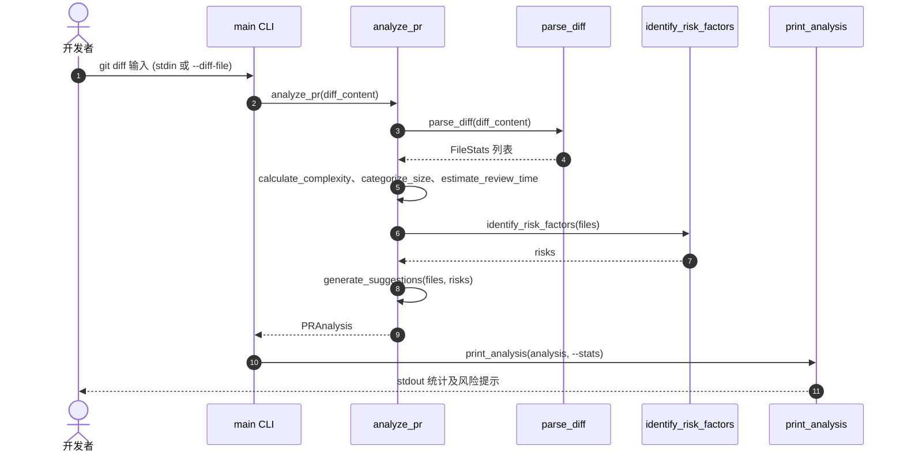

# Code Review Skill｜模块化代码审查技能

## 一句话定义

[Code Review Skill](https://github.com/awesome-skills/code-review-skill) 是面向代码审查的 AI Agent Skill：通过统一的 **PR 四阶段流程**、按需加载 C++ / Python / Qt 等语言指南、反馈分级和可选的 Git diff 规模分析，提升代码审阅的一致性。

## 英文缩写速查

| 缩写 | 英文全称 | 简要说明 |
|------|----------|----------|
| PR | Pull Request | 带背景、变更和讨论的代码合并请求 |
| CI | Continuous Integration | 自动测试与质量门，评审前应核对 |
| CLI | Command-Line Interface | 差异分析器的命令行入口 |
| RAII | Resource Acquisition Is Initialization | C++ 资源生命周期与异常安全的审查重点 |
| AST | Abstract Syntax Tree | 语义程序结构；上游 diff 脚本没有分析 AST |

## 为什么重要

- **把“审代码”变为可重复流程：** 先读需求、关联 issue 与 CI，接着检查架构和测试，最后检查实现细节与评审结论，避免只有零散意见。
- **覆盖部分机器人开发技术栈：** 上游有 C、C++、Python、Qt、Rust 等参考指南；适于代码维护，但**不能取代 ROS 2 实时/真机安全专项审查**。
- **人机分工明确：** 格式/导入顺序/lint 由工具检查；逻辑、并发、边界、访问控制、接口与可维护性需针对具体代码分析。
- **与本站其他 Skill 互补：** [Superpowers](superpowers-obra.md) 侧重交付流程，[Skills For Real Engineers](mattpocock-skills.md) 侧重需求对齐与测试驱动；本 Skill 侧重 **Review 阶段**。

## 核心原理

1. **核心入口：** 根目录 `SKILL.md` 指定评审原则与流程；`reference/` 存放语言、架构、安全、性能和跨技术栈文档，按审查任务加载。
2. **Phase 1 — Context Gathering：** 理解 PR 范围、背景、改动规模、CI 状态及需求。
3. **Phase 2 — High-Level Review：** 先审架构、性能、代码组织与测试覆盖。
4. **Phase 3 — Line-by-Line：** 再审逻辑、边界、安全、并发、性能和可维护性。
5. **Phase 4 — Summary & Decision：** 汇总优点与问题，决定 Approve / Comment / Request Changes。
6. **严重性分级：** `blocking`、`important`、`nit`，非阻塞 `suggestion`、`learning`、`praise`。

### 流程总览（根据官方 `SKILL.md`）



图中的 `pr-analyzer.py` 为**可选的辅助命令**；Skill 不会自行运行完整自动审查流程或阻止 merge。

### 源码运行时序图（上游 `scripts/pr-analyzer.py`）



该图依上游源程序真实函数入口绘制，并非泛化的“AI 代码审核机器人”时序。

## 工程实践

**安装：**

```bash
npx skills add awesome-skills/code-review-skill
```

上游另支持克隆到 `~/.claude/skills/code-review-skill`。具体安装目录与激活方式以所用编程代理及上游 README 为准。

**按需调阅：**

| 审查对象 | 一手参考路径 | 关注点 |
|----------|--------------|--------|
| C++ 控制器 / 驱动 | `reference/cpp.md`、`reference/c.md` | RAII、内存安全、资源释放、越界 |
| Python 训练/部署脚本 | `reference/python.md` | 异常、并发、测试与可变参数 |
| Qt 上位机 | `reference/qt.md` | 对象生命周期、信号槽、UI 线程 |
| 安全/性能专项 | `reference/security-review-guide.md`、`reference/performance-review-guide.md` | 输入边界、访问控制、资源/算法代价 |

**代码中实际可运行的 diff 预分析：**

```bash
git diff main...HEAD | python scripts/pr-analyzer.py
python scripts/pr-analyzer.py --diff-file changes.diff --stats
```

源码基于文件数、改动行数、非测试比例、语言数量计算复杂度启发式评分；超过 400 行、没有测试改动、敏感文件名、SQL/迁移变更等会触发提醒。这些结果不是漏洞存在的证明，也不是独立测试报告。

**机器人项目建议（本站工程映射，非上游默认功能）：** 与 CI、仿真/真机安全测试配合，单独检查 ROS 2 回调阻塞、控制周期抖动、C++ 竞态、硬件失效保护；不要仅凭通用指南批准高风险机器人软件变更。

## 局限与风险

- **规则文本不等于自动分析工具：** `SKILL.md` 是指导 Agent 的说明；`pr-analyzer.py` 只统计 Git diff 并输出提示，不执行 AST/符号分析、不自动评论或批准 GitHub PR。
- **敏感文件提示较粗：** 依赖文件名关键词，不能代替漏洞扫描或安全威胁建模。
- **能力没有公开实测：** 上游宣称 20+ 语言和 21,000+ 行指南，但未给出可验证的 review 准确率基准；本轮未运行对照 benchmark。
- **机器人领域仍有缺口：** 上游未提供 ROS 2、DDS/实时控制独立专用指南，需按工程安全约束扩展。
- **阅读和运行边界：** 已通读 `SKILL.md` 并阅读 CLI 主实现；语言专用参考文档未逐篇全读，且未在本环境执行上游单测。

## 关联页面

- [Skills For Real Engineers（mattpocock）](mattpocock-skills.md) — 需求与反馈环
- [Superpowers（obra）](superpowers-obra.md) — 结构化编码交付流程
- [HumanLayer Skills](humanlayer-skills.md) — 循环式代理维护
- [Agentic Coding 时代的软件工程基础](../concepts/agentic-coding-software-fundamentals.md) — 审查、质量与架构取舍

## 参考来源

- [上游仓库原文及源码核验](../../sources/repos/code-review-skill.md)
- [官方项目站核验](../../sources/sites/code-review-skill.md)
- [SKILL.md 原文](https://github.com/awesome-skills/code-review-skill/blob/main/SKILL.md)
- [pr-analyzer.py 原始实现](https://github.com/awesome-skills/code-review-skill/blob/main/scripts/pr-analyzer.py)

## 推荐继续阅读

- [上游双语 README](https://github.com/awesome-skills/code-review-skill/blob/main/README.md) — 安装与技术栈
- [reference/ 指南目录](https://github.com/awesome-skills/code-review-skill/tree/main/reference) — 语言与横切主题
- [test_pr_analyzer.py](https://github.com/awesome-skills/code-review-skill/blob/main/scripts/test_pr_analyzer.py) — 脚本测试与边界案例
