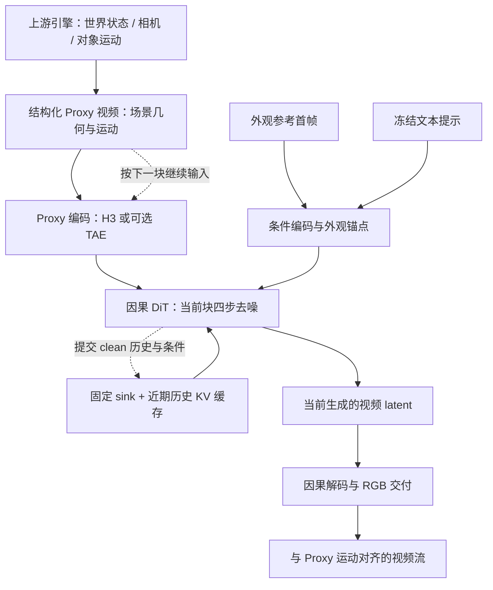
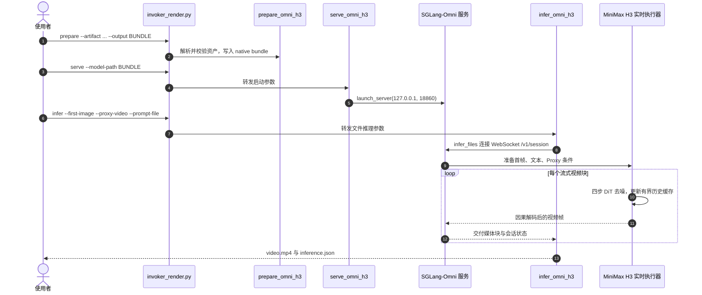

# Code World Model 2.0 / Invoker-Render：结构代理驱动的长时可控视频生成 / Towards Infinite Controllable Video Generation

> **一手入口**：[项目主页](https://www.inclusion-ai.org/CodeWorldModel/) · [官方仓库](https://github.com/inclusionAI/CodeWorldModel) · [模型权重](https://huggingface.co/inclusionAI/invoker-render-1.0) · [部署说明](https://github.com/inclusionAI/CodeWorldModel/blob/master/docs/INFERENCE.md)。作者包括 Ruoyu Wang、Hao Zhong、Yanming Yang、Jiahao Tian、Lin Liu 等；机构为 **蚂蚁集团 Inclusion AI AGI Research Center、西湖大学、浙江大学**。本条按公开代码/部署项目身份收录，**不是已在 arXiv 正式公开的独立论文记录**。

## 一句话定义

**Code World Model 2.0** 将“世界状态推进”与“视频外观生成”分离：上游引擎提供布局、相机轨迹和物体运动的视觉 Proxy，**Invoker-Render** 结合一张参考首帧及文本提示，流式合成受 Proxy 约束的场景视频。

## 英文缩写速查

| 缩写 | 英文全称 | 简要说明 |
|---|---|---|
| CWM | Code World Model | 使用上游显式世界状态与生成式渲染器分工的系统 |
| DiT | Diffusion Transformer | 对当前视频潜变量块执行四步去噪的骨干 |
| KV | Key-Value Cache | 保留固定前缀与近期历史的因果注意力缓存 |
| TAE | Tiny Autoencoder | 官方实时流水线可选的轻量 Proxy 编码器 |
| FPS | Frames Per Second | 每秒生成或播放帧数；须区分推理吞吐与媒体播放时基 |
| TP | Tensor Parallelism | 用于解码等组件的张量并行 |
| RGB | Red Green Blue | 输出视频和首帧使用的颜色空间 |

## 为什么重要

- **把可控性留在显式状态侧：** 相机路线、道路交通和物体轨迹由结构化 Proxy 驱动，渲染器主要负责材质、纹理、照明等外观生成，而非代替物理引擎。
- **同一渲染器可接不同粒度的 Proxy：** 官网展示语义图、稀疏 3D 框、主体掩码、几何体和框加骨架等输入，对低细节仿真到高保真观测的转换有研究价值。
- **按块输出有利于在线交互：** 固定外观锚点与有界历史的缓存避免视频时长直接决定上下文驻留长度；官方给出持续 30 分钟的赛车视频展示，但不能据此推断所有场景都无累积误差。
- **机器人适用边界：** 可作为仿真画面增强或视觉训练数据合成研究参考；**它不输出关节动作、不替代接触求解器，也未证明机器人闭环策略收益**。

## 核心原理

| 模块 | 输入或责任 | 官方依据 |
|---|---|---|
| 世界状态源 | 游戏/几何引擎决定对象和相机行为，形成逐帧视觉 Proxy | 官网“Structure from the proxy”及 README |
| 外观条件 | 单张首帧和文本约束场景视觉身份与风格 | Hugging Face 模型卡、README |
| 因果流式生成 | MiniMax-H3 基底的四步 Euler 去噪 DiT，按视频潜变量块前向生成 | `docs/INFERENCE.md` model contract |
| 注意力历史 | 一个固定 sink latent 和近期 12 个 latent；旧历史逐步退出 KV cache | `docs/INFERENCE.md` model contract |
| 编码、解码和传输 | Proxy 编码、当前 chunk 的 DiT 渲染、因果 RGB 解码和 CPU 发送可按部署配置交叠 | 官网 Infra、`serve_omni_h3.py` |
| 会话接口 | `/v1/session` WebSocket、文件推理和浏览器客户端 | 官方 README、部署说明、CLI 源码 |

官方冻结协议 `cwm_causal/v1` 中采用 9 个 latent 的首块和后续每块 5 latent，位置与 Proxy 条件帧对齐。**官方展示的 18 FPS** 来自优化过的 8 GPU 流水线（含 TAE、Ulysses8、重叠 codec 和异步交付）；不能把这项实测泛化到 README 的每一种部署配置。

### 项目流程总览

基于官网、README 与部署文档核读的**数据流**，虚线表示重复的下一块过程：

### 源码运行时序图

实际入口经 `invoker_render.py` 使用 `runpy` / `launch.py` 分发到 `projects.minimax_h3.tools`。核对了 `infer_omni_h3.py`、`serve_omni_h3.py` 和 `docs/INFERENCE.md`；下图的 HTTP/WebSocket 服务交互是**官方公开入口级时序**，没有声称已审计每个内部 CUDA kernel。

**复现说明：** `check-env` → `prepare`（需外部配置与权重）→ `serve` → `infer`；这里是对源码调用契约的静态核读，**没有执行 GPU 生成、验证可复现吞吐或画质**。

## 工程实践

| 项目 | 官方配置与检查点 |
|---|---|
| 入口 | `python invoker_render.py check-env / prepare / serve / infer`；另有 `web-adapter`、`web` |
| 依赖 | Linux，Python 3.11/3.12，NVIDIA CUDA，vendored SGLang + SGLang-Omni；生产 profile 为单机八卡 |
| 输入 | 1344×768 RGB 首帧；24 FPS Proxy，文件输入帧数满足 `17*N+5` 且不少于 39；非空 UTF-8 提示词 |
| 部署资产 | HF 公开 33.12B FP32 DiT，约 132.5 GB；VAE/Qwen/因果解码器/silence tensors/打包好的 bundle 不随模型卡提供 |
| 服务端口 | 默认本机 `127.0.0.1:18860` 的 `/v1/session`；浏览器需额外 adapter/gateway |
| 检验 | 对照 `inference.json` 的帧数、EOS、close acknowledgement、资产哈希和阶段计时；回看视频检查视觉一致性 |

不能将 24 FPS **视频时基** 当作生成吞吐；首次服务启动可能包含解码器编译，不能用冷启动时延与预热稳态 benchmark 混为一谈。

## 实验与评测（官方报告，不等于独立复测）

- 官网 Infra 给出的优化流水线在 8 GPU 上每 chunk 约 **930 ms**，达 **18.0 FPS**；对照基线 **1770 ms/chunk**，约 **1.82×**。性能报告依赖特定并行与流水线优化。
- 官方 README 称，在 140 条留出 rollout 上的四项主观评估综合 Elo 为 **1343.2**；SolarRenderer (Causal) **1245.3**、StreamRender-H3 **1051.9**、Streaming CWM **359.6**。这是**项目方披露**，本次未读技术报告 PDF 的评测细节，无法核对采样与置信区间。
- 官网演示改变相机路径、动态交通、Proxy 粒度、交互赛车。演示属于定性可控性证据，不是机器人真实部署测试；30 分钟展示含默认服务**不启用**的参考引导质量策略。

## 与其他工作对比

| 方向 | 分工方式 | 与 CWM 2.0 的关键区别 |
|---|---|---|
| [EdenLive](./edenlive.md) | 上游视觉参考 + 生成式视频渲染 | 也分开状态/外观，但以不同参考编码器与 Wan 系列骨干实现；不能直接横比 FPS |
| [Generative World Models](../methods/generative-world-models.md) | 预测未来视觉或潜状态 | 本项目更明确依赖**外部显式状态源**，不是自主学习全部物理规则 |
| [World Action Models](../concepts/world-action-models.md) | 世界预测与机器人动作耦合 | Invoker-Render 只输出视频，没有动作头/执行器控制接口 |

## 局限与风险

- **非机器人行动世界模型：** 像素跟随 Proxy 不代表接触力、物理规律或传感器可信；机器人评估需独立验证状态/动作标签。
- **工程成本：** 默认 production 依赖单机 8 卡与匹配的 CUDA / 注意力内核；33.12B 公开权重不等于可单卡复现的完整可运行 bundle。
- **发布不完整：** 官方目前开放推理代码与模型权重，但训练方法/数据未开放；GitHub 仓库含 `docs/CodeWorldModel2.pdf`，本次仅定位到 PDF，**未完整读取，不声称已核对技术报告全部方法及实验**；arXiv 尚标注 coming soon。
- **许可分层：** 仓库自身 Apache-2.0，附带第三方组件和权重各有条款；HF 模型卡列出 `apache-2.0-and-cc-by-nc-4.0`，商业使用必须逐项审查，不能仅据主仓许可判断。
- **未部署实测：** 未下载大权重或运行 CUDA，性能、长时一致性、外部游戏适配、浏览器联通性均以官方披露为准。

## 关联页面

- [EdenLive](./edenlive.md) — 对照另一种“显式状态源 + 生成渲染器”方案
- [Generative World Models](../methods/generative-world-models.md) — 可控视频生成在世界模型分类中的位置
- [Video-as-Simulation](../concepts/video-as-simulation.md) — 视觉生成和物理仿真间的验证边界
- [World Action Models](../concepts/world-action-models.md) — 区分视频渲染与动作条件政策学习
- [WAM 纵深路线 Stage 1](../../roadmap/depth-wam.md) — 世界侧可控渲染对照阅读

## 参考来源

- [官方 GitHub 与部署文档核对](../../sources/repos/inclusionai-codeworldmodel.md)
- [官方项目主页核对](../../sources/sites/inclusionai-codeworldmodel.md)
- [Hugging Face 权重及许可核对](../../sources/models/invoker-render-1-0.md)

## 推荐继续阅读

- [CodeWorldModel 官方中文 README](https://github.com/inclusionAI/CodeWorldModel/blob/master/README.zh-CN.md)
- [官方部署说明及推理协议](https://github.com/inclusionAI/CodeWorldModel/blob/master/docs/INFERENCE.md)
- [CodeWorldModel 技术报告 PDF（待读全文）](https://github.com/inclusionAI/CodeWorldModel/blob/master/docs/CodeWorldModel2.pdf)
