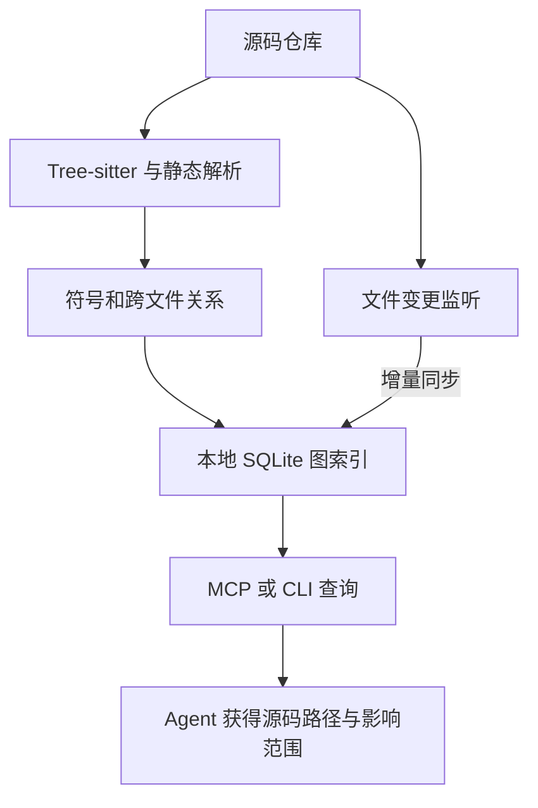

# CodeGraph

**CodeGraph**（[官方仓库](https://github.com/colbymchenry/codegraph)，[项目页](https://colbymchenry.github.io/codegraph/)，MIT）将代码仓库解析成可查询的结构图，让 coding agent 能根据一个问题定位相关符号、跨文件调用路径和变更影响，而不必反复从全库搜索开始。CodeGraph 的重点是代码结构与静态关系，并通过文件监听保持索引更新。

## 一句话定义

CodeGraph 是一个本地运行的代码索引、图查询与 MCP 服务：把源码中的符号、调用、导入和类型关系预先组织起来，再按任务把相关代码和路径交给 agent。

## 英文缩写速查

| 缩写 | 英文全称 | 简要说明 |
|------|----------|----------|
| AST | Abstract Syntax Tree | 抽象语法树；解析代码结构并提取符号、调用等关系 |
| MCP | Model Context Protocol | 模型上下文协议；CodeGraph 用它向 coding agent 提供查询工具 |
| FTS5 | Full-Text Search 5 | SQLite 全文检索扩展，用于本地符号与文本搜索 |
| CLI | Command-Line Interface | 命令行接口；可初始化、查询、检查调用方和分析影响范围 |

## 核心机制

| 阶段 | 作用 |
|------|------|
| **解析** | 官方称 Rust 内核使用 Tree-sitter 等解析路径抽取函数、类、方法、导入、调用、继承与实现关系；对跨文件引用再做解析与连接。 |
| **存储** | 项目索引写入 `.codegraph/codegraph.db` 本地 SQLite 数据库，附带 FTS5 全文检索。 |
| **同步** | 文件系统 watcher 发现代码变化后，经防抖处理进行增量同步；MCP 重连时会核对自上次连接后的改动。 |
| **查询** | `codegraph_explore` MCP 工具按自然语言问题返回相关源码、关系路径和变更影响；CLI 也提供更细粒度的搜索、调用者、被调用者和 `affected` 命令。 |
| **Agent 接入** | `codegraph install` 配置支持的 agent，`codegraph init` 为具体仓库建图。官方列出 Claude Code、Cursor、Codex CLI、OpenCode、Hermes、Gemini、Antigravity、Kiro 与 GitHub Copilot。 |

## 典型工作流

关键差异是先建立可复用的代码索引：查询返回的不只是关键词命中，也可以包含调用链、引用关系及修改某符号的潜在影响范围。项目方还提供 `codegraph affected`，可根据变更文件沿依赖关系定位可能相关的测试文件。

## 对机器人研发的用途

- **阅读机器人软件栈：** 在 ROS / ROS 2、多包工作区、仿真器插件、驱动与策略部署仓库中，可从入口函数追到调用者、下游依赖或相关测试，帮助 agent 建立代码上下文。
- **评估修改影响：** 修改控制节点、消息转换、硬件接口或配置解析前，可用调用和依赖图查看潜在影响范围，再由工程师结合运行时配置、参数文件和真机行为核对。
- **加快回归测试选择：** `codegraph affected` 可辅助筛选受影响测试；对安全关键的控制栈，静态影响结果应补充集成测试、仿真回归和真机验证。
- **支持本地仓库工作流：** 图数据库保存在项目本地；官方声明遥测仅发送汇总使用统计且可以关闭。团队采用前仍应依据自己的数据与安全政策检查配置和遥测选项。

## 与相近工具的区别

| 工具 | 核心侧重 | 适合解决的问题 |
|------|----------|----------------|
| **CodeGraph** | Tree-sitter / 静态关系图、MCP 查询、文件变化自动同步 | agent 需要代码级符号、调用路径和变更影响上下文 |
| [Graphify](./graphify.md) | 从代码与文档等混合资料构建知识图，可结合语义抽取和图遍历 | 探索包含代码、文档、论文等多类材料的资料目录 |
| [Understand Anything](./understand-anything.md) | 结构分析加业务语义视图、导览与交互式 dashboard | 需要面向人的代码库导览和高层业务解释 |

这些工具都把代码或资料组织成图，但提取机制、交互方式和侧重点不同。对于机器人仓库，若目标是调用链与变更影响分析，应重点看静态解析的语言和框架覆盖；若要把代码与设计文档、论文一起连起来，则还需评估混合资料和语义抽取能力。

## 局限与风险

- **静态分析不是运行时事实。** 反射、动态加载、运行时插件、依赖注入容器、宏或生成代码等场景可能无法得到完整关系；项目页所列框架规则不能保证每个项目约定都能解析。
- **语言能力不完全一致。** 官方支持列表为逐语言标注完整或部分支持，跨语言桥接和特定框架路由属于显式适配范围；使用前应在目标仓库抽样核对解析覆盖。
- **关系图只能辅助审查。** 图中未显示依赖不代表代码不受影响；特别是机器人控制、通信和安全路径，不应仅凭影响分析裁剪测试。
- **上下文与成本结果依赖任务。** 项目方在七个代码库的基准中报告较少的工具调用和 token，但这些是其选定模型和任务下的自测；结果不能直接推广到所有 agent、模型或机器人仓库。一次性返回较密集的源码也可能占用较多上下文窗口。
- **遥测设置需纳入评估。** 索引保存在本地不等于所有使用数据都不离开设备；官方说明存在匿名汇总使用遥测，并提供关闭选项。部署时应核查当前版本的 `TELEMETRY.md` 和配置。

## 关联页面

- [Graphify](./graphify.md) — 从代码与文档等混合语料构建可遍历图，语义抽取范围更广。
- [Understand Anything](./understand-anything.md) — 代码图谱结合业务语义视图、导览与 dashboard。
- [Open Code Review](./open-code-review.md) — 对变更 diff 做结构化代码评审；可与代码库结构探索互补。
- [Agentic Coding 时代的软件工程基础](../concepts/agentic-coding-software-fundamentals.md) — coding agent 仍需要工程约束、测试与风险判断。

## 参考来源

- [CodeGraph 仓库归档](../../sources/repos/colbymchenry-codegraph.md)
- [CodeGraph 项目页归档](../../sources/sites/codegraph-project.md)
- [CodeGraph GitHub 仓库](https://github.com/colbymchenry/codegraph)
- [CodeGraph 项目页](https://colbymchenry.github.io/codegraph/)

## 推荐继续阅读

- [CodeGraph README](https://github.com/colbymchenry/codegraph#readme) — 安装、初始化、CLI/MCP、遥测和支持语言。
- [CodeGraph Languages](https://colbymchenry.github.io/codegraph/languages/) — 查看语言支持详情和状态。
- [MIT License](https://github.com/colbymchenry/codegraph/blob/main/LICENSE) — 项目许可。
