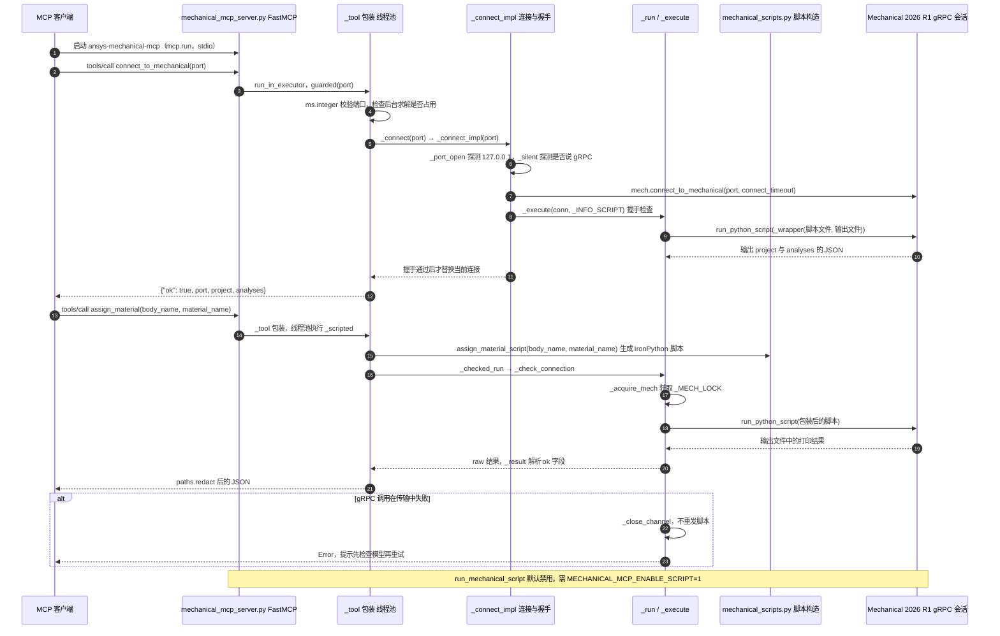

# Mechanical MCP（PyMechanical gRPC）（codersag/mechanical-mcp）

## 一句话定义

Mechanical MCP（PyMechanical gRPC）（codersag/mechanical-mcp）是通过 PyMechanical gRPC 连接 ANSYS Mechanical，工具覆盖几何/材料、网格、边界条件、求解与结果、报告及 IronPython 脚本。

## 英文缩写速查

| 缩写 | 英文全称 | 简要说明 |
|------|----------|----------|
| MCP | Model Context Protocol | 代理与工程软件工具的交互协议 |
| CAE | Computer-Aided Engineering | 计算机辅助工程软件与分析 |
| API | Application Programming Interface | 软件可供自动化调用的接口 |

## 为什么重要

对 CAE 自动化而言，代理能否稳定完成任务，取决于工程步骤是否清楚、工具边界是否明确、结果是否保留可审查证据。通过 PyMechanical gRPC 连接 ANSYS Mechanical，工具覆盖几何/材料、网格、边界条件、求解与结果、报告及 IronPython 脚本。

## 核心原理

**项目自身范围：** MCP server connecting AI clients to ANSYS Mechanical through PyMechanical gRPC.

**工作流：** 用户启动或定位 Mechanical gRPC 端口，MCP 客户端调用服务器连接会话，执行建模、求解和结果提取。

**仓库映射说明：** 文章未给出该项目完整的 owner/repository URL；此处按文章中的项目名/描述与公开 GitHub 仓库匹配。引用时请以本页链接的仓库 README 为准。

## 工程实践

1. 从目标问题识别所需的 Skill、MCP、CLI 或软件接口，不把指导文件当成求解器。
2. 依照仓库 README 检查安装前提、软件/许可证、输入文件和输出证据。
3. 小规模运行并逐项核对几何、网格、边界、求解状态和物理量，再决定是否扩大任务。

文章所述的项目特征：通过 PyMechanical gRPC 连接 ANSYS Mechanical，工具覆盖几何/材料、网格、边界条件、求解与结果、报告及 IronPython 脚本。

## 局限与风险

依赖 ANSYS Mechanical 2023 R1+ 与授权；脚本执行能力需在受信任环境内使用，不能省略结构结果审查。

源码状态核验：该 GitHub 仓库于 2026-10-07 可公开访问。仓库 API 报告许可证为 Apache-2.0。 涉及商业软件时，安装包和有效许可证需由使用者自行提供。

## 源码运行时序图

入口：`pip install -e .` 后，MCP 客户端以 `"command": "ansys-mechanical-mcp"` 启动服务（`pyproject.toml` 的 `[project.scripts]` 指向 `mechanical_mcp_server:main`，经 `mcp.run()` 走 stdio）；Mechanical 端需在 Workbench 中 `StartGrpcServer()` 取得端口，再调用 `connect_to_mechanical(port)`。

图依据：codersag/mechanical-mcp@c247356，实际读过 README.md、pyproject.toml（[project.scripts]）、mechanical_mcp_server.py（_tool、_connect_impl、_connect、_check_connection、_acquire_mech、_run、_execute、_checked_run、_scripted、connect_to_mechanical、assign_material、run_mechanical_script、main 段）；mechanical_scripts.py 与 mcp_paths.py 未打开，脚本构造与路径脱敏只按调用名标注。

## 关联页面

- [CAE / CFD 代理工具项目总览](../overview/cae-cfd-agent-skills-landscape.md)
- [ANSYS Workbench MCP](./hongwenwang36-eng-ansys-workbench-mcp.md)

## 参考来源

- [公众号文章原始资料归档](../../sources/blogs/wechat_cae_cfd_agent_skills_2026-10-07.md)
- [GitHub 仓库资料归档](../../sources/repos/codersag-mechanical-mcp.md)
- [codersag/mechanical-mcp 官方仓库](<https://github.com/codersag/mechanical-mcp>)

- 源码核对（2026-11-02）：codersag/mechanical-mcp@c247356，读过 README.md、pyproject.toml、mechanical_mcp_server.py（连接、执行、工具包装与 main 段）；时序图依据以上文件，未运行代码。

## 推荐继续阅读

- [项目 README](<https://github.com/codersag/mechanical-mcp/blob/main/README.md>)