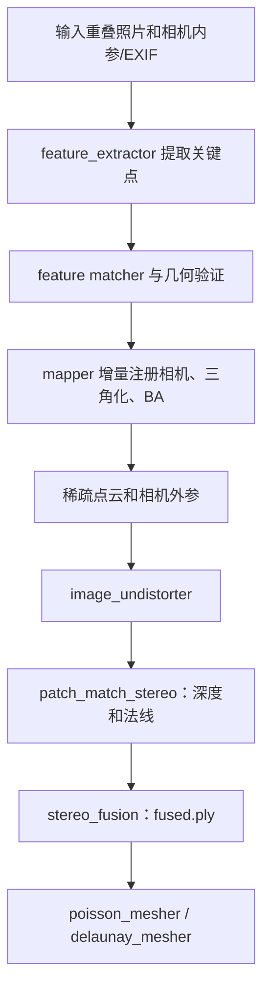
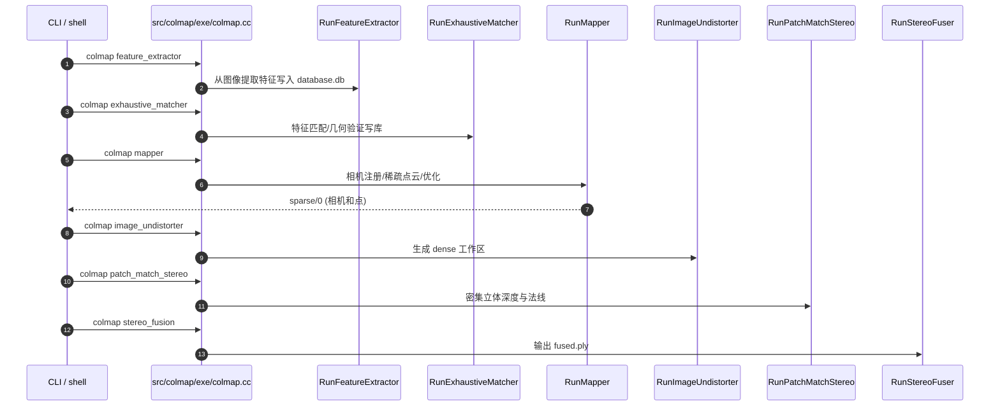

# COLMAP：原始文档、方法与源码

## 一句话定义

COLMAP 将特征提取、匹配与几何验证、增量式 SfM 相机注册/三角化/束调和基于 MVS 的深度融合/网格恢复串接为三维重建流水线。

## 英文缩写速查

| 缩写 | 英文全称 | 简要说明 |
|---|---|---|
| SfM | Structure from Motion | 恢复相机位姿和稀疏三维点 |
| MVS | Multi-View Stereo | 基于多视图恢复稠密深度、法线 |
| SIFT | Scale-Invariant Feature Transform | 局部特征检测与描述 |
| BA | Bundle Adjustment | 联合优化三维点与相机参数 |
| EXIF | Exchangeable Image File Format | 相机内参的可能初值来源 |
| PLY | Polygon File Format | 稠密点云的常见输出格式 |

## 为什么重要

COLMAP 不依赖神经网络权重作为前提，是离线图像三维重建工具箱。SfM 的稀疏相机/点云结果经 MVS 转为稠密点云或网格；3D Gaussian Splatting 和许多 NeRF 实验会复用其相机估计、图像去畸变和 SfM 点作为下游输入。它不是默认的实时机器人 odometry。

## 核心原理与方法

1. **相机与观测**：照片读取时可从 EXIF 获取焦距初值，也可输入手工标定内参；相同物理相机、焦距和分辨率的图像可共享 camera model，rig/frame 描述多相机同步采集。
2. **特征与匹配**：默认 SIFT 或支持的学习特征提取；匹配方式可选 exhaustive、sequential、vocabulary tree、spatial、transitive；几何验证剔除错误像素匹配。
3. **增量式 SfM**：从初始图像对建立场景，不断注册新图像、三角化稀疏点并进行局部/全局 BA；未注册图像可能需要提高匹配覆盖或改变初始化图像对。
4. **稠密 MVS**：稀疏模型先去畸变，再运行 PatchMatch stereo 获取深度与法线，融合成 `fused.ply`，最后用 Poisson / Delaunay 生成网格。
5. **关键输出**：新版稀疏路径中的 `rigs.bin`、`cameras.bin`、`frames.bin`、`images.bin`、`points3D.bin`；数据库 `database.db` 为 SQLite。

## 流程总览（官方算法步骤）

## 源码运行时序图

**范围**：根据官方 README 与 CLI / demo 实际入口建图，不声称已在本机编译运行。

## 实验与评测

官方文档把 COLMAP 定义为重建工具，而不是一个不变的 accuracy 指标。影响结果的因素包括：照片间纹理、视差、多视图覆盖、相机内参初值、特征匹配图、动态对象、BA 收敛与 MVS 计算资源。官方 tutorial 建议每个物体由至少约 3 张有重叠的图像观测，并避免仅原地旋转采集；这是采集建议，不是误差性能。

## 结论

对于机器人重建数据管线，先确保图像采集质量、匹配连接与 BA 可观性，再使用 MVS 或 3DGS；将 COLMAP 当相机标定和稀疏几何基线，而非实时轨迹估计。

## 工程实践

最简命令：`colmap automatic_reconstructor --workspace_path path/to/project --image_path path/to/project/images`；可拆成 `feature_extractor`、`exhaustive_matcher`、`mapper`、`image_undistorter`、`patch_match_stereo`、`stereo_fusion`。2026 官方文档还提到 `global_mapper` 及 `view_graph_calibrator` 备选方案；全局 SfM 在没有准确焦距先验时更需标定。Python 可用 `pycolmap`，必须核对 CUDA/CPU 依赖和大批图像计算开销。

## 局限与风险

失败包括少纹理/重复纹理、曝光变化、纯旋转导致三角化几何退化、错误畸变模型、内参固定错、MVS 显存不足。匹配全部图像随 N 约二次增长，不适合上万图无筛选。SfM 是离线渐进重建，不保证随传感器时钟在线同步处理；把 COLMAP 生成的相机位姿用于 3DGS 训练时必须保留坐标变换约定。

## 关联页面

- [Kalibr](./kalibr.md)
- [LVI-SAM](./paper-lvi-sam.md)

## 参考来源

- [原作者代码与教程来源归档](../../sources/repos/vision3d_colmap_20261108.md)
- [官方代码和技术文档](https://github.com/colmap/colmap)

## 推荐继续阅读

- [官方文档/源码完整入口](https://github.com/colmap/colmap)
