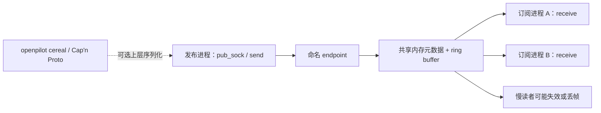
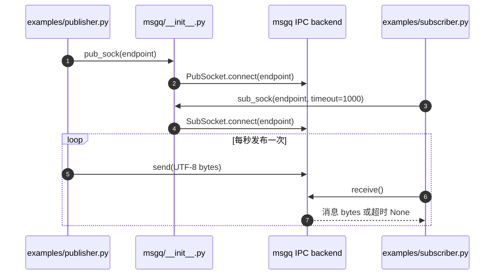

# msgq：共享内存进程间消息队列 / msgq IPC

## 一句话定义

msgq 是 comma.ai 的进程间发布订阅消息库，一个命名端点对应一个发布者、多个订阅者；它是 openpilot cereal 的底层消息传输后端。

## 英文缩写速查

| 缩写 | 英文全称 | 简要说明 |
|---|---|---|
| IPC | Inter-Process Communication | 同一机器上的跨进程消息交换 |
| PUB/SUB | Publish/Subscribe | 发布者和订阅者模式 |
| SHM | Shared Memory | 本地环形数据缓冲区 |
| API | Application Programming Interface | pub_sock/sub_sock 等接口 |

## 为什么重要

在机器人多进程系统中，传感器、推理和控制进程需要独立频率与错误隔离；msgq 展示了以命名端点、环形缓冲区和读写指针组织低开销传输的实现取舍。

## 核心原理

调用 msgq.pub_sock(endpoint) 创建发送端，msgq.sub_sock(endpoint, timeout=..., conflate=...) 创建订阅端；发布方 send(bytes)，接收方 receive()，可借助 Poller 观察多个端点。README 描述队列由元数据及 ring buffer 组成；每条消息含 8 字节长度前缀。写入覆盖滞后的读者时可将其标为失效，因此慢订阅者可能丢消息；conflate 模式读取最新可用消息。openpilot 另通过 cereal/Cap’n Proto 定义数据模式，不能混称 msgq 自带这些消息结构。

### 流程总览

以下图示基于官方 README 与所核对代码，区分模块职责，不表示所有模块在同一线程执行。

## 源码运行时序图

可执行入口与源码路径见[原始仓库归档](../../sources/repos/commaai-msgq.md)；图示为源码核对的关键消息路径，非实车测试追踪。

## 工程实践

可复核的官方示例：安装 msgq-ipc 后分别运行 python -m msgq.examples.publisher --endpoint demo 与 python -m msgq.examples.subscriber --endpoint demo；用同名 endpoint 接收。测试命令是仓库 ./test.sh。对于控制链路需评估队列溢出、读端滞后、数据新鲜度及重放需求。

## 局限与风险

接口不等同于可靠的持久消息队列：消息按环形缓存容量覆盖，慢订阅者可能漏收；README 的基准图不能直接当作所有机器人平台的实时延迟保证。

## 结论

**msgq 是 comma.ai 可独立研究与复用的工程组件，不能把各层职责混为一个“自动驾驶算法”。**

- 按原仓库 README 的版本与依赖执行，不把文档示例当成实际车辆部署许可。
- 关注模型／控制、通信与车端报文、安全 MCU 各自的验证边界。
- 对具体硬件行为做 SIL/HIL 与场景检查；本页不宣称实车复现成功。

## 关联页面

- [openpilot](./commaai-openpilot.md) — comma.ai 栈中的独立组件
- [panda](./commaai-panda.md) — comma.ai 栈中的独立组件
- [opendbc](./commaai-opendbc.md) — comma.ai 栈中的独立组件
- [CAN 总线协议](../concepts/can-bus-protocol.md)
- [进程间通信](../concepts/ipc-inter-process-communication.md)
- [车载通信架构](../concepts/robot-onboard-communication-architecture.md)
- [PID 控制](../methods/pid-control.md) — 对比控制回路与通讯层职责
- [模型预测控制](../methods/model-predictive-control.md) — 对比控制算法与车辆接口的分工
- [安全控制纵深路线 Stage 4](../../roadmap/depth-safe-control.md)

## 参考来源

- [官方仓库原文与源码核对归档](../../sources/repos/commaai-msgq.md)
- [comma.ai/msgq 官方 GitHub](https://github.com/commaai/msgq)
- [本次核查的 master commit](https://github.com/commaai/msgq/commit/42554d0a6f1cb2e87238c994760078be36cfdb27)

## 推荐继续阅读

- [官方文档／测试入口](https://github.com/commaai/msgq/tree/master/msgq/examples)
