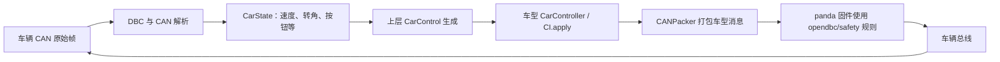
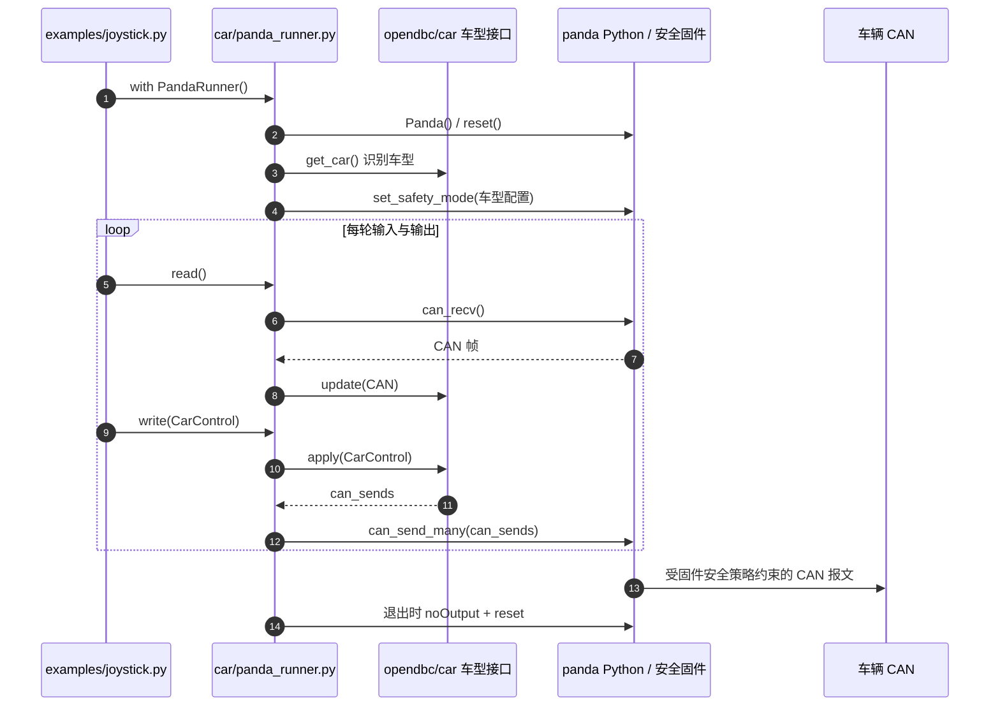

# opendbc：车辆接口与安全规则 / opendbc Car Interface

## 一句话定义

opendbc 是 comma.ai 的车辆控制接口工程，包含 DBC 信号定义、CAN 报文编解码、车型适配的 Python API 与在 panda 固件使用的安全规则。

## 英文缩写速查

| 缩写 | 英文全称 | 简要说明 |
|---|---|---|
| DBC | Database CAN | CAN 报文信号定义文件 |
| LKAS | Lane Keeping Assist System | 车辆已有的车道保持辅助接口 |
| ACC | Adaptive Cruise Control | 车辆已有的自适应巡航接口 |
| ECU | Electronic Control Unit | 汽车电子控制单元 |

## 为什么重要

把上层控制器输出和真实车型的帧地址、信号刻度、方向、限幅、安全检查分离；有助于研究机器人硬件抽象、总线协议和安全边界的分工。

## 核心原理

opendbc/dbc 保存车型 DBC，opendbc/can 解析/构造 CAN，opendbc/car 中每品牌的 carstate.py、carcontroller.py、interface.py 负责车辆状态和控制映射；opendbc/safety 提供车型安全模型。README 的移植指南要求录制 CAN 轨迹、分析信号、实现车型目录并按清单验证。PandaRunner 选择车型与安全模式，read 调用 CI.update，write 调用 CI.apply 生成 CAN，并经 panda 发送。

### 流程总览

以下图示基于官方 README 与所核对代码，区分模块职责，不表示所有模块在同一线程执行。

## 源码运行时序图

可执行入口与源码路径见[原始仓库归档](../../sources/repos/commaai-opendbc.md)；图示为源码核对的关键消息路径，非实车测试追踪。

## 工程实践

官方 quickstart 为 ./test.sh；示例 examples/joystick.py 通过 PandaRunner 实现键盘/摇杆输入的 100 Hz 指令示范（仅在有合适车辆与硬件的测试环境运行）。移植时先做 fingerprint / DBC 解析，再实现 carstate 与 carcontroller，使用官方 CAR_PORTING_CHECKLIST 验证，不应直接照搬别的车型控制报文。

## 局限与风险

不同车型能读取和能控制的信号不同；README 明确默认 SAFETY_SILENT，只有选择相应安全模式后才可能发送。所谓统一 API 不代表支持所有车型、也不代表安全规则可以由上位机忽略。

## 结论

**opendbc 是 comma.ai 可独立研究与复用的工程组件，不能把各层职责混为一个“自动驾驶算法”。**

- 按原仓库 README 的版本与依赖执行，不把文档示例当成实际车辆部署许可。
- 关注模型／控制、通信与车端报文、安全 MCU 各自的验证边界。
- 对具体硬件行为做 SIL/HIL 与场景检查；本页不宣称实车复现成功。

## 关联页面

- [openpilot](./commaai-openpilot.md) — comma.ai 栈中的独立组件
- [msgq](./commaai-msgq.md) — comma.ai 栈中的独立组件
- [panda](./commaai-panda.md) — comma.ai 栈中的独立组件
- [CAN 总线协议](../concepts/can-bus-protocol.md)
- [进程间通信](../concepts/ipc-inter-process-communication.md)
- [车载通信架构](../concepts/robot-onboard-communication-architecture.md)
- [PID 控制](../methods/pid-control.md) — 对比控制回路与通讯层职责
- [模型预测控制](../methods/model-predictive-control.md) — 对比控制算法与车辆接口的分工
- [安全控制纵深路线 Stage 4](../../roadmap/depth-safe-control.md)

## 参考来源

- [官方仓库原文与源码核对归档](../../sources/repos/commaai-opendbc.md)
- [comma.ai/opendbc 官方 GitHub](https://github.com/commaai/opendbc)
- [本次核查的 master commit](https://github.com/commaai/opendbc/commit/34b55aec160a8fa0c5733a9b5279be40b5e1d775)

## 推荐继续阅读

- [官方文档／测试入口](https://github.com/commaai/opendbc/blob/master/docs/CAR_PORTING_CHECKLIST.md)
