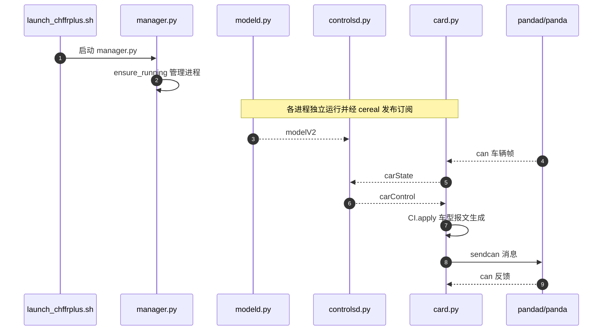

# openpilot：模块化驾驶辅助系统 / openpilot Modular Driver Assistance

## 一句话定义

openpilot 是 comma.ai 面向受支持汽车的开源驾驶辅助系统，以独立进程组合感知、驾驶模型、状态判定、控制及车辆接口。

## 英文缩写速查

| 缩写 | 英文全称 | 简要说明 |
|---|---|---|
| ADAS | Advanced Driver Assistance Systems | 驾驶辅助，不等于无人驾驶 |
| CAN | Controller Area Network | 车辆控制器局域网 |
| IPC | Inter-Process Communication | 各进程交换传感和控制消息 |
| MPC | Model Predictive Control | 对照研究的优化控制方法，不等同于本系统每个控制环 |

## 为什么重要

可研究一个真实部署的多进程闭环：模型推理与控制指令分层，车型兼容性和安全控制交给独立模块，不依赖单个端到端程序。

## 核心原理

启动入口 launch_chffrplus.sh 建立 Python 环境、准备子模块后运行 manager.py；manager 根据设备状态启停受管理进程。cereal 使用 msgq 发布订阅传输消息，Cap’n Proto 定义序列化结构。controlsd 订阅 modelV2、车辆状态和控制相关消息，计算转向、加速度等 CarControl；card.py 经 opendbc 的车型接口将车辆 CAN 状态解析并生成可发送的控制报文。panda 的车端安全规则不由 Python 控制器绕过。

### 流程总览

以下图示基于官方 README 与所核对代码，区分模块职责，不表示所有模块在同一线程执行。

## 源码运行时序图

可执行入口与源码路径见[原始仓库归档](../../sources/repos/commaai-openpilot.md)；图示为源码核对的关键消息路径，非实车测试追踪。

## 工程实践

研究入口：先读 launch_chffrplus.sh → manager.py / process_config.py → cereal README → controlsd.py → card.py；车型支持与安装前提以官方 docs/CARS.md 为准。官方 README 给出设备安装入口 openpilot.comma.ai 及开发环境安装脚本。

## 局限与风险

官方定义是驾驶辅助，不是可放手无人驾驶系统；支持范围依车型、车型接口和硬件线束而变化。官方 README 标明软件用于研究、无保修并要求遵守当地法律；源码架构可读不代表已进行实车安全验证。

## 结论

**openpilot 是 comma.ai 可独立研究与复用的工程组件，不能把各层职责混为一个“自动驾驶算法”。**

- 按原仓库 README 的版本与依赖执行，不把文档示例当成实际车辆部署许可。
- 关注模型／控制、通信与车端报文、安全 MCU 各自的验证边界。
- 对具体硬件行为做 SIL/HIL 与场景检查；本页不宣称实车复现成功。

## 关联页面

- [msgq](./commaai-msgq.md) — comma.ai 栈中的独立组件
- [panda](./commaai-panda.md) — comma.ai 栈中的独立组件
- [opendbc](./commaai-opendbc.md) — comma.ai 栈中的独立组件
- [CAN 总线协议](../concepts/can-bus-protocol.md)
- [进程间通信](../concepts/ipc-inter-process-communication.md)
- [车载通信架构](../concepts/robot-onboard-communication-architecture.md)
- [PID 控制](../methods/pid-control.md) — 对比控制回路与通讯层职责
- [模型预测控制](../methods/model-predictive-control.md) — 对比控制算法与车辆接口的分工
- [安全控制纵深路线 Stage 4](../../roadmap/depth-safe-control.md)

## 参考来源

- [官方仓库原文与源码核对归档](../../sources/repos/commaai-openpilot.md)
- [comma.ai/openpilot 官方 GitHub](https://github.com/commaai/openpilot)
- [本次核查的 master commit](https://github.com/commaai/openpilot/commit/4bd73298e9a820c64426b973e81675c702a2e650)

## 推荐继续阅读

- [官方文档／测试入口](https://docs.comma.ai/)
