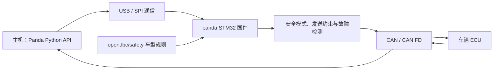
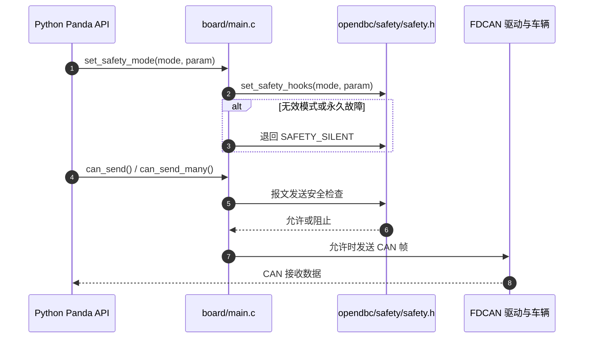

# panda：车辆 CAN/CAN FD 接口与安全固件 / comma.ai panda

## 一句话定义

panda 是 comma.ai 的车辆 CAN/CAN FD 硬件与固件组件，面向车载通信接入，并在 MCU 端执行车型相关的安全策略。

## 英文缩写速查

| 缩写 | 英文全称 | 简要说明 |
|---|---|---|
| CAN | Controller Area Network | 车载通信总线 |
| CAN FD | CAN with Flexible Data-rate | 支持可变数据阶段速率的 CAN |
| MCU | Microcontroller Unit | 运行板载固件的微控制器 |
| HIL | Hardware-in-the-Loop | 真实硬件参与的回归测试 |

## 为什么重要

提供可读的安全边界实例：上位机输出控制消息，不应因此自动获得无限制发送能力；板载固件通过安全模式、故障状态和报文校验构成独立保护层。

## 核心原理

官方 README 指出硬件采用 STM32H725，包含 board 固件、python 主机接口、tests 测试。board/main.c 的 set_safety_mode 通过 set_safety_hooks 选择来自 opendbc 的安全模式；失败时回退 SAFETY_SILENT；永久故障强制静默。主机通过 Panda 的 CAN API 收发帧，固件可对拟发送的控制报文实施 safety hooks 和故障处理。

### 流程总览

以下图示基于官方 README 与所核对代码，区分模块职责，不表示所有模块在同一线程执行。

## 源码运行时序图

可执行入口与源码路径见[原始仓库归档](../../sources/repos/commaai-panda.md)；图示为源码核对的关键消息路径，非实车测试追踪。

## 工程实践

README 提供 git clone、./setup.sh、./test.sh，Python 端 Panda().can_recv() 与 can_send() 示例；真实汽车使用前需选择匹配车型的安全配置，验证 CAN 总线映射、心跳、故障恢复和 HIL 回归。开放源码不等于目标车辆已经通过安全认证。

## 局限与风险

车型安全逻辑已在 opendbc 仓库维护，不能只看 panda 单仓就理解完整限制。测试中的 ALLOUTPUT 等模式不得当成道路安全配置，固件与车型配置需一致；未做硬件验证。

## 结论

**panda 是 comma.ai 可独立研究与复用的工程组件，不能把各层职责混为一个“自动驾驶算法”。**

- 按原仓库 README 的版本与依赖执行，不把文档示例当成实际车辆部署许可。
- 关注模型／控制、通信与车端报文、安全 MCU 各自的验证边界。
- 对具体硬件行为做 SIL/HIL 与场景检查；本页不宣称实车复现成功。

## 关联页面

- [openpilot](./commaai-openpilot.md) — comma.ai 栈中的独立组件
- [msgq](./commaai-msgq.md) — comma.ai 栈中的独立组件
- [opendbc](./commaai-opendbc.md) — comma.ai 栈中的独立组件
- [CAN 总线协议](../concepts/can-bus-protocol.md)
- [进程间通信](../concepts/ipc-inter-process-communication.md)
- [车载通信架构](../concepts/robot-onboard-communication-architecture.md)
- [PID 控制](../methods/pid-control.md) — 对比控制回路与通讯层职责
- [模型预测控制](../methods/model-predictive-control.md) — 对比控制算法与车辆接口的分工
- [安全控制纵深路线 Stage 4](../../roadmap/depth-safe-control.md)

## 参考来源

- [官方仓库原文与源码核对归档](../../sources/repos/commaai-panda.md)
- [comma.ai/panda 官方 GitHub](https://github.com/commaai/panda)
- [本次核查的 master commit](https://github.com/commaai/panda/commit/4b995ddbebbaaa8ce9fe301ad5a1ae2c140d04ba)

## 推荐继续阅读

- [官方文档／测试入口](https://github.com/commaai/panda/tree/master/tests)
