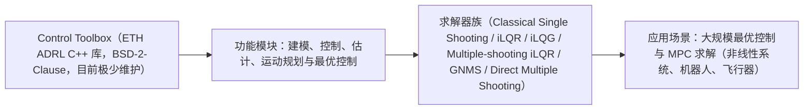
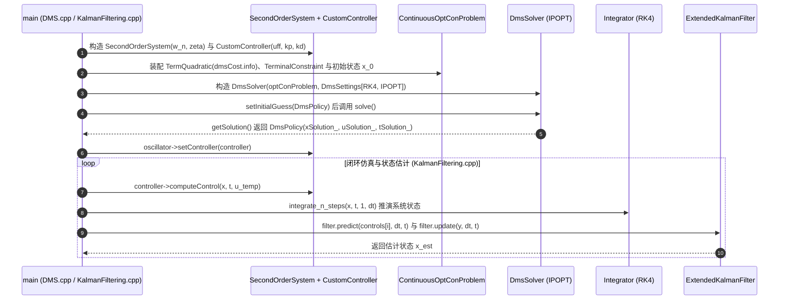

# Control Toolbox（ct）

**Control Toolbox（ct）**（[https://github.com/ethz-adrl/control-toolbox](https://github.com/ethz-adrl/control-toolbox)）是 [Qt历险记《C/C++ 运动控制开源库分类整理》](https://mp.weixin.qq.com/s/RIXXIltQ0ABoBO_OVLZTZw) 中「机器人动力学 / 整机控制库」一类的项目。本页以**一手资料**为准，文章说法放在「文章说法核对」里对照。

## 一句话定义

**Control Toolbox（ADRL CT）是 ETH ADRL 的 C++ 库，用于机器人的建模、控制、估计、轨迹优化与 MPC。**

## 英文缩写速查

| 缩写 | 英文全称 | 简要说明 |
|------|----------|----------|
| OTG | Online Trajectory Generation | 在线轨迹生成 |
| PTP | Point-To-Point | 点到点运动 |

## 为什么重要

- 在文章的选型建议里属于「机器人动力学 / 整机控制库」；横向对比见 [C/C++ 运动控制开源库地图：轨迹生成、动力学、工业总线与 ROS 栈（一手资料核对版）](../overview/cpp-motion-control-open-source-libraries-map.md)。

## 一手资料

| 项 | 内容 |
|----|------|
| **仓库 / 官方来源** | [https://github.com/ethz-adrl/control-toolbox](https://github.com/ethz-adrl/control-toolbox) |
| **许可（核查）** | BSD-2-Clause（README：BSD-2 clause license；仓库根目录未见独立 LICENSE 文件） |
| **最近提交** | 2021-07-05 |
| **论文 / 文档** | Giftthaler 等，The Control Toolbox - An Open-Source C++ Library for Robotics, Optimal and Model Predictive Control（ICRA 2018，arXiv:1801.04290，已核对标题） |

**一手描述：** README：efficient C++ library for control, estimation, optimization and motion planning in robotics；求解器列表含 Classical Single Shooting、iLQR/iLQG、Multiple-shooting iLQR、GNMS、Direct Multiple Shooting 等；可用于大规模最优控制问题的 MPC 求解。

## 文章说法核对

- **文章：** C++；BSD；最优控制、MPC、自动微分、shooting 方法；适用非线性系统、机器人、飞行器最优控制。
- **维护状态**：README 顶部声明（2021 年 7 月）该库「currently only scarcely maintained」，对 bug 与需求响应缓慢；仓库最近提交 2021-07-05。文章未提，选型需注意。
- 许可：README 写 BSD-2 clause；仓库根目录未找到独立 LICENSE 文件（文章写「BSD」）。
- 「自动微分」：README 已读片段列出多种 shooting / iLQR 求解器；自动微分细节按文章保留，未逐项核对。

## 机制与架构图

## 源码运行时序图

以下时序图基于仓库 `README.md`、`ct_core/examples/include/ct/core/examples/CustomController.h`、`ct_optcon/examples/DMS.cpp` 与 `ct_optcon/examples/KalmanFiltering.cpp` 梳理，展示 Direct Multiple Shooting（IPOPT）轨迹优化与基于 `CustomController` + `ExtendedKalmanFilter` 的闭环仿真估计两条核心运行路径。

## 关联页面

- [model-predictive-control](../methods/model-predictive-control.md)
- [crocoddyl](../entities/crocoddyl.md)
- [pinocchio](../entities/pinocchio.md)
- [towr-trajectory-optimization](../entities/towr-trajectory-optimization.md)
- [cpp-motion-control-open-source-libraries-map](../overview/cpp-motion-control-open-source-libraries-map.md)
- [Trajectory Optimization（轨迹优化）](../methods/trajectory-optimization.md) — 建模与最优控制求解器可服务离线轨迹优化，与在线 MPC 的滚动执行区分。

## 参考来源

- [control_toolbox_ct.md](../../sources/repos/control_toolbox_ct.md)
- [wechat_qt_adventure_cpp_motion_control_libs_2026-11-02.md](../../sources/blogs/wechat_qt_adventure_cpp_motion_control_libs_2026-11-02.md)
- [原文（微信公众号）](https://mp.weixin.qq.com/s/RIXXIltQ0ABoBO_OVLZTZw)
