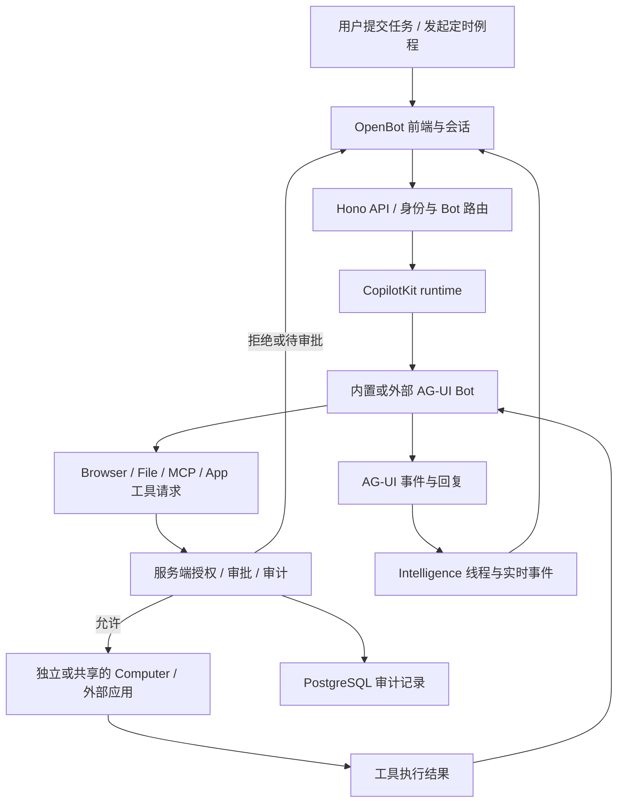
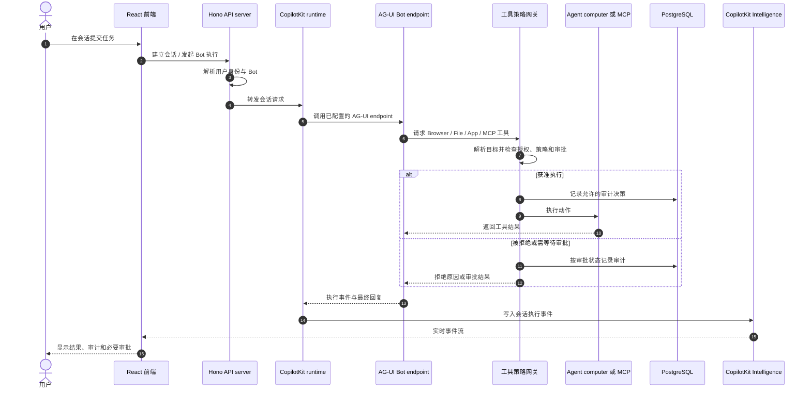

# OpenBot（CopilotKit）：可自托管 AI Agent 工作空间 / Self-hostable AI Coworker Workspace

## 一句话定义

**OpenBot**（[CopilotKit/OpenBot](https://github.com/CopilotKit/OpenBot)）是将多个 AI 同事（Bot）、个人或团队工作空间、独立浏览器/终端、可连接的工具与审批审计放在同一产品里的可自托管平台；它位于**高层 Agent 执行与治理层**，不是 [Intel Labs 同名手机机器人 OpenBot](./paper-openbot-smartphone-mobile-robot.md)，也不是可直接输出机器人关节控制指令的运动策略。

## 英文缩写速查

| 缩写 | 英文全称 | 简要说明 |
|---|---|---|
| AG-UI | Agent-User Interaction Protocol | 外部/内置 Bot 与工作空间交换执行事件和交互结果的协议 |
| MCP | Model Context Protocol | 为 Bot 连接外部工具与服务的协议 |
| API | Application Programming Interface | OpenBot 统一服务端接口、身份与工具治理入口 |
| SSO | Single Sign-On | 团队版身份登录与管理方式之一 |
| CEL | Common Expression Language | 服务端动作授权规则所采用的表达式语言 |

## 为什么重要

- **Agent 与工作台解耦：** 既能运行内置 Bot，也能注册遵循 AG-UI 的已有 Agent；用户界面、模型选型和代理执行框架不必捆绑。
- **有计算机不等于无约束执行：** 浏览器、文件、终端以及 MCP / App 工具要经过服务端权限与审计边界；可针对不同 Bot 和人员配置审批。
- **适合上层自动化的工程参考：** 机器人团队可借鉴任务编排、研发文档处理、人工复核与工具治理；是否能连接 ROS 2 / Nav2 或机械臂取决于另行开发的机器人能力接口与安全网关。

## 核心原理：四层分工

| 层级 | 官方组成 | 核心职责 |
|---|---|---|
| 用户交互 | React / Vite 前端，桌面应用与其他前端入口 | 会话、实时执行画面、审批、结果展示 |
| Agent 运行 | 内置 Bot 或自带的 AG-UI endpoint，CopilotKit runtime | 接收任务、推理、调用获授权的工具、回传执行事件 |
| 执行与治理 | Hono API server、策略网关、computer Supervisor、MCP / App 插件 | 对动作进行授权、审批与审计，并管理各 Bot 的浏览器/文件/终端环境 |
| 状态与服务 | PostgreSQL；CopilotKit Intelligence | 保存产品数据、审批审计；提供持久会话与独立授权的相关服务 |

这里的“一个 Bot 一台电脑”要按部署模式理解：官方说明默认可按用户建立容器、为不同 Bot 分配独立工作目录和浏览器 profile；标记 `Isolated` 的 Bot 可拥有自己的容器，若未使用 supervisor 则存在共享 computer 模式。**不能把每个 Bot 都必然硬隔离当作默认承诺。**

## 流程总览

主干依照官方 [Architecture / Runtime flow](https://github.com/CopilotKit/OpenBot/blob/main/docs/architecture.md#runtime-flow) 与浏览器治理文档；实际工具会因 Bot 授权、前端注册和部署方式而不同。

## 源码运行时序图

官方可复现入口为 `cp .env.example .env`、`bun install`，配置 CopilotKit Intelligence / 模型密钥后执行 `bash scripts/start.sh`。该脚本通过 `backend-images.env` 选择已发布镜像，并启动 server（默认 3001）、React app（默认 3010）及计算机相关服务。以下是**官方文档明确描述的单次 Agent 工具执行路径**，不是逆向发布镜像的内部函数调用图：

**源码与证据边界：** 已核对 `scripts/start.sh`、`package.json`、官方 README、`docs/architecture.md` 和 `docs/coworkers.md` 中的启动与运行说明；server / computer 的实际执行依赖发布镜像，本次未运行容器，也未对镜像内部调用链做源码级验证。审批记录时点及具体外部工具路径以官方文档的各类分支为准。

## 工程实践

1. **最小体验：** 使用官方桌面应用，或克隆仓库、准备 Docker 与 Bun 1.4+，完成 `.env` 的 CopilotKit Intelligence 与模型凭证配置后执行 `bash scripts/start.sh`；切勿将示例单用户免认证配置部署到公网。
2. **接入自有 Agent：** 创建 Bot 并填写角色、可选的 AG-UI endpoint 与凭证；在服务端分别授予计算机、组件和外部应用的权限，而非仅靠 system prompt 限制。
3. **审计优先：** 用 Browser / File / MCP 调用验证 deny/allow 规则、审批状态、失败回执与审计记录。官方默认策略及 `dry-run` 模式不等同于已经配置适用的生产安全边界。
4. **在机器人研发中：** 可以把 [Agentic Manipulation Policies](../methods/agentic-manipulation-policies.md) 类高层任务代理或 [视觉语言导航](../tasks/vision-language-navigation.md) 的上层意图接口接入一条独立开发的网关；**速度/力矩闭环、急停、碰撞约束仍必须留在机器人控制系统**。这属于可借鉴的集成方向，不是 OpenBot 官方已发布的机器人功能。
5. **开放状态：** 应用模板与前端源码按 MIT 公开；CopilotKit Intelligence 单独授权，生产部署要核对 license、工具/计算机镜像、外部模型计费和凭证管理。

## 与相关项目对比

| 项目 | 主定位 | 与 OpenBot 的差别 |
|---|---|---|
| [CopilotKit OpenMuse](./copilotkit-openmuse.md) | 跨端个人代理应用 | 同组织不同仓库；OpenBot 更强调企业工作空间、统一治理和多种 Agent 接入 |
| [OpenClaw](./openclaw.md) | 个人 AI 助手和消息网关 | 更侧重常驻个人 Agent、技能与聊天通道；OpenBot 提供集中治理的工作台 |
| [Hermes Agent](./hermes-agent.md) | 代理运行时、技能与跨会话成长 | Hermes 是可执行 Agent 本体；OpenBot 的目标是托管/连接 Agent 的多用户工作空间 |
| [Intel OpenBot](./paper-openbot-smartphone-mobile-robot.md) | 手机驱动的低成本轮式机器人 | 名称相同但完全不同项目：不应合并源码、论文与项目身份 |

## 局限与风险

- **源码公开与整套服务开源不是一回事：** 应用模板 MIT 不意味着 Intelligence 或已发布 backend 镜像的内部代码均以 MIT 授权；需分别核查发行包和生产许可证。
- **部署安全取决于配置：** 浏览器动作策略、MCP 授权、人工审批、容器隔离、网络出口策略和秘钥托管均需要配置及测试；官方文档明确指出代理进程可尝试绕过仅基于代理环境变量的网络限制。
- **入口覆盖有差异：** macOS / Windows 提供桌面安装，网站列出其他前端早期访问入口，不应推断所有通道均已开放。
- **未提供机器人实时控制：** 没有核实 OpenBot 自带 ROS 2、硬实时调度或真机运动安全接口；把它用于机器人只能作为高层工作流，不能直接替代 WBC / RL policy / 急停回路。
- **未做部署实测：** 本页基于官方仓库、文档和网站核对，未实际拉起全部服务、验证镜像行为或第三方连接器的真实权限表现。

## 关联页面

- [OpenMuse（CopilotKit）](./copilotkit-openmuse.md) — 同组织个人代理产品
- [多 Agent 编码管理与认知把关](../concepts/coding-agent-orchestration-and-cognitive-oversight.md) — 工作流验收与人工把关
- [Model Context Protocol](../concepts/model-context-protocol.md) — 外部工具接口
- [OpenClaw](./openclaw.md) — 个人代理网关对比
- [Hermes Agent](./hermes-agent.md) — 代理运行时对比
- [Agentic Manipulation Policies](../methods/agentic-manipulation-policies.md) — 机器人上层代理能力与真机执行的分层
- [视觉语言导航](../tasks/vision-language-navigation.md) — 与机器人技能的概念边界

## 参考来源

- [OpenBot 官方仓库与架构归档](../../sources/repos/copilotkit-openbot.md)
- [OpenBot 官网归档](../../sources/sites/copilotkit-openbot-project.md)
- [官方 README](https://github.com/CopilotKit/OpenBot)
- [官方架构与治理文档](https://github.com/CopilotKit/OpenBot/blob/main/docs/architecture.md)
- [官方许可](https://github.com/CopilotKit/OpenBot/blob/main/LICENSE)

## 推荐继续阅读

- [OpenBot — How it works](https://github.com/CopilotKit/OpenBot/blob/main/docs/how-openbot-works.md) — 8 个 Agent 产品原语
- [OpenBot — Coworkers](https://github.com/CopilotKit/OpenBot/blob/main/docs/coworkers.md) — AG-UI Bot 注册与权限边界
- [OpenBot — Approvals](https://github.com/CopilotKit/OpenBot/blob/main/docs/approvals.md) — 动作分类、人工审批与审计细则
