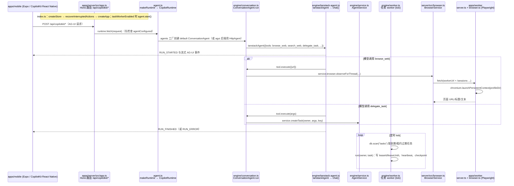

---

type: entity
project_id: copilotkit-openmuse
code: https://github.com/CopilotKit/OpenMuse
tags:
  - llm-agents
  - agent-infrastructure
status: complete
updated: 2026-10-14
related:
  - ./hermes-agent.md
  - ./deep-agents.md
  - ./openclaw.md
sources:
  - ../../sources/repos/copilotkit-openmuse.md
summary: "OpenMuse 是 CopilotKit 构建的开源个人代理应用：以 AG-UI 连接跨端客户端和服务端 agent runtime，通过持久任务 worker、浏览器、可选 Linux 工作区及行动审阅执行多步工作；Alpha 阶段，面向机器人可作上层任务代理架构参考，不提供机器人控制能力。"
tags: [llm-agents, agent-infrastructure, copilotkit, ag-ui]

---

# OpenMuse（CopilotKit）

**OpenMuse** 是 CopilotKit 开源的跨端个人代理应用：用户给出目标后，系统可以规划并执行多步工作，展示进度、请求补充输入或审阅行动，并返回可检查的结果。

## 一句话定义

一个把对话式 agent、持久浏览器、可选 Linux 工作区、后台任务和人工审阅组合起来的自托管应用骨架。

## 英文缩写速查

| 缩写 | 英文全称 | 简要说明 |
|------|----------|----------|
| AG-UI | Agent-User Interaction Protocol | 客户端与 agent runtime 之间的事件流协议 |
| API | Application Programming Interface | 客户端或服务之间调用功能的接口 |
| PDF | Portable Document Format | OpenMuse 可导入、填写、预览和导出的文档格式 |
| OAuth | Open Authorization | Gmail / Calendar 等 Google 连接器使用的授权机制 |

## 核心结构

官方 README 将实现划分为跨端客户端、服务端 agent runtime、持久任务 worker、数据存储、浏览器 worker、可选 Linux computer 与连接器：

| 组件 | 作用 |
|------|------|
| Expo / React Native / Web 客户端 | 提供 iOS、Android、Web 的对话和任务界面，并通过 AG-UI 与认证 API 通信 |
| Hono + CopilotKit runtime | 承载 API、身份边界、agent runtime、任务引擎、审阅和持久化 |
| Durable task worker | 执行长时任务、保存进度与行动结果，并支持暂停、恢复、取消和重试 |
| Chromium worker | 提供可持续的浏览器 profile；用户可接管同一浏览器会话 |
| Optional Linux computer | 通过隔离容器执行受限命令、处理工作区文件；默认关闭，可配置 Docker 后启用 |
| Stored action review | 保存待审阅行动；Gmail / Calendar 等连接器的写操作可先审阅 |
| PGlite / PostgreSQL | 持久化应用状态和任务数据 |

## 运行方式与适用场景

OpenMuse 将短交互式对话与可恢复的后台任务放在同一应用中。一个典型闭环是：用户提交目标，agent 需要时请求输入或提出行动，worker 使用浏览器/文件等工具执行，系统记录进度与结果，用户可以审阅并接续工作。

对机器人开发者，它适合作为**高层任务代理与交互工作台**的架构参考，例如任务委派、浏览器/文档工具、行动审阅和执行收据。它本身不包含 ROS、机器人感知、运动规划或实时控制接口；真机能力需要另行开发并置于独立安全边界内。

## 工程实践

- 项目为 Alpha，README 要求 Node.js 24 LTS 与 pnpm 11.19.0。
- 最小本地样例不要求模型账户、Google OAuth 或 Docker；连接真实模型、Google 服务、浏览器 worker、Linux computer 时须按官方配置提供对应服务与凭证。
- 官方将已实现功能与待扩展项分列。Linux computer 默认禁用且没有网络访问；不要把 roadmap 功能当成现有能力。
- 运行命令在隔离的 computer 容器中执行，不会在 API host 上降级执行。容器隔离、外部连接器授权、行动审批与数据持久化边界仍需按部署环境独立审计。
- MIT 许可源码公开；live Google 和模型验收需要相应凭证，项目验证文档会注明配置前提。

## 与相关代理框架的区别

- [Hermes Agent](./hermes-agent.md) 强调常驻运行时、跨会话记忆、技能和多消息网关；OpenMuse 更像具有移动/Web 客户端和可视化工作界面的个人代理应用。
- [Deep Agents](./deep-agents.md) 是可嵌入应用的 agent harness；OpenMuse 在 harness 之外还提供完整客户端、浏览器/工作区和任务管理流程。
- [OpenClaw](./openclaw.md) 等个人代理可用于对比运行时与交互形态；选型时应分别检查模型适配、隔离和写操作审阅机制。

## 源码运行时序图

入口：`pnpm dev`（`tsx watch apps/server/src/index.ts`，API 与进程内任务 worker）；浏览器 worker 另起 `pnpm dev:browser`（`apps/worker/src/index.ts`，监听 8790）；前端 `pnpm dev:web`（Expo web，`apps/mobile`）。

图依据：CopilotKit/OpenMuse@a4944f4，读过 README.md、package.json（scripts）、apps/server/src/index.ts、agent.ts、app.ts（路由与 /api/copilotkit 段）、engine/conversation.ts（run 起始与 browse_web / search_web 等工具定义片段）、engine/tanstack-agent.ts（函数清单）、engine/worker.ts（tick / run 开头）、browser.ts（fetch 处）、apps/worker/src/index.ts、server.ts（路由）、browser.ts（chromium 启动处）；任务 worker 如何调用具体浏览器/计算机工具、ConversationAgent.run 的完整流程及 mobile 端调用未读，故未画。

## 关联页面

- [Hermes Agent](./hermes-agent.md)
- [Deep Agents](./deep-agents.md)
- [OpenClaw](./openclaw.md)

## 参考来源

- [OpenMuse 仓库归档](../../sources/repos/copilotkit-openmuse.md)
- [OpenMuse 官方 README](https://github.com/CopilotKit/OpenMuse/blob/main/README.md)
- [Agent computer 配置与限制](https://github.com/CopilotKit/OpenMuse/blob/main/docs/COMPUTER.md)
- [功能清单](https://github.com/CopilotKit/OpenMuse/blob/main/docs/FEATURES.md)
- 源码核对（2026-11-02）：CopilotKit/OpenMuse@a4944f4，读过 README.md、package.json、apps/server/src/{index,agent,app,browser}.ts、engine/{conversation,tanstack-agent,worker}.ts（部分）、apps/worker/src/{index,server,browser}.ts（部分）；时序图依据以上文件，未运行代码。

## 推荐继续阅读

- [OpenMuse 架构说明](https://github.com/CopilotKit/OpenMuse#architecture) — 客户端、agent runtime、worker 与工具服务的结构
- [OpenMuse agent computer 文档](https://github.com/CopilotKit/OpenMuse/blob/main/docs/COMPUTER.md) — Linux computer 的配置与隔离边界
- [CopilotKit / AG-UI](https://github.com/CopilotKit) — 应用集成栈和协议生态
