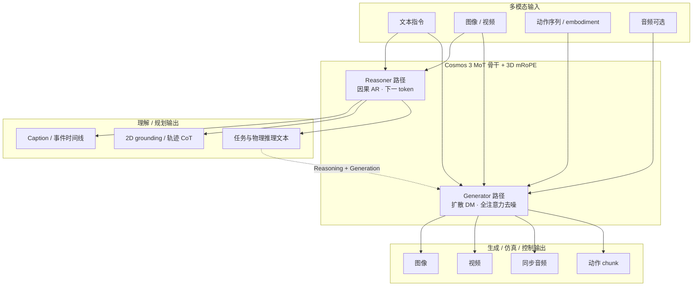
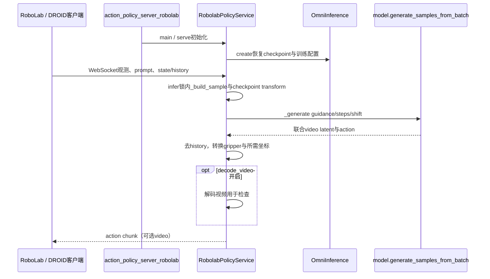
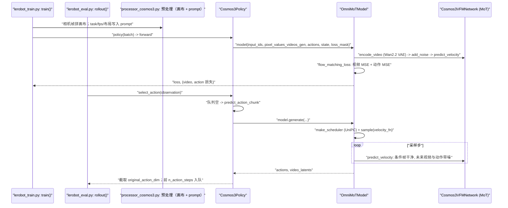

# Cosmos 3（NVIDIA 全模态世界模型）

**Cosmos 3**（2026-06，[arXiv:2606.02800](https://arxiv.org/abs/2606.02800)，[项目页](https://research.nvidia.com/labs/cosmos-lab/cosmos3/)，[GitHub](https://github.com/NVIDIA/cosmos)）是 NVIDIA Cosmos 平台的第三代 **全模态（omnimodal）世界模型** 家族：在单一 **Mixture-of-Transformers（MoT）** 骨干内，以灵活的多模态 I/O 同时承担 **视觉–语言理解、图像/视频/音频生成、世界仿真、操纵策略与正/逆动力学**——把以往分立的 VLM、视频扩散生成器、世界模拟器与 world-action 模型收束为 **Physical AI 通用底座**。

## 一句话定义

**一个开源 MoT 世界模型栈：Reasoner 路径做物理 grounded 文本推理，Generator 路径做视频/音频/动作联合生成与 rollout，用同一时空表征服务机器人与自动驾驶等 Physical AI 任务。**

## 英文缩写速查

| 缩写 | 英文全称 | 简要说明 |
|------|----------|----------|
| MoT | Mixture-of-Transformers | Cosmos 3 统一骨干：AR 推理 + 扩散生成 |
| mRoPE | multi-dimensional Rotary Position Embedding | 跨模态时空位置编码 |
| VLM | Vision-Language Model | 视觉–语言理解模型；Cosmos 3 Reasoner 涵盖此类能力 |
| WAM | World Action Model | 联合世界预测与动作生成的范式 |
| Physical AI | Physical Artificial Intelligence | 需在物理世界中感知、推理与行动的 AI 系统 |
| T2V | Text-to-Video | 文本条件视频生成 |
| I2V | Image-to-Video | 图像条件视频生成 |
| SFT | Supervised Fine-Tuning | cosmos-framework 公开后训练主路径 |
| NIM | NVIDIA Inference Microservices | Reasoner / Generator 预构建容器 |

## 为什么重要

- **平台级统一，而非单点论文：** 同时发布 **4B Edge / 16B Nano / 64B Super** 权重、合成数据、评测基准与 **Diffusers / vLLM-Omni / SGLang / TensorRT-LLM / NIM** 集成，后训练走 [cosmos-framework](../../sources/repos/nvidia_cosmos_framework.md)（不再只是 Coming Soon）。代际总览见 [NVIDIA Cosmos](./nvidia-cosmos.md)。
- **Physical AI 闭环语义完整：** 项目页与 README 明确覆盖 **policy、forward dynamics、inverse dynamics**，并与 **2D 轨迹 CoT + 视频再生** 串联——对齐 [World Action Models（WAM）](../concepts/world-action-models.md) 对「预测 + 控制」联合范式的讨论。
- **开源榜单叙事强：** 技术报告撰写时，后训练模型在 **Artificial Analysis** 开源 T2I/I2V 与 **RoboArena** policy 榜位居首（见 [参考来源](#参考来源)）；与 [EWMBench](../entities/ewmbench.md) 等 **操纵向** 专用基准形成互补——前者偏平台综合能力，后者偏场景/运动/语义三维量。
- **生态承接：** 前序 **Cosmos-Predict2** 已是 [mimic-video](../methods/mimic-video.md) VAM 骨干与 [Cosmos Policy](./paper-shenlan-wm-11-cosmos-policy.md) 微调基底；Cosmos 3 把「视频先验 + 动作头」路线升级为 **原生五模态单栈**，并进入 [NVIDIA SO-101 Sim2Real](./nvidia-so101-sim2real-lab-workflow.md) 等课程的 **合成演示增广** 语境。
- **物理对齐后训练：** [PhysisForcing](./paper-physisforcing.md)（arXiv:2606.28128）在 **Cosmos3-Nano LoRA** 上叠加 **区域聚焦分层物理损失**（**PF-Cosmos**），R-Bench 整体 **63.8** 领先同期 Wan/商业基线——可作为 **平台权重之上的操纵向物理正则配方**，推理不增开销。

## 核心原理与结构

**v4全文核对：** AR仅对AR因果注意力，DM对AR+DM双向读；Reasoner不从带噪未来反向取信息。先训练Reasoner，再复制初始化Generator并冻结理解塔；统一架构不等于所有能力由同一专用checkpoint零样本完成。理解ViT与生成VAE分开，MRoPE按物理时间对齐视频、25token/s音频与动作。

| 模块 | 作用 |
|------|------|
| **MoT 骨干** | **自回归 Transformer（Reasoner）** + **扩散 Transformer（Generator）** 同层结构、独立参数，在共享attention算子交互 |
| **3D mRoPE** | 统一编码图像/视频/音频/动作的 **时空结构** |
| **Reasoner 面** | 文本+视觉 → 文本：caption、时序定位、2D grounding、具身 CoT、物理合理性 |
| **Generator 面** | 文本+视觉+声音+动作 → 视觉+声音+动作：T2I/T2V/I2V/V2V、带声视频、policy rollout |
| **Embodiment 条件** | 相机 9D、AV 9D、ego 57D、单臂 10D、双臂 20D、人形 29D 等动作空间 |
| **开放资产** | 权重（HF）、代码、策展合成数据、评测基准；**OpenMDW-1.1** 许可（论文摘要口径） |

### 模型族（公开 checkpoint）

| 模型 | 规模 | 侧重 |
|------|-----:|------|
| **Cosmos3-Edge** | 4B | 边缘 / 实时策略与视觉推理（Jetson AGX Orin / Thor / RTX Pro 6000）；无 V2V transfer |
| **Cosmos3-Nano** | 16B | 默认研究与部署入口：全模态理解+生成+动作 |
| **Cosmos3-Super** | 64B | 前沿规模全模态；教师 / 数据中心 |
| **Cosmos3-Super-Text2Image** | 64B | 高保真 T2I |
| **Cosmos3-Super-Image2Video** | 64B | 时序一致 I2V |
| **Super-*-4Step** | 64B | DMD2 蒸馏学生，README 宣称 17–25× 加速 |
| **Cosmos3-Nano-Policy-DROID** | 16B | DROID 操纵策略专用 |
| **Cosmos3-Edge-Policy-DROID** | 4B | 实时 World Action Model（README 列出） |

### 流程总览（双路径 + 典型机器人闭环）

**典型用法分岔：**

1. **只理解：** Reasoner — 例如操纵视频上的 **下一动作预测** 或 **2D 像素轨迹**。
2. **只生成：** Generator — **T2V / I2V** 合成训练数据（SO-101 课程 Strategy 3 语境）。
3. **闭环 WM：** Generator **policy**（视觉+语言→动作+rollout）或 **forward / inverse dynamics**（动作↔未来视频）。
4. **先想再做：** Reasoner 输出轨迹与 CoT → Generator 再生 **物理交互视频**（项目页 *Reasoning + Generation* demo）。

## 工程实践：部署与集成

| 路径 | 适用 | 备注 |
|------|------|------|
| **Diffusers** `Cosmos3OmniPipeline` | Generator 研究、原型 | 加载完整 checkpoint（含 Reasoner + 扩散路径） |
| **vLLM-Omni / SGLang** | Generator 生产 API | OpenAI 兼容图像 / 视频 / 声音 / 动作；action modes 含 policy / forward_dynamics / inverse_dynamics |
| **Transformers** | Reasoner 研究 | Python-first 提示与处理器 |
| **vLLM / TensorRT-LLM** | Reasoner 生产 API | Chat-completions；Qwen3-VL 风格多模态消息 |
| **Reasoner / Generator NIM** | 开箱容器 | NGC；Generator NIM 仅 T2V/I2V |
| **cosmos-framework** | SFT、导出、评测 | `scripts.train` / `inference`；8×H100 recipe；DCP→safetensors→Diffusers |

默认生成设定（README）：480p / 16:9 / 24 FPS / 最多 300 帧；Linux + BF16 + Ampere/Hopper/Blackwell。Edge 仅 256p/480p、12–30 fps、50–150 帧。推荐 CUDA 13。

### Hugging Face 权重集合

官方 [Cosmos3 collection](https://huggingface.co/collections/nvidia/cosmos3)（2026-09-05 核查 **4** 项）收录 **Cosmos3-Super / Nano / Edge** 三档主权重与 **Cosmos3-Action-Viewer** 交互 Space。README 另列的 Policy-DROID、Super-T2I/I2V、4Step 蒸馏学生等 **不在该 collection 内**，需从 [NVIDIA/cosmos](https://github.com/NVIDIA/cosmos) 模型表跳转独立 HF 仓。合成训练数据索引见 [NVIDIA Physical AI 数据集](./nvidia-physical-ai-datasets.md)。

## 源码运行时序图

对齐[cosmos-framework 1f173793](../../sources/repos/nvidia_cosmos_framework.md)的DROID/RoboLab官方服务入口；静态核读未执行模型。

仅rank0持公开socket；CFG并行文档要求两个rank。跳过视频解码仍需联合latent去噪。midtrain伪动作10D EEF与DROID专用8D绝对关节模式不同，应绑定对应checkpoint/config/stats。

## 实验与评测（六月v4）

| 项目 | 结果与边界 |
|------|------------|
| DROID policy→RoboLab | specific39.7%、default36.8%、vague20.6%；120任务各10rollout |
| 新本体LIBERO-10 | 经2000步后训练MT-init97.4% vs PT-init95.2%，非零样本 |
| RoboArena / MolmoSpaces | 2026-05-30 pairwise榜第一 / 06-20 oracle SR39.0%，非统一成功率 |
| Robotics FD | Nano25.52 / Super26.04dB，短程重建PSNR不证明可靠策略排序 |
| Physics-IQ | Super directI2V43.8/V2V59.7；BoN后48.9/63.4，额外采样分开 |
| 合成数据消融 | SDG-All总体+.10，Human−.47；并非各域无损改善 |
| 视频/音频 | HUE Super89.3/89.6；SoundBench7.31仍低于部分闭源 |

六月DROID配置四步、CFG3、shift5、32动作15Hz，两RTX Pro6000部署；15Hz是控制器执行频率。当前Edge/仿真例为后续发布，不混入原论文成绩。表19 DreamZero23.9与正文25.2不一致，此处采用表值。

## 结论

Cosmos 3以统一多模态接口提供广泛可迁移的先验，控制能力的证据仍依赖具体后训练模型与评测协议。

1. 区分Reasoner、基础Generator与DROID专用策略，不能由架构统一推导任意本体即插即用。
2. AR不读未来DM，冻结Reasoner后训练Generator；两塔独立参数而非全程同权重更新。
3. 61.3k小时动作数据中机器人约5.36k，其余含ego/AV/camera；DROID8D表示需专用适配。
4. 官方policy服务可核实，但每chunk去噪与15Hz动作执行是不同时间尺度。
5. AA T2I榜含GPT5.5重写/Gemini critic与多次生成；不要当单模型单次能力。
6. 合成数据、BoN、不同提示器/评审器均改变协议；榜位是时间快照，重建PSNR不替代闭环可靠性。

## LeRobot 实现

LeRobot 固定提交 `9e5ee98` 的 `src/lerobot/policies/cosmos3/` 把 Cosmos 3 的 **机器人动作策略** 一支移植为 `cosmos3_nano` / `cosmos3_edge` 两个策略类型（`Cosmos3NanoPolicy` / `Cosmos3EdgePolicy`，基类 `Cosmos3Policy`），改编自原生 [cosmos-framework](https://github.com/NVIDIA/cosmos-framework) 的 action policy。本节只覆盖这一支，不涉及 Reasoner 文本推理、T2V、NIM 等其它入口。

- **身份核对**：LeRobot 文档 `cosmos3.mdx` 引用技术报告 [arXiv:2606.02800](https://arxiv.org/abs/2606.02800)；arXiv 标题 *Cosmos 3: Omnimodal World Models for Physical AI*，提交 2026-06-01（API 核对），与本页一致。
- **机制**（文档）：每个解码层有理解与生成两条通路，仅在共享自注意力处相遇；生成通路读 Wan2.2 VAE 视频 latent 与动作 token，双向注意力、流匹配训练。相机视图拼成一张视频画布（1 路原样、2 路并排、3 路首路在上）；训练时对当前帧加 `chunk_size` 个未来帧的 latent 与动作 chunk 加噪并联合去噪，损失为视频损失与动作损失的加权和；推理时条件帧保持干净，用 UniPC 联合采样未来视频与动作，只返回动作 chunk。
- **两个规模**（文档，参数量为 LeRobot 文档所列）：Nano 16.5B（默认训练 7.0B），MoT 由 Qwen3-VL 初始化，36 层，hidden 4096；Edge 4.6B（默认训练 1.4B），含稠密 2B transformer，28 层，hidden 2048。**与本页上文差异**：上文“模型族”表按 NVIDIA README 记 Nano 16B / Edge 4B，LeRobot 文档给出更精确的 16.5B / 4.6B，两者为不同实现/组件计数口径，不据此覆盖NVIDIA官方家族标称。
- **默认训练范围**：`train_gen_stream_only=true`、`freeze_vision_encoder=true`，只训生成通路及其周边层与动作模块。
- **权重**：基座 `lerobot/Cosmos3-Nano`、`lerobot/Cosmos3-Edge`；LIBERO 微调 `lerobot/Cosmos3-{Nano,Edge}-Policy-LIBERO` 与 `...-LIBERO_10`；数据 `lerobot/LIBERO-Cosmos3`（4 套件 1693 episode）、`lerobot/LIBERO_10-Cosmos3`（379 episode）。基座里动作模块（`action2llm`、`llm2action`、`action_modality_embed`）尚未针对机器人训练，微调需 `--policy.load_action_modules=false`。
- **LIBERO 配方**（文档）：动作 chunk 16、`domain_id=5`、10 维动作 `[delta position (3), rot6d (6), gripper]`、分位数归一化、UniPC 30 步、推理无 CFG；DROID 配方为 `domain_id=8`、chunk 32、15 FPS、8 维关节位置动作，原生训练用 256 GPU。
- **LeRobot 文档中的 LIBERO 成功率**：Nano（四套件训练）平均 97.90%，Edge 97.95%；Nano LIBERO_10 在 libero_10 上 97.6%，Edge 95.2%；技术报告表 20 的 Nano LIBERO-10 为 97.4%（500 rollouts，文档转述）。
- **硬件**（A800 80GB 实测，文档）：Nano 全量微调需 8 卡每卡约 38 GB，LoRA 单卡约 64 GB；Edge 全量单卡约 47 GB、LoRA 约 21 GB；bf16 评测 Nano 39 GB、Edge 15 GB。
- **限制与坑**：`load_action_modules=false` 加载后会被重置为 true，但无预训练路径或 PEFT 排除动作模块时动作模块会停在初始化；不要对 `action2llm` / `llm2action` 做 LoRA；动作表示不做转换，须先转换数据；`flash_attention_2` 不能与 `compile_model` 同用。

### LeRobot 移植的运行时序（固定提交 `9e5ee98`）

来源：`modeling_cosmos3.py`（`Cosmos3Policy`、`OmniMoTModel`、`Cosmos3VFMNetwork`）、`processor_cosmos3.py`。

## 与相邻路线的分界

| 对比轴 | Cosmos 3 | [mimic-video](../methods/mimic-video.md) | [τ₀-WM](./tau0-world-model.md) | [GE-Sim 2.0](./ge-sim-2.md) |
|--------|----------|------------------------------------------|-------------------------------|------------------------------|
| **模态范围** | 语言+图像+视频+音频+动作 | 语言+视频潜空间+动作 | 多视角视频+动作 | 多视角视频+本体状态 |
| **架构** | 单 MoT 双路径 | 冻结 Cosmos-Predict2 + 动作解码器 | 5B 联合 VAM + 测试时搜索 | 视觉专家 + 状态专家 + Judge |
| **开源形态** | 平台+多尺寸权重+ serving 栈 | 论文+第三方复现 | HF 权重+server | 报告已出，代码 TODO |
| **主要卖点** | **一个模型多种 Physical AI 任务** | 样本效率与潜计划 VAM | 操纵测试时 propose–evaluate–revise | 千万级闭环操纵模拟 |

## 常见误区

- **误区 1：Cosmos 3 = 只做视频生成。** Generator 明确包含 **policy 与正/逆动力学**；Reasoner 侧也是产品级能力，而非附属 caption 模型。
- **误区 2：与 Cosmos Policy 重复。** [Cosmos Policy](./paper-shenlan-wm-11-cosmos-policy.md) 是 **微调 Predict2 的联合架构论文实例**；Cosmos 3 是 **下一代全模态母平台**，可再被微调为各类 policy / 仿真器。
- **误区 3：榜单第一等于操纵闭环已解决。** 平台榜与 [EWMBench](../entities/ewmbench.md) 等 **任务语义/轨迹** 量纲不同；合成增广仍要面对 **物理幻觉与分布偏移**（见 [Sim2Real](../concepts/sim2real.md)）。
- **误区 4：Cosmos 3 替代 Newton。** [Newton](./newton-physics.md) 是解析 GPU 物理引擎；本栈是学习式世界模型。官方产品页把 Omniverse/Newton 仿真视频交给 Transfer / Generator，而不是删掉接触求解器。

## 局限与风险

- **证据口径：** 六月表/文有GPU数量、RobotSim样本量、HUE问题上限等内部差异，引用应钉位置；HUE的独立Bernoulli置信区间未处理同prompt/seed相关，小差距不作显著性结论。
- **发布与权限：** 基础、后训练、蒸馏与十月仿真例需分别核版本；可读源码不等于已取得全部训练数据或HF gated资产授权。

README 自列：长分辨率或复杂物理输出可出现时序不一致、相机/物体运动不稳、声画错位、动作–状态不一致、物体 morphing、3D 结构不准与不合理动力学。安全关键控制必须另加验证。Edge 不支持 V2V transfer。HF 仓多为门控。

## 与其他页面的关系

- [Generative World Models](../methods/generative-world-models.md) — 生成式世界模型工具箱中的 **NVIDIA 开源平台级** 样本
- [World Action Models（WAM）](../concepts/world-action-models.md) — policy + dynamics 作为 Joint 能力族谱
- [Video-as-Simulation](../concepts/video-as-simulation.md) — 视频 rollout 替代/补充解析仿真
- [机器人世界模型训练闭环 taxonomy](../overview/robot-world-models-training-loop-taxonomy.md) — ③ 可控视频生成 / 数据增广支路
- [mimic-video（VAM）](../methods/mimic-video.md) — Cosmos-Predict2 系视频先验的历史路线
- [Cosmos Policy](./paper-shenlan-wm-11-cosmos-policy.md) — Predict2 微调版联合控制实例
- [NVIDIA SO-101 Sim2Real 动手课](./nvidia-so101-sim2real-lab-workflow.md) — Cosmos 演示视频增广实验

## 参考来源

- [`sources/repos/lerobot.md`](../../sources/repos/lerobot.md) — LeRobot 固定提交上的 `cosmos3` 移植与文档
- [Cosmos 3 技术报告（arXiv:2606.02800）](../../sources/papers/cosmos3_arxiv_2606_02800.md)
- [Cosmos 3 官方项目页](../../sources/sites/cosmos3-project.md)
- [HF Cosmos3 集合](../../sources/sites/hf-nvidia-cosmos3-collection.md)
- [NVIDIA/cosmos 仓库](../../sources/repos/nvidia_cosmos.md)
- [cosmos-framework 仓库](../../sources/repos/nvidia_cosmos_framework.md)
- [NVIDIA Cosmos 产品页](../../sources/sites/nvidia-cosmos.md)

## 关联页面

- [Cosmos Interactive World Simulation](./paper-cosmos-interactive-world-simulation.md) — 基于 Cosmos 3 的交互式世界仿真后训练与四个开源 Nano checkpoint（Transfer-Auto / Sim-Auto / Sim-Transfer / Sim-Bimanual）；含 2026-11-05 HF 博文口径

- [NVIDIA Cosmos 平台](./nvidia-cosmos.md) — 1.0 / 2.5 / 3.0 总览
- [Cosmos 1.0 WFM 论文](./paper-sa-2501-03575-cosmos-world-foundation-model-platform-for-physi.md)
- [Predict2.5 / Transfer2.5](./paper-sa-2511-00062-world-simulation-with-video-foundation-models-fo.md)
- [Newton Physics](./newton-physics.md)
- [Generative World Models](../methods/generative-world-models.md)
- [World Action Models（WAM）](../concepts/world-action-models.md)
- [mimic-video（VAM）](../methods/mimic-video.md)
- [Cosmos Policy](./paper-shenlan-wm-11-cosmos-policy.md)
- [NVIDIA SO-101 Sim2Real 动手课](./nvidia-so101-sim2real-lab-workflow.md)
- [Cosmos Transfer](./cosmos-transfer.md) — 2.x V2V 翻译；本栈 Edge **不支持** video-to-video
- [Cosmos Cookbook](./cosmos-cookbook.md) — 2.x 配方；3.0 改走本仓 + cosmos-framework
- [NVIDIA Physical AI 数据集](./nvidia-physical-ai-datasets.md) — HF 合成/真机数据索引
- [Transfer1 论文](./paper-cosmos-transfer1.md)
- [HarnessEval-W](./paper-harnesseval-w.md) — Cosmos3-Super 在 Prompt I2V 族 Overall 71.9（#7）
- [WALL-SS](./paper-wall-ss.md) — 以 Cosmos3-Nano 为视频基线的 next-scale AR WM（动作跟随 0.044 vs 0.290）

## 推荐继续阅读

- [arXiv:2606.02800](https://arxiv.org/abs/2606.02800) — 论文全文
- [Cosmos 3 项目页](https://research.nvidia.com/labs/cosmos-lab/cosmos3/) — 交互 demo 与能力矩阵
- [GitHub: NVIDIA/cosmos](https://github.com/NVIDIA/cosmos) — Quickstart、模型卡与 serving 配方
- [GitHub: NVIDIA/cosmos-framework](https://github.com/NVIDIA/cosmos-framework) — SFT / 导出 / Agent Skills
- [Cosmos 3 Diffusers 文档](https://huggingface.co/docs/diffusers/main/en/api/pipelines/cosmos3) — `Cosmos3OmniPipeline` API
