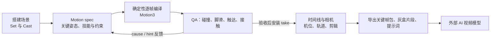
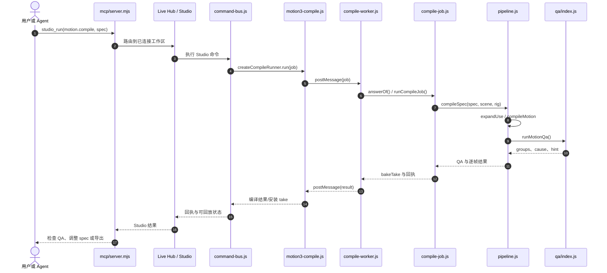

# CozyClay — Browser-Based 3D Previsualization / 浏览器端 3D 预演与 Agent 镜头编排

## 一句话定义

**CozyClay** 是 Doyun／NomaDamas 开源的 **浏览器端三维预演（Previsualization）工具**：先布置场景和角色动作、编排相机与剪辑，再导出关键帧、灰盒参考视频及提示词供外部 AI 视频模型使用；其默认动作流程是**确定性编译 + QA**，而非直接从文字生成机器人控制策略。

## 英文缩写速查

| 缩写 | 英文全称 | 简要说明 |
|---|---|---|
| Previs | Previsualization | 正式生成视频前的三维机位、角色与镜头预演 |
| MCP | Model Context Protocol | Claude、Cursor 等 Agent 驱动 Studio 的工具协议 |
| QA | Quality Assurance | 动作编译后对碰撞、脚滑、触达等问题分组检测 |
| OTIO | OpenTimelineIO | 时间线剪辑交换格式；项目支持导出 cut list |
| GLB | glTF Binary | 可导入的三维网格道具格式之一 |

## 为什么重要

- **把昂贵的 AI 视频重试前移：** 先以 3D 灰盒确定演员站位、运动、摄影机距离与切换时间，再交由视频模型补充外观与风格，减少只靠文字描述镜头导致的不确定性。
- **可编排的可控输入：** 角色姿态、相机、时间线与物体各有明确状态，Agent 可以观察、修改、获得回执并撤销编辑。
- **机器人展示中的位置：** 适合机器人任务演示、视觉分镜与教学视频的预演；**不提供**真实机器人的接触动力学、执行器约束或 Sim2Real 保证。

## 核心原理

| 阶段 | 输入与机制 | 产物 |
|---|---|---|
| Stage | 几何基元、GLB/OBJ/FBX 网格、rig 角色或胶囊占位角色 | 场景与对象位置 |
| Motion | Agent 提交 motion spec：key poses、walk/skills、anchors、props、contacts；`motion.compile` 编译逐帧 rig 姿态并运行 QA | 可回放的 take、`qa.groups`、诊断 cause/hint |
| Camera | 三维相机、焦距、机位、轨道与 cuts；`src/shot.js` 推导镜头词汇和 prompt | 可控镜头及时间线 |
| Export | 相机、首尾帧、灰盒参考、prompt 与附加渲染 pass | Keyframe pack、MP4、depth/normal、contact sheet、OTIO |
| AI video | 接收导出参考的**外部**视频生成模型 | 正式生成的视频（质量受下游模型约束） |

**动作编译 vs 生成：** `src/motion3/pipeline.js` 经 `compileMotion` + `runMotionQa` 检查 spec；默认关键帧/技能由确定性编译器求解。官方 Motion3 Guide 还定义**可选** `motion.fill` / MotionBricks 模型补间自由姿态过渡，不能把该可选路径说成 `motion.compile` 默认工作方式。

## 流程总览

## 源码运行时序图

对齐官方 `npx cozyclay` / `npx -y cozyclay mcp` 入口、`mcp/server.mjs`、`src/command-bus.js`、`src/commands/motion3-compile.js`、`src/motion3/compile-job.js`、`pipeline.js` 与 QA 实现。下图展示**已连接浏览器的 MCP 动作编译主路径**；离线 MCP 部分工具走内存模式，不能执行依赖 Studio 的编译。

关键文件：`src/commands/motion3-compile.js` 使用最多两个模块 Web Worker；无 Worker 或故障时回退主线程。`src/motion3/pipeline.js` 调用 `compileMotion`、`runMotionQa`，并将观测与 QA 结果返回给 `compile-job.js`；具体时间与性能数字只应在设备环境中复测，不推断实时机器人可用性。

## 工程实践

| 项目 | 官方方式 / 工程读法 |
|---|---|
| **启动** | Node.js 22.19+、Chromium；`npx cozyclay` 打开本地 `http://127.0.0.1:5180/app/` |
| **源码运行** | `git clone https://github.com/NomaDamas/CozyClay.git` → `npm install` → `npm run dev` |
| **MCP** | `npx -y cozyclay mcp`；工具可读场景、操作物体/相机、通过 `studio_run` 控制已连接 Studio |
| **CLI** | `cclay live status --wait` → inspect → 单步 edit → verify/capture；每步保留回执 |
| **动作 QA** | 先 `motion.compile`（可选 `install: false`）检查 `qa.groups`，调整 spec 后 `install: true`；人眼复看接触图 |
| **代码与许可** | 官方主仓已开源，`AGPL-3.0-or-later`；网络服务/分发有许可证义务，商用前核对 `LICENSING.md` |
| **与机器人栈衔接** | 可把生成的视觉预演素材用作展示/任务沟通；需要真实动力学时另在 MuJoCo/Isaac 仿真和控制器验证 |

## 局限与风险

- **不是物理仿真验证器：** QA 使用 rig 和几何代理判断动画缺陷，不能替代物理接触、稳定性、关节力矩、摩擦或闭环控制测试。
- **视频结果依赖外部模型：** 灰盒与 prompt 旨在提高构图一致性，不能保证模型严格服从。
- **功能有模式与连接限制：** 胶囊占位人物或 Storyboard 项目不可直接编译 rig 动作；部分 MCP 工具要求已连接浏览器。
- **环境与许可：** 官方要求 Chromium（不承诺 Safari/Firefox）、Node ≥22.19；许可为 AGPL，而非 MIT/Apache。
- **核验范围：** 已阅读官方主文档和关键运行源码，但**未在本环境实际启动项目、执行测试或验证生成质量**；源码可能在新版本变化。

## 关联页面

- [3D Gen Studio](./3dgenstudio.md) — ComfyUI 驱动的静态网格生产管线；CozyClay 的重点是分镜和动作预演。
- [Blender](./blender.md) — 更完整的 DCC 工作台，可衔接三维资产与动画制作。
- [ARDY](./ardy.md) — 学习式交互运动生成；与 CozyClay 确定性 Motion3 编译主路径不同。
- [ComfyUI](./comfyui.md) — 第三方生成式图像/网格管线，可用于视觉资产制作而非预演编排本身。

## 参考来源

- [官方代码与技术文档归档](../../sources/repos/cozyclay.md)
- [官方项目页归档](../../sources/sites/cozyclay-org.md)

## 推荐继续阅读

- [CozyClay 官方主页](https://cozyclay.org/)
- [官方 README（2026-11-07 版本）](https://github.com/NomaDamas/CozyClay/blob/6635fd56f4fa0c93c5ccf9a18cc85bf42823b2b9/README.md)
- [Motion3 Agent Guide](https://github.com/NomaDamas/CozyClay/blob/6635fd56f4fa0c93c5ccf9a18cc85bf42823b2b9/docs/motion3-agent-guide.md)
- [MCP Server 与 Live 接口](https://github.com/NomaDamas/CozyClay/blob/6635fd56f4fa0c93c5ccf9a18cc85bf42823b2b9/mcp/README.md)
