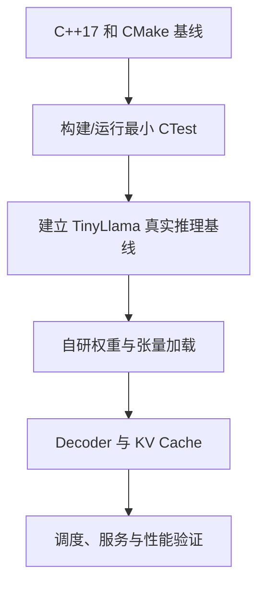
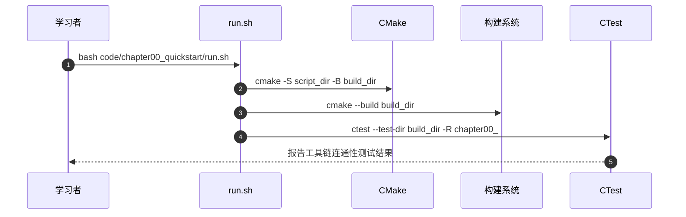

# cpp-llm-engine：从零构建 C++ LLM 推理引擎

## 一句话定义

这套课程从工具链与正确性开始，逐步构建 C++ LLM 推理引擎，覆盖真实模型、解码器与服务，并按 CPU 和 CUDA 条件选择实践。

## 英文缩写速查

| 缩写 | 英文全称 | 简要说明 |
|---|---|---|
| LLM | Large Language Model | 推理目标 |
| KV | Key-Value Cache | 自回归解码的注意力缓存 |
| CUDA | Compute Unified Device Architecture | NVIDIA GPU 加速后端 |
| CTest | CMake Test | 运行 CMake 工程测试的工具 |

## 为什么重要

推理引擎的速度取决于权重布局、内存管理、Attention/KV cache、请求调度和具体硬件；先对齐正确性再调性能，有助于区分教学代码与可生产交付的服务系统。

## 核心原理

官方 USAGE.md 给出最短路径：检查 C++17/CMake，运行 code/chapter00_quickstart/run.sh 确认工具链，再建立 llama.cpp/TinyLlama 基线，随后从自研张量加载器进入 decoder、KV cache 与服务。README 还给 Qwen3、MoE、MLA、多模态示例的支持边界。

### 课程/项目主线流程总览

## 源码运行时序图

以下是**核对过的代表性源码入口**，不代表全部示例运行或获得同等输出。

## 工程实践

已核对 code/chapter00_quickstart/run.sh：用临时构建目录执行 cmake -S / -B、cmake --build，再运行 ctest -R '^chapter00_'，退出时清理临时构建目录；这只是环境连通性而不是模型推理 benchmark。

## 局限与风险

章节真实模型需要事先下载权重；CUDA 分支需要兼容 GPU，教材的小型示例并不代表与成熟推理后端在正确性和吞吐上等价。

**原文通读范围：** 本节点以完整阅读过的官方 README 原文为主（配套内容有重点核验），不声称整本书或全部实验章节均逐篇精读。健康度描述的是知识节点的结构与已声明原文范围。

## 关联页面

- [gguf-quant-internals](./gguf-quant-internals.md) — 关联的工程知识或开源项目。
- [tensorrt-llm](./tensorrt-llm.md) — 关联的工程知识或开源项目。
- [nvidia-cuda](./nvidia-cuda.md) — 关联的工程知识或开源项目。

## 参考来源

- [官方入口文档通读记录](../../sources/repos/cpp-llm-engine-course-overview-read-20261113.md)
- [项目来源索引](../../sources/repos/cpp-llm-engine.md)
- [作者/维护者仓库](https://github.com/datawhalechina/cpp-llm-engine)

## 推荐继续阅读

- [官方原文入口](https://github.com/datawhalechina/cpp-llm-engine)
