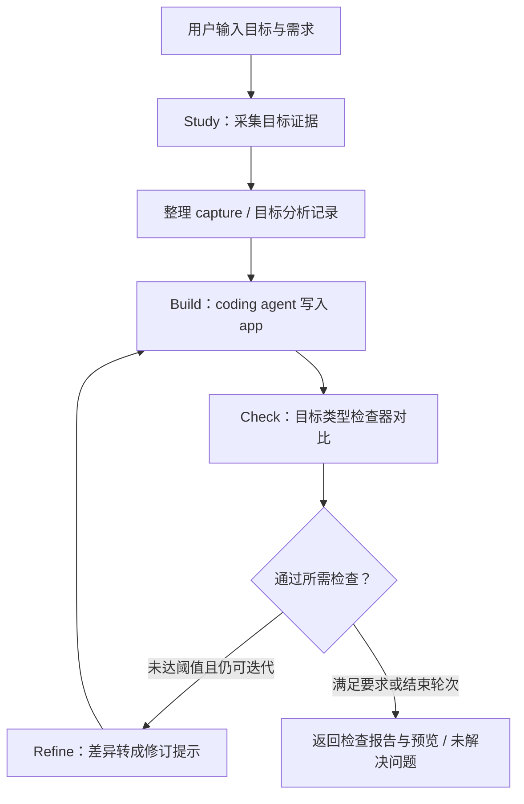
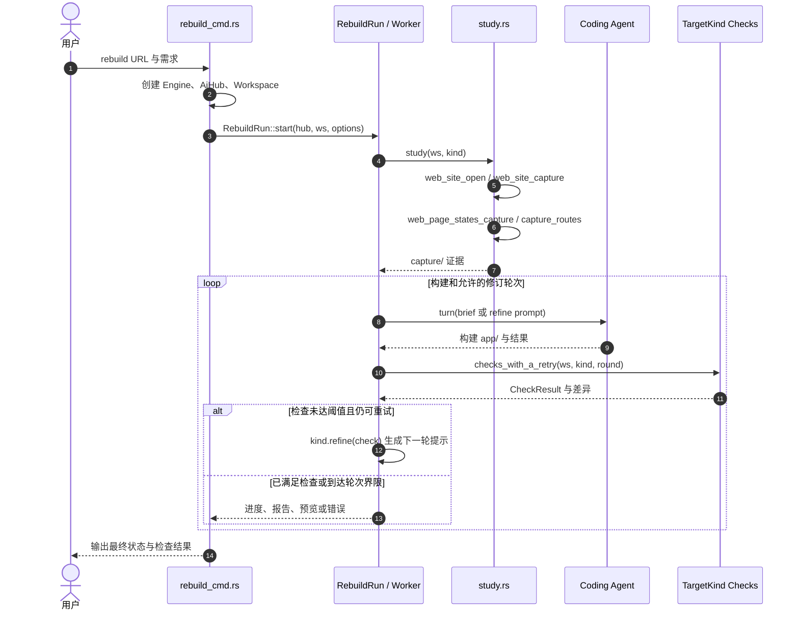

# Craft Anything：软件证据驱动的分析与重建

## 一句话定义

Craft Anything 是一套 Rust 开源工作台：对网站、应用或游戏采集可核对的证据，驱动 coding agent 创建独立实现，再按目标检查并迭代。它**不是**机器人仿真器或通用逆向结果真实性保证工具。

## 英文缩写速查

| 缩写 | 英文全称 | 简要说明 |
|------|----------|----------|
| CLI | Command-Line Interface | 不打开桌面 GUI 也可执行检查与重建 |
| MCP | Model Context Protocol | 将同一批工具开放给外部智能体 |
| ACP | Agent Client Protocol | 对接部分 coding agent 的通信协议 |
| UI | User Interface | 可观察的页面、控件和窗口行为 |

## 为什么重要

普通的“截图 + 提示词生成代码”缺少可追溯的输入证据和自动比较环节。Craft Anything 将 **目标检查、构建、外部检查与反馈** 放在持续循环里：哪些细节有证据、哪些环节未匹配、哪些操作要人工批准，都可单独审阅。

对机器人软件研发，它可以作为研究 **软件工具链的证据化复现与自动验收机制** 的参考；但官方没有证明它可复现控制算法、物理仿真或硬件实时性，不能替代 ROS / Sim2Real 的功能测试。

## 核心原理

| 环节 | 输入与模块 | 输出或判定 |
|------|------------|------------|
| Study | 网站 URL / 本地软件；`study.rs` 调用网站采集或本地目标检查工具 | `capture/` 内的页面截图、状态和目标分析笔记 |
| Build | 项目请求、`capture/`、后端 agent；`Worker::run` → `turn` | `app/` 中的新工程及 agent 记录 |
| Check | `kind.checks` 与 `checks_with_a_retry`，依据目标类型采用视觉、构建、运行等检查 | `checks/` 与 `CheckResult`，标明通过与差异 |
| Refine / Ready | `kind.refine(check)`、阈值、轮次、构建可用性 | 继续发指令修复，或给出预览及开放问题 |

**访问权限有两层，不能混淆：**

- **Clean room（默认）**：仅允许 `clean_room.rs` 白名单中的工具对原目标做外部观察；网站可采集可见布局、截图和交互状态，不读取原站源码/脚本/内部文件。
- **Deep**：允许深入源码、二进制、JS 和文件（Ghidra 为可选增强）。**两者都不构成对用户系统或 coding agent 的操作系统沙箱**；构建器的文件访问、命令执行仍取决于其权限与批准设置。

## 流程总览

依据[官方 README](https://github.com/storytold/craft-anything/blob/56aa31976b4ff0950e6b34ba020b0a568d2462fa/README.md)和实际 `rebuild` 主循环：

**注意：** 流程图是主干抽象；真实代码还处理失败重试、取消、补充指令、恢复会话、没有构建产物等边界。并非所有目标都能产生可比较的视觉分数。

## 源码运行时序图

已核对[CLI 入口](https://github.com/storytold/craft-anything/blob/56aa31976b4ff0950e6b34ba020b0a568d2462fa/apps/craft-anything-cli/src/rebuild_cmd.rs)、[主循环](https://github.com/storytold/craft-anything/blob/56aa31976b4ff0950e6b34ba020b0a568d2462fa/crates/ai/src/rebuild/mod.rs)和[Study 实现](https://github.com/storytold/craft-anything/blob/56aa31976b4ff0950e6b34ba020b0a568d2462fa/crates/ai/src/rebuild/study.rs)。以下以 **CLI 重建网站** 为例；网站采集里的浏览器工具可能有额外操作。

这张图展示的是已查证的运行路径，而非每个后端和目标类型都遵循完全相同的工具细节。

## 工程实践

1. **安装与检查环境**：官方要求 Rust ≥ 1.97；先以 `craft-anything-cli doctor` 确认工具链、builder 登录及引擎。
2. **命令行样例**：`craft-anything-cli rebuild https://example.com "Recreate this website"`；也可用 `craft-anything-cli mcp` 暴露工具。检查目标本身可不依赖 AI，生成新实现需要可用的 coding agent。
3. **检查证据**：重点看 `capture/`、`app/`、`checks/`、`investigation.cany/`、`craft.json`，明确每轮对比覆盖的页面、视口和可观察行为。
4. **不交出无限权限**：`--unattended` 会对审批请求默认拒绝；人工审核依赖安装与构建命令，尤其注意 npm 安装脚本和 Rust build scripts。
5. **机器人相关借鉴**：可学习“先捕获行为 → 构建 → 验证 → 记录差异”的方法，但若验证 ROS 节点、动力学或控制周期，必须自己增加相应测试，而不能以页面相似度替代。

## 局限与风险

- **成熟度**：官方明确标记 **early alpha**。网站多视口比对有实现；应用和游戏行为检查、部分后端和引擎能力仍不完整。Codex 适配器存在，但官方 README 说尚未在真实安装验证。
- **覆盖范围**：`CheckResult` 只反映配置过的检查器；“视觉相似/能构建”不能推出所有功能正确、安全或性能等价。
- **授权边界**：只检查有权分析的软件；不能将 MIT / Apache-2.0 自动解释为第三方商标、素材或目标应用的复制许可。
- **执行风险**：Clean room 不是 sandbox；运行外部安装命令、插件或 coding agent 仍有本机权限风险。
- **本次核查限制**：已通读主要原文 README，并按关键路径核对源码；**未安装运行或完成跨平台实测**，不对具体重建质量给出实证评分。

## 关联页面

- [Agentic Coding 软件工程基础](../concepts/agentic-coding-software-fundamentals.md)：开发智能体的流程与验证机制。
- [CodeGraph](./codegraph.md)：源码符号关系与分析工具的不同侧重点。

## 参考来源

- [官方资料与源码核查归档](../../sources/repos/storytold-craft-anything.md)
- [官方 README（固定版本）](https://github.com/storytold/craft-anything/blob/56aa31976b4ff0950e6b34ba020b0a568d2462fa/README.md)
- [官方 STATUS（功能完成度与验证范围）](https://github.com/storytold/craft-anything/blob/56aa31976b4ff0950e6b34ba020b0a568d2462fa/docs/STATUS.md)

## 推荐继续阅读

- [官方架构与开发规范 AGENTS.md](https://github.com/storytold/craft-anything/blob/56aa31976b4ff0950e6b34ba020b0a568d2462fa/AGENTS.md)
- [官方 Claude Code 使用说明](https://github.com/storytold/craft-anything/blob/56aa31976b4ff0950e6b34ba020b0a568d2462fa/docs/claude-code.md)
