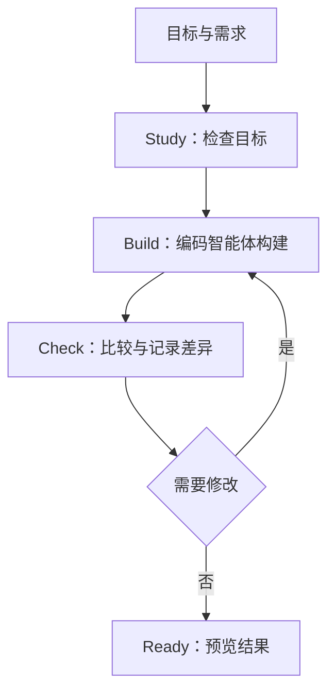
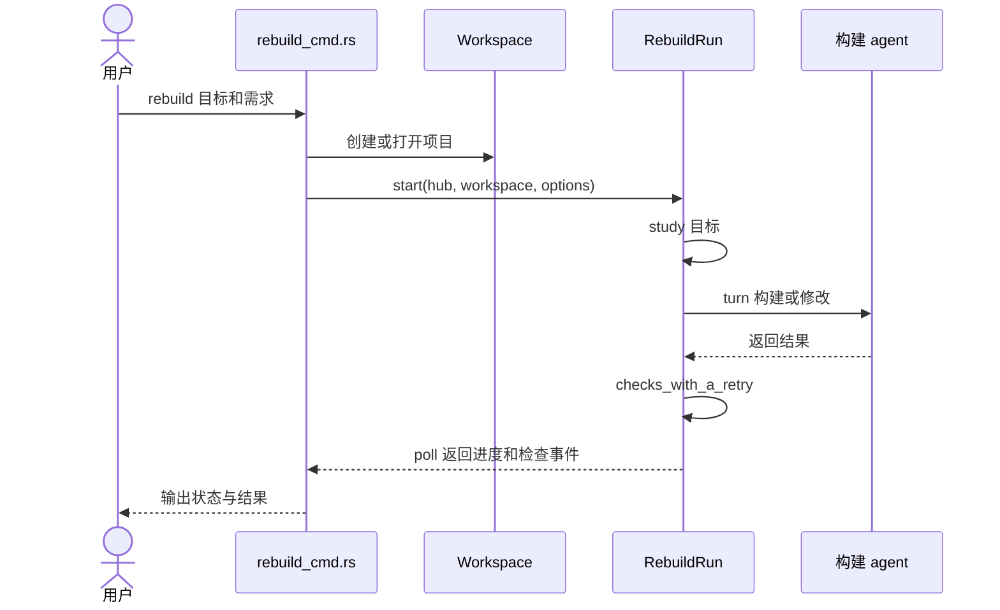

# Craft Anything：软件分析与重建工具

## 一句话定义

Craft Anything 是开源 Rust 工具，面向网站、应用和游戏，组织目标检查、coding agent 构建与结果比较。

## 英文缩写速查

| 缩写 | 英文全称 | 简要说明 |
|------|----------|----------|
| CLI | Command-Line Interface | 命令行入口 |
| MCP | Model Context Protocol | 向 agent 提供工具的协议 |
| ACP | Agent Client Protocol | 对接部分 coding agent 的协议 |

## 流程总览

基于[官方 README](https://github.com/storytold/craft-anything/blob/5430c5a7c647439e42305d3780686847e61bb789/README.md)：

默认 Clean room 使用访客可见的信息，不读取源代码、页面源码或内部文件；Deep 模式可使用内部分析工具。CLI 与 MCP 暴露工具，检查本身不要求 AI，但重建需要配置构建后端。

## 源码运行时序图

以下只覆盖已核查的 CLI 主干，不代表所有目标类型的内部实现：

入口见 [rebuild_cmd.rs](https://github.com/storytold/craft-anything/blob/5430c5a7c647439e42305d3780686847e61bb789/apps/craft-anything-cli/src/rebuild_cmd.rs)，主循环见 [rebuild/mod.rs](https://github.com/storytold/craft-anything/blob/5430c5a7c647439e42305d3780686847e61bb789/crates/ai/src/rebuild/mod.rs)。检查后可根据条件继续修改；此图省略分支、异步事件和具体检查器。

## 工程实践与局限

- 源码公开，README 提供桌面端、CLI 与 MCP 运行入口；从源码构建要求 Rust 1.97 或以上。
- 官方将其标为 early alpha。网站检查包含多视口比较；应用和游戏的行为检查仍有未完成部分。Codex 适配器存在但 README 称尚未在真实安装中验证。
- 官方建议仅分析有权检查的软件；Clean room 与 Deep 的数据访问范围不同。比较分数是工具对选定指标的检查结果，不等于完整功能正确性。
- 本次尚未实机运行，也未逐项核查各类型捕获与检查实现；机器人软件的适用性需另行验证。

## 关联页面

- [Agentic Coding 软件工程基础](../concepts/agentic-coding-software-fundamentals.md) — 编码 agent 的工程约束与验证。
- [CodeGraph](./codegraph.md) — 侧重源码符号关系和影响范围检索。

## 参考来源

- [仓库资料归档](../../sources/repos/storytold-craft-anything.md)
- [官方状态说明](https://github.com/storytold/craft-anything/blob/5430c5a7c647439e42305d3780686847e61bb789/docs/STATUS.md)

## 推荐继续阅读

- [官方 README](https://github.com/storytold/craft-anything/blob/5430c5a7c647439e42305d3780686847e61bb789/README.md)
