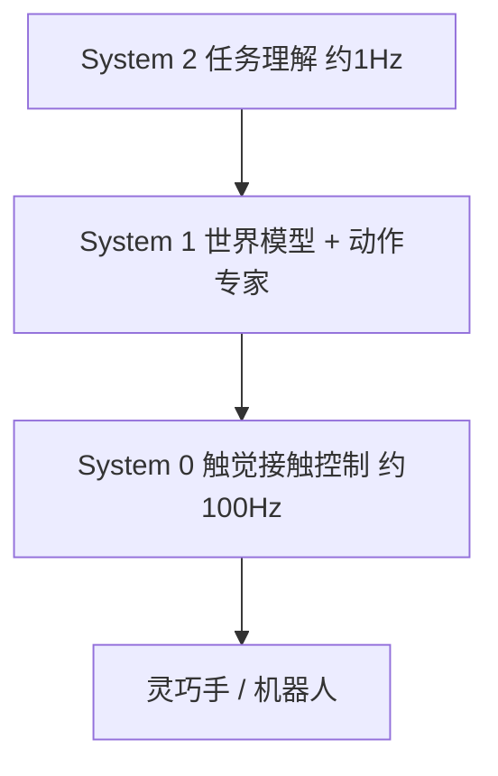

# CraftNet：Sharpa 的分层视觉-触觉-语言-动作模型

## 一句话定义

**CraftNet** 是 Sharpa 的端到端分层 VTLA 模型，按“System 0 触觉交互 / System 1 运动”分工，把“最后一毫米”的接触交给高频底层。

## 英文缩写速查

| 缩写 | 英文全称 | 简要说明 |
|------|----------|----------|
| VTLA | Vision-Tactile-Language-Action | 视觉-触觉-语言-动作 |
| System 0/1/2 | — | 交互 / 运动 / 任务理解三层（System 2 仅见于天南文章） |
| WM | World Model | System 1 内的世界模型（文章表述） |

## 两种来源的说法

| 层 | 官方新闻稿（2026-01-19） | 天南文章 |
|----|--------------------------|----------|
| System 2 | 未提及 | 约 1 Hz，理解任务与规划 |
| System 1 | Motion Brain | 约 2 Hz 世界模型 + 约 10 Hz 动作专家 |
| System 0 | Interaction Brain | 约 100 Hz 高频触觉接触控制 |

天南称 CraftNet 公开于 2026-01-07，早于 Helix 02（2026-01-27）20 天；新闻稿日期为 01-19，二者不矛盾但 01-07 的发布出处本库未核到。

## 为什么重要

- 文章称“三层架构基本成了圈子里的共识”（作者判断）。
- 使“模型侧 debate”不必二选一：System 1 可换成世界模型或多模态生成模型，接触交给 System 0。

## 流程总览

## 工程实践

| 项 | 状态 |
|----|------|
| 论文 / 代码 / 权重 | **均未发布**；第三方列表标 proprietary；新闻稿称“分阶段分享更新” |
| 源码运行时序图 | **不适用**（无可运行实现） |
| 演示 | CES 2026 North 人形：拍照、乒乓、风车组装（30+ 连续步骤）、发牌；新闻稿未逐项归因于 CraftNet |

## 结论

**CraftNet 是已公开架构叙事、未公开技术细节的闭源模型。**

- 可靠事实：分层、VTLA、System 0/1 分工、CES 演示。
- System 2 与各层频率仅来自天南文章转述。
- 与 [WM-CraftNet](./paper-wm-craftnet.md)（arXiv 2609.07002）是不同项目，勿合并。

## 常见误区与局限

- 把 WM-CraftNet 论文当作 CraftNet 的技术报告是错误的。
- 演示成功不等于模型指标，无基准公开。

## 关联页面

- [Sharpa Robotics](./sharpa-robotics.md)
- [WM-CraftNet](./paper-wm-craftnet.md) — 不同项目，名称相近
- [TacBPM](./paper-tacbpm.md) — System 0 方向的底层行为先验
- [VLA](../methods/vla.md)
- [Sharpa 学术路线三条主线（阅读坐标）](../overview/sharpa-academic-route-three-lines.md)

## 参考来源

- [CraftNet CES 2026 新闻稿归档](../../sources/sites/sharpa-craftnet-ces-2026.md)
- [天南具身公园：Sharpa 学术路线](../../sources/blogs/wechat_tiannan_sharpa_academic_route_2026-10-22.md)

## 推荐继续阅读

- [新闻稿原文](https://technode.global/prnasia/sharpa-aims-to-manufacture-time-via-its-craftnet-vtla-model-and-stuns-ces-2026-with-live-autonomous-demos-for-fine-manipulation/)
