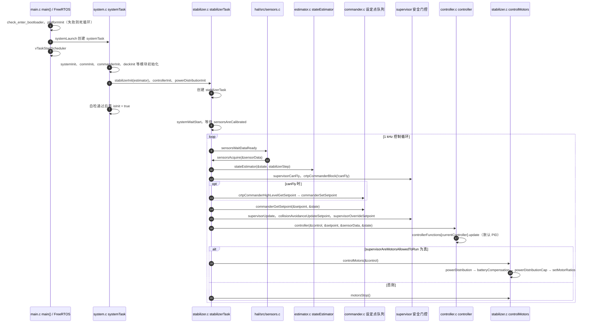

# Crazyflie Firmware

**crazyflie-firmware**（[bitcraze/crazyflie-firmware](https://github.com/bitcraze/crazyflie-firmware)）是 **Bitcraze** 微四轴平台的 **机载实时固件**，与 [PX4](./px4-autopilot.md) 同属「飞控层」但面向 **27g 级微机体** 与 **CRTP** 生态。

## 英文缩写速查

| 缩写 | 英文全称 | 简要说明 |
|------|----------|----------|
| IMU | Inertial Measurement Unit | 惯性测量单元，提供加速度与角速度 |

## 为什么重要

- **群体飞行硬件底座**：[Crazyswarm2](./crazyswarm2.md) 依赖本固件 + cflib 上位机。
- **教学与研究友好**：成本低、风险可控，适合控制与 swarm 算法入门。
- [gym-pybullet-drones](./gym-pybullet-drones.md) 提供 **Crazyflie 尺度** 动力学选项，可与真机对照。

## 核心结构/机制

| 模块 | 说明 |
|------|------|
| **传感器融合** | IMU、气压计；外接定位甲板 |
| **控制** | 姿态/速率 PID，电机混控 |
| **CRTP** | 与 PC/机载计算机的轻量协议 |
| **Deck 驱动** | Lighthouse、Loco、OptiTrack 等扩展 |
| **参数/日志** | 在线调参与飞行日志 |

上位机常用 **cfclient**、**cflib**（Python）发送设定点或高层命令。

## 常见误区或局限

- **误区：Crazyflie = PX4 小飞机** — 协议、算力、任务模式完全不同，勿混用工具链。
- **局限：室外长航程** — 微型机体受风与续航限制大。
- **局限：重载操作** — 不适合工业级载荷与人机协作臂。

## 源码运行时序图

入口：MCU 复位后执行 `src/init/main.c` 的 `main()`，经 FreeRTOS 调度 `systemTask`，再由 `stabilizerInit` 创建 1 kHz 的 `stabilizerTask`（固件由仓库根目录 Makefile 构建，烧录与上位机 cfclient/cflib 不在图内）。

图依据：crazyflie-firmware@e828ed2，实际读过 src/init/main.c（main 段）、src/modules/src/system.c（systemLaunch、systemInit、systemTask、systemWaitStart 段）、src/modules/src/stabilizer.c（stabilizerInit、stabilizerTask 主循环、controlMotors 段）、src/hal/src/sensors.c（sensorsWaitDataReady、sensorsAreCalibrated 段）、src/modules/src/controller/controller.c（controller 分发与 ControllerTypeAutoSelect 段）、src/modules/src/estimator/estimator.c（stateEstimator 分发段）、src/modules/src/commander.c（commanderGetSetpoint 段）；CRTP 接收侧（commander 设定点如何入队）、supervisor、power_distribution_quadrotor.c 的具体实现与 motors 驱动均未读，只按 stabilizer.c 的调用名画出。

## 参考来源

- [sources/repos/crazyflie_firmware.md](../../sources/repos/crazyflie_firmware.md)
- [bitcraze/crazyflie-firmware](https://github.com/bitcraze/crazyflie-firmware)

- 源码核对（2026-11-02）：bitcraze/crazyflie-firmware@e828ed2，读过 src/init/main.c、src/modules/src/system.c、src/modules/src/stabilizer.c、src/hal/src/sensors.c、src/modules/src/controller/controller.c、src/modules/src/estimator/estimator.c、src/modules/src/commander.c；时序图依据以上文件，未运行代码。

## 关联页面

- [多旋翼栈总览](../overview/multirotor-simulation-planning-control-stack.md)
- [Crazyswarm2](./crazyswarm2.md)
- [PX4 Autopilot](./px4-autopilot.md)（标准多旋翼飞控对照）
- [Project Quiver](./project-quiver.md) — 25 kg 户外机架对照（不是微四轴）

## 推荐继续阅读

- [Bitcraze 官方文档](https://www.bitcraze.io/documentation/)
