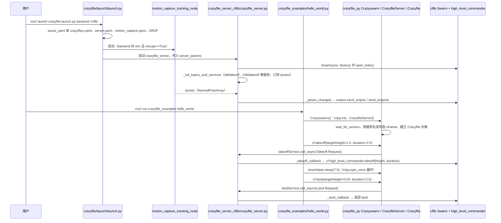

---

type: entity
tags: [repo, swarm, crazyflie, ros2, motion-capture, multirotor, bitcraze]
status: complete
updated: 2026-09-16
related:
  - ../overview/multirotor-simulation-planning-control-stack.md
  - ./crazyflie-firmware.md
  - ./gym-pybullet-drones.md
  - ./quad-swarm-rl.md
  - ./ego-planner-swarm.md
sources:
  - ../../sources/repos/crazyswarm2.md
summary: "Crazyswarm2 是 IMRCLab 的 ROS2 大规模 Crazyflie 群体框架：动捕/UWB 定位、轨迹上传与碰撞避免，用于室内多机编队与灯光秀实验。"
---

# Crazyswarm2

**Crazyswarm2**（[IMRCLab/crazyswarm2](https://github.com/IMRCLab/crazyswarm2)）在 **[Crazyflie 固件](./crazyflie-firmware.md)** 之上提供 **数十至上百架微四轴** 的同步起飞、轨迹执行与编队能力（ROS2 重写版 Crazyswarm）。

## 英文缩写速查

| 缩写 | 英文全称 | 简要说明 |
|------|----------|----------|
| ROS 2 | Robot Operating System 2 | 机器人系统集成与通信的常用中间件 |

## 为什么重要

- **真机 swarm 标杆**（微四轴尺度）：与 [EGO-Planner Swarm](./ego-planner-swarm.md)（标准多旋翼 + PX4）形成 **平台尺度对照**。
- 依赖 **动作捕捉 / Lighthouse / UWB** 等 **室内全局定位**，是理解「swarm 先解决定位再谈编队」的典型案例。
- 仿真侧可先用 [gym-pybullet-drones](./gym-pybullet-drones.md) 或 [quad-swarm-rl](./quad-swarm-rl.md)，再迁移到本框架。

## 核心结构/机制

- **ROS2** 节点：广播、轨迹服务、状态监控  
- **Python 脚本**：编队几何、起飞序列、灯光模式  
- **机载**：Crazyflie + 定位甲板（Lighthouse 等）  
- **安全**：简化碰撞模型 + 操作规范（仍以现场规程为准）  

## 常见误区或局限

- **误区：可户外 GPS 大编队** — 设计目标是 **室内定位** 场景。
- **局限：载荷与续航** — 微四轴不适合重载任务。
- **局限：与 PX4 栈不互通** — 控制链为 CRTP + Bitcraze 生态，非 MAVLink 多旋翼。

## 源码运行时序图

入口（两个终端）：`ros2 launch crazyflie launch.py backend:=cflib`（`backend` 默认 `cpp`，可选 `cflib` / `sim`；`mocap` 默认 `True`），然后 `ros2 run crazyflie_examples hello_world`（`crazyflie_examples/setup.py` 注册为 `crazyflie_examples.hello_world:main`）。下图以 `cflib` 后端为例；默认的 `cpp` 后端同样提供这些服务，但其底层 `crazyflie_server_cpp/deps/crazyflie_tools` 是 git 子模块，浅克隆中为空，未读。

图依据：IMRCLab/crazyswarm2@5660d95，读过 README.md、crazyflie/launch/launch.py、crazyflie_examples/crazyflie_examples/hello_world.py 与 setup.py、crazyflie_py/crazyflie_py/crazyswarm_py.py 与 crazyflie.py（TimeHelper、Crazyflie.takeoff、CrazyflieServer.__init__）、crazyflie_server_cflib/crazyflie_server_cflib/crazyflie_server.py（_takeoff_callback、_poses_changed 及 Swarm 初始化行）、crazyflie_server_cpp/src/crazyflie_server.cpp（仅 takeoff 服务与 poses 订阅处）。

## 参考来源

- [sources/repos/crazyswarm2.md](../../sources/repos/crazyswarm2.md)
- [IMRCLab/crazyswarm2](https://github.com/IMRCLab/crazyswarm2)
- 源码核对（2026-11-02）：IMRCLab/crazyswarm2@5660d95，读过 README.md、crazyflie/launch/launch.py、crazyflie_examples/hello_world.py、crazyflie_py/{crazyswarm_py,crazyflie}.py、crazyflie_server_cflib/crazyflie_server.py（部分）、crazyflie_server_cpp/src/crazyflie_server.cpp（部分）；cpp 后端的 crazyflie_tools 子模块未读；时序图依据以上文件，未运行代码。

## 关联页面

- [多旋翼栈总览](../overview/multirotor-simulation-planning-control-stack.md)
- [Crazyflie Firmware](./crazyflie-firmware.md)
- [gym-pybullet-drones](./gym-pybullet-drones.md)

## 推荐继续阅读

- [Crazyswarm 文档](https://crazyswarm.readthedocs.io/) — 概念与硬件清单（v2 见仓库 README）
