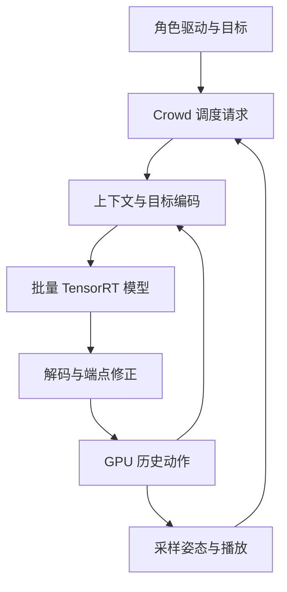
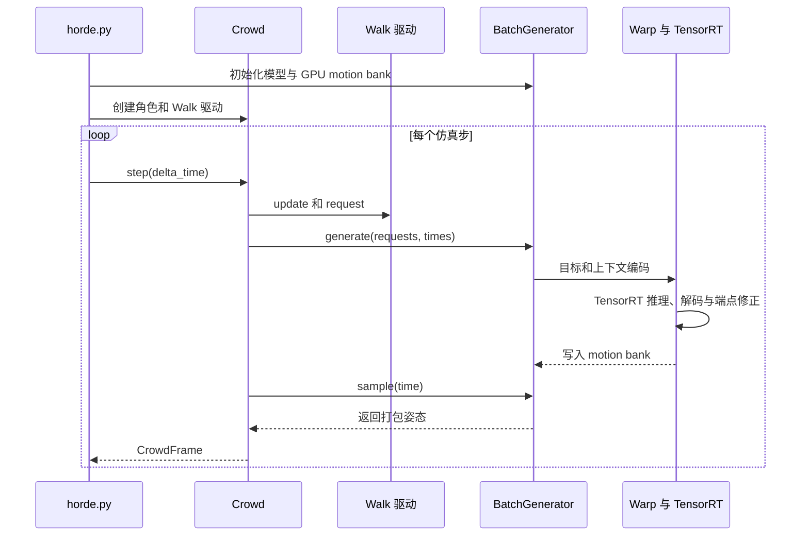

# CrowdBricks：批量实时角色运动生成

| 项目 | 信息 |
|------|------|
| 机构 | 帕奇团队（Patch） |

## 一句话定义

CrowdBricks 是 Patch 的第三方运行时，将 MotionBricks 的 SOMA 人体运动生成请求合批，用于多角色动画；它输出运动学姿态，不是机器人闭环控制器。

## 英文缩写速查

| 缩写 | 英文全称 | 简要说明 |
|------|----------|----------|
| GPU | Graphics Processing Unit | 执行批量推理和 Warp kernel |
| ONNX | Open Neural Network Exchange | 上游模型交换格式 |
| FP16 | 16-bit floating point | 基准所用半精度 |
| IK | Inverse Kinematics | 上游用于接触目标的逆运动学 |

## 流程总览

每次生成使用最近四帧上下文和一至四个目标姿态。步态库提供行走、跑步及风格；Smart Primitives 支持跨越、跳跃、低头和坐下。`fork` 复制角色状态及已有动作，使多个未来从同一历史分叉。默认 0.15 秒 lookahead 用来积攒批次；紧急请求或批次已满时执行，交互驱动按精确转场时刻生成。

## 源码运行时序图

以 [`examples/horde.py`](https://github.com/patch-gg/crowdbricks/blob/bf8f682affe1e2637ba64fbe333aa51cf772ee85/examples/horde.py) 为入口，调用关系核对自同版本 `crowd.py` 和 `batch.py`：

生成只在请求紧急或批次已满时触发，并非每一步都会推理；`sample` 将打包姿态返回 CPU。完整生成动作及上下文保存在 GPU，不能推断整个应用无 CPU 数据传输。

## 性能与验证

作者在 RTX 4090、FP16、50 次测量中位数下，对站立到跑步的完整生成报告：单请求上游 2.57 ms wall、389 次/秒；批量 48 个请求为 4.66 ms wall、10,307 次/秒，约 26.5 倍吞吐。每次生成是一段动作，不是一个动画帧。另一个 192 角色示例报告 60 Hz 步进、215 次生成/秒；场景与基准不同，不应混同。

上游对照测试中，batch 1 FP32 的根位置误差为 11 微米，关节在 0.1 度比较精度内；FP16 对离散 token 选择敏感，不能保证逐帧完全一致。以上均为作者报告，尚未独立复测。

## 工程实践与局限

- 需要 NVIDIA GPU 和单独的 MotionBricks checkout，首次按批量大小及精度构建 TensorRT plan；README 提供 `examples/futures.py`、`examples/horde.py` 和浏览器 viewer 的运行步骤。
- 当前路径使用 SOMA 人体骨架；不能据此声称支持 G1 批量机器人控制。输出需要下游跟踪和安全控制才能用于物理机器人。
- 未实现上游手脚 IK 固定、idle/坐姿片段播放和输入弹簧平滑；跨越时手可能偏离墙面。
- CrowdBricks 代码采用 Apache-2.0，但上游模型、骨架和示例动作各自许可不同；发布应用前需核对资产条款。

## 关联页面

- [MotionBricks 论文](./paper-motionbricks.md) — 上游模型与原始研究。
- [motion-bricks.cpp](./motion-bricks-cpp.md) — 另一独立运行时，侧重 G1 与 CPU/Vulkan。
- [MotionBricks 方法](../methods/motionbricks.md) — 上游方法背景。

## 参考来源

- [CrowdBricks 原始资料归档](../../sources/repos/crowdbricks.md)

## 推荐继续阅读

- [CrowdBricks 仓库及 README](https://github.com/patch-gg/crowdbricks)
- [NVIDIA MotionBricks 官方仓库](https://github.com/NVlabs/motionbricks)
