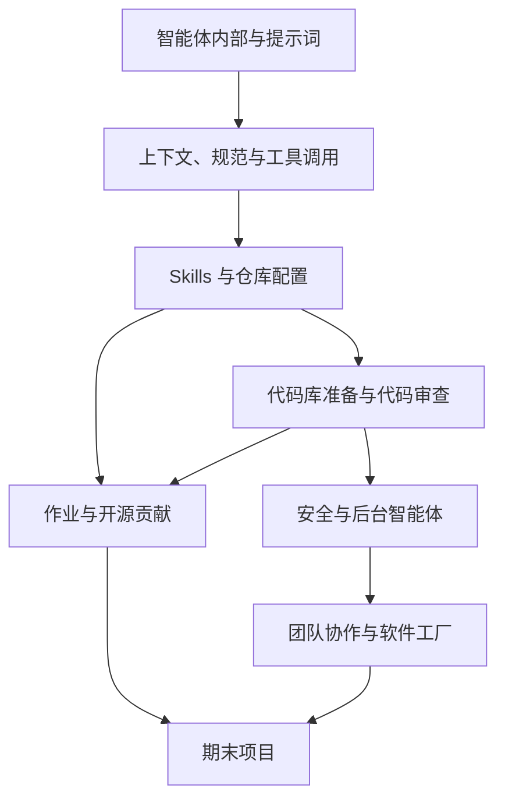

# CS146S：The Modern Software Developer

**CS146S** 是斯坦福大学一门讨论 AI 原生软件开发的课程；2026 秋季版本结合讲课、实操作业、开源贡献与期末项目，关注人和 coding agent 如何协作构建软件。

## 英文缩写速查

| 缩写 | 英文全称 | 简要说明 |
|------|----------|----------|
| LLM | Large Language Model | 课程讨论的编程智能体基础模型 |
| MCP | Model Context Protocol | 课程中的工具调用与服务端主题 |
| CLI | Command-Line Interface | 第三周课程主题之一 |
| OSS | Open Source Software | 课程要求的开源贡献 |

## 课程路径

下图表达官方日历中的学习主题关系，是课程安排的归纳，不代表具体智能体的内部实现。

课程依次涉及智能体设计、上下文工程、MCP、skills、仓库规范与 hooks、代码审查、安全、后台智能体和团队级模型路由。实际作业包括构建 MCP server、编写 skill、整理仓库和撰写 agent readiness 报告。

## 工程学习价值

- 用仓库结构、文档和自动检查降低智能体理解与修改代码的成本，可对照本仓库的 [agentic coding 基础](../concepts/agentic-coding-software-fundamentals.md)。
- 将需求转为可执行规格是课程强调的主题之一，可结合 [规范驱动开发](../concepts/specification-driven-development.md) 实践。
- 课程强调工具、上下文与人机协作；日历本身不提供具体实现或效果数据，不能据此推断效率提升。

## 核查范围与局限

本页基于 2026 秋季主页及官方日历，不是逐讲笔记；讲义、作业细节和课程源码尚未全部获取。主页未列出该学期课程代码仓库，开放状态及可运行入口待核实，因此源码运行时序图暂无法绘制。

## 关联页面

- [Agentic Coding 软件基础](../concepts/agentic-coding-software-fundamentals.md)
- [规范驱动开发](../concepts/specification-driven-development.md)

## 参考来源

- [课程主页与日历归档](../../sources/courses/cs146s-modern-software-developer.md)

## 推荐继续阅读

- [课程主页](https://themodernsoftware.dev/)
- [2026 秋季课程日历](https://docs.google.com/document/d/1W11sWBigWIsi9wVIhhFx3wajIEnP0Qfb-ei8Ecf5VKU/edit?usp=sharing)
