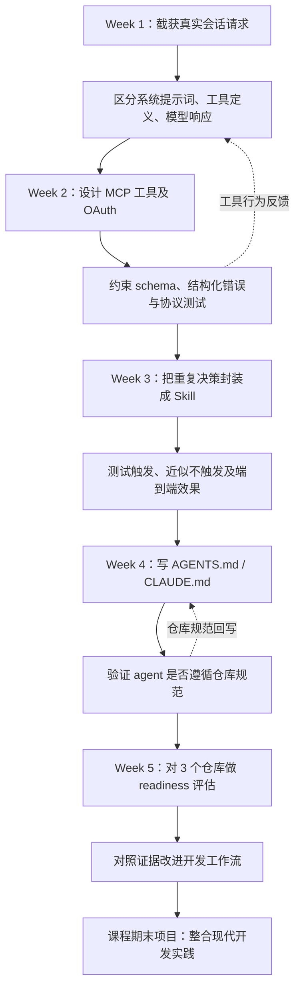

# 斯坦福 CS146S：现代软件开发者 / The Modern Software Developer

## 一句话定义

**CS146S: The Modern Software Developer** 是 Stanford University 的 AI 原生软件工程课程；2026 秋季版本以 coding agent、MCP、Agent Skills、规范驱动开发和软件工厂为主线，让开发者在真实仓库上练习**可观察、可约束、可评估**的人机协作，而不只是让模型生成代码。

## 英文缩写速查

| 缩写 | 英文全称 | 简要说明 |
|---|---|---|
| LLM | Large Language Model | 驱动编程智能体的基础模型 |
| MCP | Model Context Protocol | 将外部 API 和资源暴露为可调用工具的协议 |
| CLI | Command-Line Interface | Claude Code、Droid 等命令行工具的使用形式 |
| OAuth | Open Authorization | Week 2 第三方 API 授权与令牌管理 |
| OSS | Open Source Software | Week 3–5 练习选择的开源代码库 |

## 为什么重要

传统 AI 辅助编程关注代码生成；课程实践将问题延伸到**智能体究竟看到了什么、工具如何防误用、知识如何在仓库中沉淀、如何量化代码库对智能体的友好程度**。官方课程描述还覆盖 loop engineering、软件工厂及团队协作，但不提供固定倍数的生产力提升验证。

工程学习的关键变化是：以请求轨迹、可执行测试和真实任务记录替代“模型似乎做对了”的主观评价；将工具契约、仓库上下文和安全边界作为系统的一部分设计。

## 核心机制与流程总览

下面根据**官网课程目标和公开 Week 1–5 作业**归纳学习路径，箭头表示由观察智能体到设计、验证工作流的知识递进，**不是官方声称的每周任务运行依赖图，也不是某个 agent 的真实内部架构**。

### 五项关键判断

1. **观测与推断分开：** Week 1 要基于实际 HTTP 请求和工具调用编号，把行为结论标成 `[OBSERVED]` 或 `[INFERRED]`。
2. **工具接口先于提示词：** Week 2 要把参数约束写入 schema、裁剪返回值，并通过 MCP 协议测试可调用性；对不可逆写操作增加 `dry_run` 或预览确认。
3. **Skill 不等于脚本别名：** Week 3 要包含需要判断的分支，且验证“应该触发”和“近似但不应该触发”两类输入。
4. **仓库上下文必须可执行：** Week 4 的 AGENTS.md / CLAUDE.md 需要真实的目录结构、构建测试命令、约定及禁改范围，而不是通用口号。
5. **评估证据不能过度外推：** Week 5 对三个不同仓库比较成熟度、八大维度和具体失败项，明确小样本的适用边界。

## 工程实践

已公开的教师作业仓库提供 Week 1–5 的说明及对应 `writeup.md` 模板，**不是已填写的学生结果，也不是五套可直接运行的参考实现**。

| 阶段 | 实践任务 | 建议验收依据 |
|---|---|---|
| Week 1：[会话轨迹分析](https://github.com/mihail911/modern-software-dev-assignments/blob/master/week1/assignment.md) | 在自己的临时仓库上用 mitmproxy 捕获 Claude Code 请求，分析 system、tools、messages 和错误恢复 | 多文件改动、至少一次失败、可追溯的计划与脱敏后的证据 |
| Week 2：[MCP Server](https://github.com/mihail911/modern-software-dev-assignments/blob/master/week2/assignment.md) | 使用 FastMCP 封装真实 OAuth API，设计至少三个可组合工具及写操作 | 令牌刷新、最小权限、协议级测试、一次串联调用和错误处理记录 |
| Week 3：[Agent Skill](https://github.com/mihail911/modern-software-dev-assignments/blob/master/week3/assignment.md) | 编写 `SKILL.md`，将带判断条件的重复流程沉淀下来 | 三条命中、一条近似未命中及一次完整运行 |
| Week 4：[仓库 Agent Ready](https://github.com/mihail911/modern-software-dev-assignments/blob/master/week4/assignment.md) | 为陌生 OSS 仓库编写 AGENTS.md 或 CLAUDE.md | 精确的构建/测试命令、边界说明及两次实际任务观察 |
| Week 5：[成熟度对比](https://github.com/mihail911/modern-software-dev-assignments/blob/master/week5/assignment.md) | 用 Factory Droid `/readiness-report` 对三个代码库评估 | 原始输出、维度对比、优先修复项和可解释的限制 |

**环境入口：** 作业 [README](https://github.com/mihail911/modern-software-dev-assignments/blob/master/README.md) 建议 Python 3.12、Conda 环境，安装 Poetry 后在仓库根目录运行 `poetry install --no-interaction`。它是**作业环境初始化**，不是某个已实现的 MCP 服务启动命令。

**可迁移到机器人软件仓库的做法：** 在本仓库或 ROS 2 项目中，可先用 Week 4 方法核实 `build / test / lint` 命令并写入 AGENTS.md，再用 Week 3 将重复的 PR 检查、复现步骤或文档核验封装成 Skill；这些是基于课程任务的工程应用建议，**不是官方课程提供的机器人实验结果**。

## 局限与风险

- **核验边界：** 已通读官网公开 Overview，以及教师作业仓库 README、Week 1–5 的作业说明与 writeup 模板、依赖定义；**没有声称通读整学期讲义、全部录像及非公开作业**。先前存档的课程日历提供后续主题线索，具体时间以官网实时材料为准。
- **开放范围：** 官方作业仓库目前公开的是作业文本和环境依赖；Week 1–5 目录中未见完整的可运行参考 MCP 服务、Skill 或软件工厂实现。因此**不绘制源码运行时序图**，以免把题目中的设计要求伪装成已核对的实际调用链。
- **敏感信息：** Week 1 的会话捕获可能包含源码、个人路径、API 密钥及令牌，不可提交原始 flows；Week 2 的 OAuth 写工具需最小权限、预览/确认和测试资源。
- **效果边界：** Week 5 是三仓库对比作业，不等于课程或工具在真实生产环境中的普遍效果统计。

## 关联页面

- [Agentic Coding 软件基础](../concepts/agentic-coding-software-fundamentals.md) — 智能体研发的上下文、测试和工程约束
- [规范驱动开发](../concepts/specification-driven-development.md) — 把需求转为可验证的任务描述

## 参考来源

- [本仓库一手资料核读与核验范围](../../sources/courses/cs146s-modern-software-developer.md) — 官网全文、前五周作业及模板的逐项梳理
- [Stanford CS146S 官方课程目录](https://bulletin.stanford.edu/courses/2274401) — 课程身份与总体定位

## 推荐继续阅读

- [CS146S 官方课程主页（Fall 2026）](https://themodernsoftware.dev/)
- [教师维护的课程作业仓库（Fall 2026）](https://github.com/mihail911/modern-software-dev-assignments)
- [2026 秋季课程日历（Google Docs）](https://docs.google.com/document/d/1W11sWBigWIsi9wVIhhFx3wajIEnP0Qfb-ei8Ecf5VKU/edit?usp=sharing)
