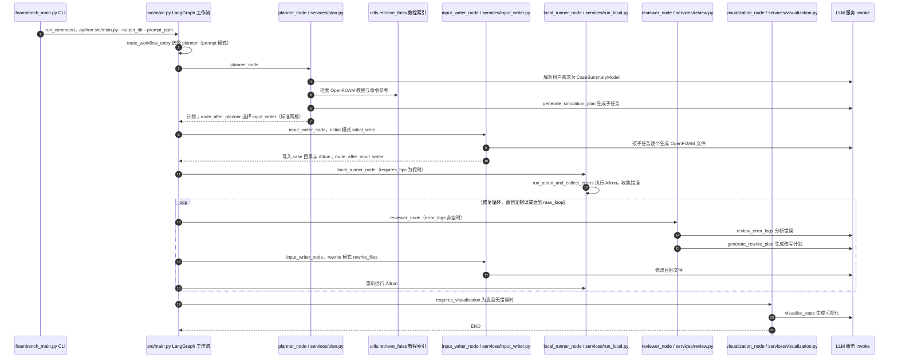

# Foam-Agent（csml-rpi/Foam-Agent）

## 一句话定义

Foam-Agent（csml-rpi/Foam-Agent）是多智能体 CFD 工作流框架（文章指出发表于 CMAME），不是单个 SKILL.md。

## 英文缩写速查

| 缩写 | 英文全称 | 简要说明 |
|------|----------|----------|
| CFD | Computational Fluid Dynamics | 计算流体力学计算流程 |
| MCP | Model Context Protocol | 让代理发现并调用外部工具的协议 |
| y+ | Dimensionless Wall Distance | 壁面网格分辨率相关的无量纲距离 |

## 为什么重要

对 CAE 自动化而言，代理能否稳定完成任务，取决于工程步骤是否清楚、工具边界是否明确、结果是否保留可审查证据。多智能体 CFD 工作流框架（文章指出发表于 CMAME），不是单个 SKILL.md；适合参考如何把网格、求解、结果解释拆成协作角色。

## 核心原理

**项目自身范围：** Multi-agent framework for automating computational fluid dynamics workflows.

**工作流：** 由多个语言模型代理围绕 CFD 工作阶段协作，将任务拆分后与仿真工具链交互。

## 工程实践

1. 从目标问题识别所需的 Skill、MCP、CLI 或软件接口，不把指导文件当成求解器。
2. 依照仓库 README 检查安装前提、软件/许可证、输入文件和输出证据。
3. 小规模运行并逐项核对几何、网格、边界、求解状态和物理量，再决定是否扩大任务。

文章所述的项目特征：多智能体 CFD 工作流框架（文章指出发表于 CMAME），不是单个 SKILL.md；适合参考如何把网格、求解、结果解释拆成协作角色。

## 局限与风险

框架论文/代码声称的自动化能力不等于工程验证；需单独核对复现实验、工具调用边界与失败处理。

源码状态核验：该 GitHub 仓库于 2026-10-07 可公开访问。仓库 API 报告许可证为 MIT。 

## 源码运行时序图

入口：`python foambench_main.py --output output --prompt_path user_requirement.txt`（`foambench_main.py` 以子进程方式调用 `src/main.py`；MCP 入口 `foamagent-mcp` 与 Docker 入口未在图内展开）。

图依据：csml-rpi/Foam-Agent@8f23d39，实际读过 README.md、foambench_main.py（全文）、src/main.py（图构建与 main 段）、src/router_func.py（路由函数段）、src/nodes/planner_node.py、src/nodes/input_writer_node.py、src/nodes/local_runner_node.py、src/nodes/visualization_node.py、src/nodes/meshing_node.py（仅开头）、src/nodes/reviewer_node.py（开头段）、src/services/plan.py、src/services/input_writer.py、src/services/run_local.py、src/services/review.py（函数签名与 llm 调用处）。未画 meshing 分支（自定义网格与 gmsh 路径）与 hpc_runner；FAISS 检索的内部实现与 LLM 客户端 global_llm_service 未读。

## 关联页面

- [CAE / CFD 代理工具项目总览](../overview/cae-cfd-agent-skills-landscape.md)
- [OpenFOAM MCP Server](./webworn-openfoam-mcp-server.md)

## 参考来源

- [公众号文章原始资料归档](../../sources/blogs/wechat_cae_cfd_agent_skills_2026-10-07.md)
- [GitHub 仓库资料归档](../../sources/repos/csml-rpi-foam-agent.md)
- [csml-rpi/Foam-Agent 官方仓库](<https://github.com/csml-rpi/Foam-Agent>)
- 源码核对（2026-11-02）：csml-rpi/Foam-Agent@8f23d39，读过 foambench_main.py、src/main.py、src/router_func.py、src/nodes/{planner,input_writer,local_runner,visualization,meshing,reviewer}_node.py、src/services/{plan,input_writer,run_local,review}.py；时序图依据以上文件，未运行代码。

## 推荐继续阅读

- [项目 README](<https://github.com/csml-rpi/Foam-Agent/blob/main/README.md>)