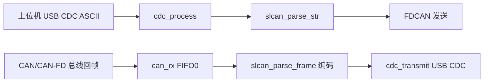
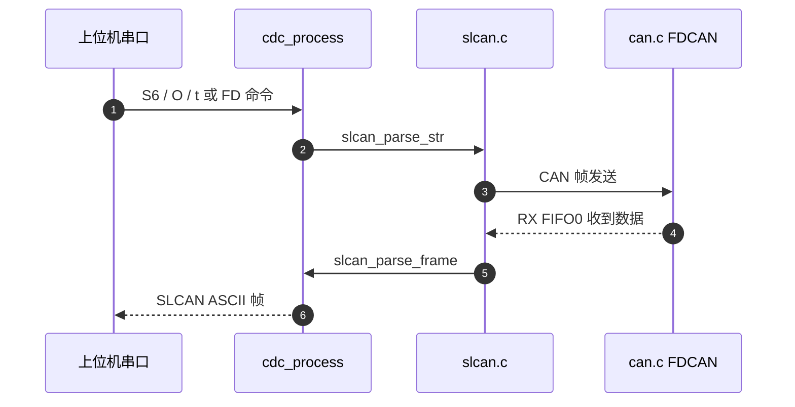

# CyberBeast canable2-fw-n32：N32H473 USB-CAN 桥接固件 / USB-to-CAN Firmware

## 一句话定义

**canable2-fw-n32** 是 CyberBeast 关节控制软件栈的独立开源组件：将 CANable2 SLCAN 固件移植到 N32H473 的 USB CDC-to-CAN/CAN-FD 桥接程序，支持标准及扩展帧 ASCII 命令。

## 英文缩写速查

| 缩写 | 英文全称 | 简要说明 |
|---|---|---|
| USB | Universal Serial Bus | USB CDC 设备通信 |
| SLCAN | Serial Line CAN | 文本命令式 CAN 网桥协议 |
| FDCAN | Flexible Data-rate CAN | 经典 CAN 与 FD 帧收发 |

## 为什么重要

它提供可读的官方源码，而不只是协议表格：能够逐层核对控制指令如何经配置、总线与运行时程序到达关节执行端。它在 [CyberBeast 关节软件栈总览](../overview/cyberbeast-joint-software-stack.md) 中有明确职责；单一模块的功能不等于完整系统的实时性或兼容性承诺。

## 核心原理

固件 main 初始化 system/can/led/usb，在循环中执行 led_process、can_process、cdc_process，再将 FDCAN RX 帧转为 ASCII 回送 USB CDC；slcan.c 解析 `O`、`S6`、`t/T` 与 CAN FD 的 `d/D/b/B` 等命令。

### 流程总览

## 源码运行时序图

上图根据官方 README 的运行命令和源码入口整理，描述模块间的关键调用/传输路径；未进行实机测量，不将示例 tick、文档标称频率解读为交付性能。

## 工程实践

**先按官方入口完成离线/构建检查，再接实际硬件：**

1. `make`
2. `将设备接为 USB CDC 后打开 SLCAN 串口`
3. `S6 (500k) → O (打开) → t/T/d/D/b/B 发送帧`

在机器人侧，应验证总线负载、反馈新鲜度、丢帧与异常后失能状态；参数/模式/增益应使用设备实际量程而非照抄示例。

## 局限与风险

本页说明 main 分支 SLCAN 实现；PORTING_PLAN 中部分引脚是规划建议而非最终硬件定版，必须按实际 PCB 校核；USB CDC/ASCII 具有额外时延，不可自动等同硬实时 SocketCAN。 本次只做官方源码静态核读，**未声称完成编译、烧录或实机验收**。

## 关联页面

- [关节软件栈总览（Firmware → SDK → ROS 2）](../overview/cyberbeast-joint-software-stack.md)
- [关节执行器参数辨识](../methods/joint-actuator-parameter-identification.md)；[MIT 关节阻抗模式调参](../methods/mit-joint-impedance-mode-tuning.md)
- [驱动器底软通信协议总览](../overview/motor-drive-firmware-bus-protocols.md)
- [robot_mc：基于 Ben Katz mini-c…](cyberbeast-robot-mc.md)
- [OpenBootloader：面向 N32H473CE 的 Cla…](cyberbeast-openbootloader.md)
- [JointSDK：将 CYBERBEAST CAN/C…](cyberbeast-jointsdk.md)
- [JointROS：在 JointSDK 上封装 ROS…](cyberbeast-jointros.md)

## 参考来源

- [canable2-fw-n32 官方源码、README 与运行入口（原文归档）](../../sources/repos/cyberbeast-canable2-n32.md)

## 推荐继续阅读

- [官方仓库 canable2-fw-n32](https://github.com/cyberbeast0829/canable2-fw-n32)
- [CyberBeast 软件栈总览](../overview/cyberbeast-joint-software-stack.md)
