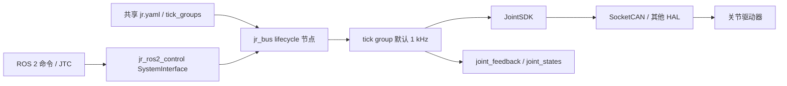
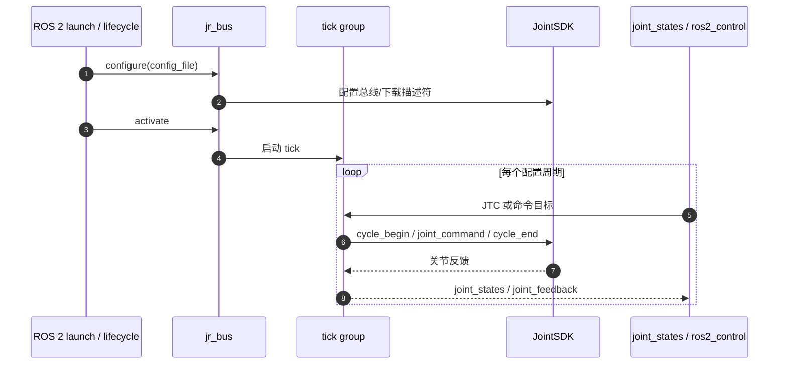

# CyberBeast JointROS：ROS 2 关节驱动与 ros2_control / ROS 2 Joint Integration

## 一句话定义

**JointROS** 是 CyberBeast 关节控制软件栈的独立开源组件：在 JointSDK 上封装 ROS 2 lifecycle、/joint_states、ros2_control SystemInterface 与 JointTrajectoryController 的关节通信层。

## 英文缩写速查

| 缩写 | 英文全称 | 简要说明 |
|---|---|---|
| ROS 2 | Robot Operating System 2 | 通信、生命周期与控制集成 |
| JTC | Joint Trajectory Controller | 关节轨迹控制器 |
| RT | Real-Time | 关节控制 tick 与调度时限 |

## 为什么重要

它提供可读的官方源码，而不只是协议表格：能够逐层核对控制指令如何经配置、总线与运行时程序到达关节执行端。它在 [CyberBeast 关节软件栈总览](../overview/cyberbeast-joint-software-stack.md) 中有明确职责；单一模块的功能不等于完整系统的实时性或兼容性承诺。

## 核心原理

`jr_bus` lifecycle 的 configure 阶段加载 YAML、打开总线、设备发现，activate 后才建话题/服务并运行 tick；`jr_ros2_control` 从同一 YAML 导出 position/velocity/effort 接口供 JTC 使用。默认示例 tick_groups.rate_hz=1000。

### 流程总览

## 源码运行时序图

上图根据官方 README 的运行命令和源码入口整理，描述模块间的关键调用/传输路径；未进行实机测量，不将示例 tick、文档标称频率解读为交付性能。

## 工程实践

**先按官方入口完成离线/构建检查，再接实际硬件：**

1. `colcon build --base-paths jr_interfaces jr_ros2 jr_ros2_control jr_bringup --cmake-args -DJRSDK_SOURCE_DIR=$HOME/JointSDK`
2. `ros2 launch jr_bringup vbus_demo.launch.py`
3. `ros2 lifecycle set /axis1 configure`
4. `ros2 lifecycle set /axis1 activate`

在机器人侧，应验证总线负载、反馈新鲜度、丢帧与异常后失能状态；参数/模式/增益应使用设备实际量程而非照抄示例。

## 局限与风险

裸 `ros2 run jr_bus` 不会自动 activate；需要 lifecycle configure/activate；SLCAN 仅配置与监控，生产实时闭环优先 SocketCAN 并测量抖动；不保证任意设备 1 kHz。 本次只做官方源码静态核读，**未声称完成编译、烧录或实机验收**。

## 关联页面

- [关节软件栈总览（Firmware → SDK → ROS 2）](../overview/cyberbeast-joint-software-stack.md)
- [关节执行器参数辨识](../methods/joint-actuator-parameter-identification.md)；[MIT 关节阻抗模式调参](../methods/mit-joint-impedance-mode-tuning.md)
- [驱动器底软通信协议总览](../overview/motor-drive-firmware-bus-protocols.md)
- [robot_mc：基于 Ben Katz mini-c…](cyberbeast-robot-mc.md)
- [OpenBootloader：面向 N32H473CE 的 Cla…](cyberbeast-openbootloader.md)
- [JointSDK：将 CYBERBEAST CAN/C…](cyberbeast-jointsdk.md)
- [canable2-fw-n32：将 CANable2 SLCAN 固…](cyberbeast-canable2-n32.md)

## 参考来源

- [JointROS 官方源码、README 与运行入口（原文归档）](../../sources/repos/cyberbeast-jointros.md)

## 推荐继续阅读

- [官方仓库 JointROS](https://github.com/cyberbeast0829/JointROS)
- [CyberBeast 软件栈总览](../overview/cyberbeast-joint-software-stack.md)
