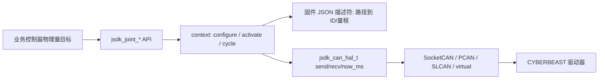
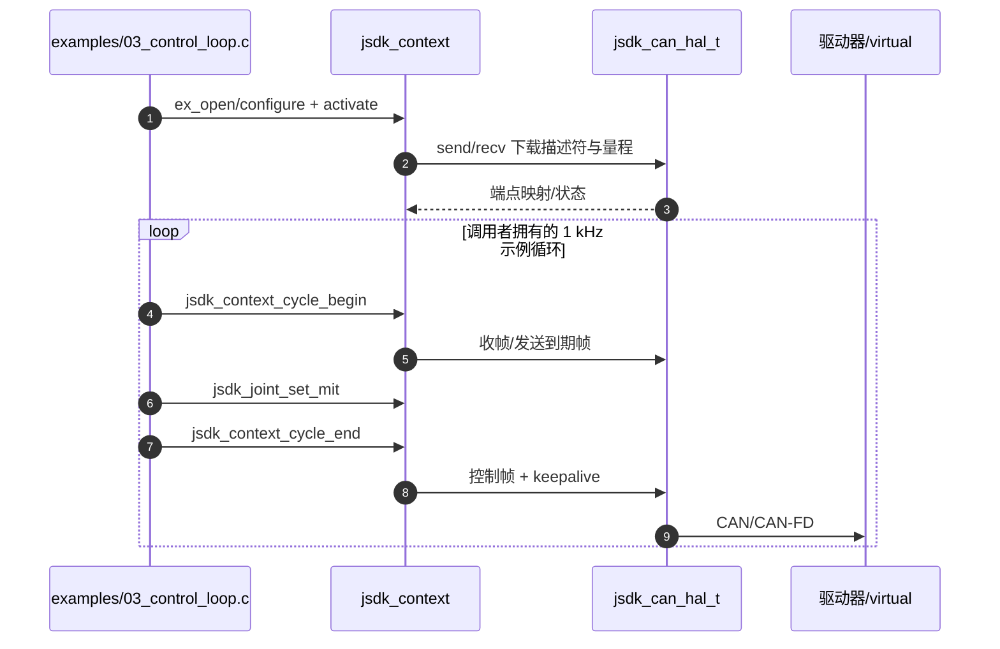

# CyberBeast JointSDK：纯 C99 关节协议栈 / Portable Joint Protocol SDK

## 一句话定义

**JointSDK** 是 CyberBeast 关节控制软件栈的独立开源组件：将 CYBERBEAST CAN/CAN-FD 帧和运行时端点描述符封装为物理量级 joint API 的跨平台 C99 SDK，控制路径零 malloc。

## 英文缩写速查

| 缩写 | 英文全称 | 简要说明 |
|---|---|---|
| SDK | Software Development Kit | 关节控制应用接口 |
| HAL | Hardware Abstraction Layer | 调用者实现的 CAN 与时钟回调 |
| RT | Real-Time | 配置阶段与实时控制阶段隔离 |

## 为什么重要

它提供可读的官方源码，而不只是协议表格：能够逐层核对控制指令如何经配置、总线与运行时程序到达关节执行端。它在 [CyberBeast 关节软件栈总览](../overview/cyberbeast-joint-software-stack.md) 中有明确职责；单一模块的功能不等于完整系统的实时性或兼容性承诺。

## 核心原理

调用者提供 arena 和 HAL send/recv/now_ms，在 configure 阶段握手并下载 JSON 描述符，activate 后每拍 cycle_begin→jsdk_joint_set_mit→cycle_end；CLI 支持 virtual、slcan、socketcan、pcan，默认不开堆模式。

### 流程总览

## 源码运行时序图

上图根据官方 README 的运行命令和源码入口整理，描述模块间的关键调用/传输路径；未进行实机测量，不将示例 tick、文档标称频率解读为交付性能。

## 工程实践

**先按官方入口完成离线/构建检查，再接实际硬件：**

1. `cmake -S . -B build -DJSDK_WERROR=ON`
2. `cmake --build build && (cd build && ctest)`
3. `./build/jsdk-cli --if virtual scan`
4. `./build/examples/03_control_loop`

在机器人侧，应验证总线负载、反馈新鲜度、丢帧与异常后失能状态；参数/模式/增益应使用设备实际量程而非照抄示例。

## 局限与风险

端点 ID 必须由当前设备的 JSON 描述符解析，不能硬编码为 0；1 kHz 示例采用虚拟后端，不等于真机总线实时保证；SLCAN 不适合高频生产循环。 本次只做官方源码静态核读，**未声称完成编译、烧录或实机验收**。

## 关联页面

- [关节软件栈总览（Firmware → SDK → ROS 2）](../overview/cyberbeast-joint-software-stack.md)
- [关节执行器参数辨识](../methods/joint-actuator-parameter-identification.md)；[MIT 关节阻抗模式调参](../methods/mit-joint-impedance-mode-tuning.md)
- [驱动器底软通信协议总览](../overview/motor-drive-firmware-bus-protocols.md)
- [robot_mc：基于 Ben Katz mini-c…](cyberbeast-robot-mc.md)
- [OpenBootloader：面向 N32H473CE 的 Cla…](cyberbeast-openbootloader.md)
- [JointROS：在 JointSDK 上封装 ROS…](cyberbeast-jointros.md)
- [canable2-fw-n32：将 CANable2 SLCAN 固…](cyberbeast-canable2-n32.md)

## 参考来源

- [JointSDK 官方源码、README 与运行入口（原文归档）](../../sources/repos/cyberbeast-jointsdk.md)

## 推荐继续阅读

- [官方仓库 JointSDK](https://github.com/cyberbeast0829/JointSDK)
- [CyberBeast 软件栈总览](../overview/cyberbeast-joint-software-stack.md)
