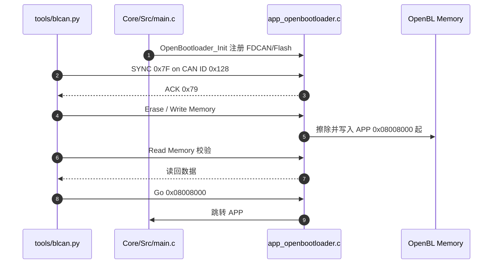

# CyberBeast OpenBootloader：N32H473 CAN OTA 引导程序 / CAN Bootloader

## 一句话定义

**OpenBootloader** 是 CyberBeast 关节控制软件栈的独立开源组件：面向 N32H473CE 的 Classic CAN IAP 引导程序，Bootloader 从 0x08000000 占用 32 KB，500 kbit/s 升级 APP。

## 英文缩写速查

| 缩写 | 英文全称 | 简要说明 |
|---|---|---|
| IAP | In-Application Programming | 应用固件的在应用升级 |
| CAN | Controller Area Network | Classic CAN 传输与握手 |
| IWDG | Independent Watchdog | APP 软复位后引导程序持续喂狗 |

## 为什么重要

它提供可读的官方源码，而不只是协议表格：能够逐层核对控制指令如何经配置、总线与运行时程序到达关节执行端。它在 [CyberBeast 关节软件栈总览](../overview/cyberbeast-joint-software-stack.md) 中有明确职责；单一模块的功能不等于完整系统的实时性或兼容性承诺。

## 核心原理

上电配置后轮询握手 200 ms，无主站时跳转至 APP 0x08008000；APP 可通过共享 RAM 0x20023FF0 写 0xB00710AD 并软复位要求进入引导；仅注册 FDCAN 而非 USART 通道。

### 流程总览

## 源码运行时序图

上图根据官方 README 的运行命令和源码入口整理，描述模块间的关键调用/传输路径；未进行实机测量，不将示例 tick、文档标称频率解读为交付性能。

## 工程实践

**先按官方入口完成离线/构建检查，再接实际硬件：**

1. `Keil MDK-ARM 构建 N32H473 target`
2. `python tools/blcan.py sync`
3. `python tools/blcan.py upgrade --firmware &lt;bin&gt; --addr 0x08008000 --verify --go-addr 0x08008000`

在机器人侧，应验证总线负载、反馈新鲜度、丢帧与异常后失能状态；参数/模式/增益应使用设备实际量程而非照抄示例。

## 局限与风险

这条升级链使用 Classic CAN 500 kbit/s、11 位 ID，不能直接照搬应用固件的 29 位扩展帧或 CAN FD 参数；擦写和起跳须核对地址并保留配置区域。 本次只做官方源码静态核读，**未声称完成编译、烧录或实机验收**。

## 关联页面

- [关节软件栈总览（Firmware → SDK → ROS 2）](../overview/cyberbeast-joint-software-stack.md)
- [关节执行器参数辨识](../methods/joint-actuator-parameter-identification.md)；[MIT 关节阻抗模式调参](../methods/mit-joint-impedance-mode-tuning.md)
- [驱动器底软通信协议总览](../overview/motor-drive-firmware-bus-protocols.md)
- [robot_mc：基于 Ben Katz mini-c…](cyberbeast-robot-mc.md)
- [JointSDK：将 CYBERBEAST CAN/C…](cyberbeast-jointsdk.md)
- [JointROS：在 JointSDK 上封装 ROS…](cyberbeast-jointros.md)
- [canable2-fw-n32：将 CANable2 SLCAN 固…](cyberbeast-canable2-n32.md)

## 参考来源

- [OpenBootloader 官方源码、README 与运行入口（原文归档）](../../sources/repos/cyberbeast-openbootloader.md)

## 推荐继续阅读

- [官方仓库 OpenBootloader](https://github.com/cyberbeast0829/OpenBootloader)
- [CyberBeast 软件栈总览](../overview/cyberbeast-joint-software-stack.md)
