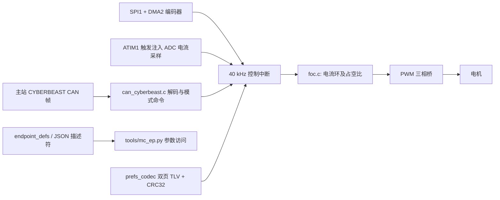

# CyberBeast robot_mc：N32H473 裸机 FOC 关节固件 / Bare-Metal Joint FOC Firmware

## 一句话定义

**robot_mc** 是 CyberBeast 关节控制软件栈的独立开源组件：基于 Ben Katz mini-cheetah motorcontrol 移植的 N32H473CE 三相 FOC 固件，40 kHz 中断控制、CAN/CAN-FD 参数访问与双页 TLV 持久化。

## 英文缩写速查

| 缩写 | 英文全称 | 简要说明 |
|---|---|---|
| FOC | Field-Oriented Control | 电机 dq 坐标电流与 PWM 控制 |
| ADC | Analog-to-Digital Converter | 三相电流采样 |
| TLV | Type-Length-Value | 带键值与 CRC 的持久化编码 |

## 为什么重要

它提供可读的官方源码，而不只是协议表格：能够逐层核对控制指令如何经配置、总线与运行时程序到达关节执行端。它在 [CyberBeast 关节软件栈总览](../overview/cyberbeast-joint-software-stack.md) 中有明确职责；单一模块的功能不等于完整系统的实时性或兼容性承诺。

## 核心原理

ATIM1 触发 ADC 注入采样，SPI1 + DMA2 读取编码器，控制中断运行 FOC 和 CYBERBEAST 控制帧处理；JSON endpoint 描述符流由主循环发送；配置用带 CRC32 的双页 TLV 持久化。

### 流程总览



## 源码运行时序图

```mermaid
sequenceDiagram
  autonumber
  participant Host as tools/mc_ep.py / CAN 主站
  participant CAN as can_cyberbeast.c
  participant Loop as main.c 中断/FSM
  participant FOC as foc.c
  participant HW as ATIM1/ADC/功率级
  Host->>CAN: 控制帧 / 参数请求
  CAN->>Loop: 解析目标及状态
  loop 每 25 us (40 kHz)
    HW-->>Loop: 电流 ADC 与编码器反馈
    Loop->>FOC: 当前状态与控制目标
    FOC->>HW: 更新三相 PWM 占空比
  end
  CAN-->>Host: 心跳/反馈帧
```

上图根据官方 README 的运行命令和源码入口整理，描述模块间的关键调用/传输路径；未进行实机测量，不将示例 tick、文档标称频率解读为交付性能。

## 工程实践

**先按官方入口完成离线/构建检查，再接实际硬件：**

1. `make`
2. `make check`
3. `make hosttest`
4. `python tools/mc_ep.py --can tree`

在机器人侧，应验证总线负载、反馈新鲜度、丢帧与异常后失能状态；参数/模式/增益应使用设备实际量程而非照抄示例。

## 局限与风险

40 kHz 是固件内部控制环频率，不等于主站可达到 40 kHz 的总线指令刷新率；量程、引脚与标定参数以具体板卡和固件版本为准。 本次只做官方源码静态核读，**未声称完成编译、烧录或实机验收**。

## 关联页面

- [关节软件栈总览（Firmware → SDK → ROS 2）](../overview/cyberbeast-joint-software-stack.md)
- [关节执行器参数辨识](../methods/joint-actuator-parameter-identification.md)；[MIT 关节阻抗模式调参](../methods/mit-joint-impedance-mode-tuning.md)
- [驱动器底软通信协议总览](../overview/motor-drive-firmware-bus-protocols.md)
- [OpenBootloader：面向 N32H473CE 的 Cla…](cyberbeast-openbootloader.md)
- [JointSDK：将 CYBERBEAST CAN/C…](cyberbeast-jointsdk.md)
- [JointROS：在 JointSDK 上封装 ROS…](cyberbeast-jointros.md)
- [canable2-fw-n32：将 CANable2 SLCAN 固…](cyberbeast-canable2-n32.md)

## 参考来源

- [robot_mc 官方源码、README 与运行入口（原文归档）](../../sources/repos/cyberbeast-robot-mc.md)

## 推荐继续阅读

- [官方仓库 robot_mc](https://github.com/cyberbeast0829/robot_mc)
- [CyberBeast 软件栈总览](../overview/cyberbeast-joint-software-stack.md)
