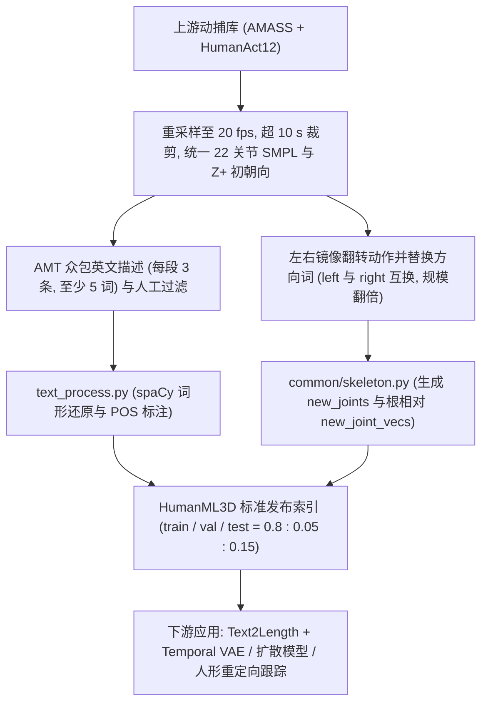
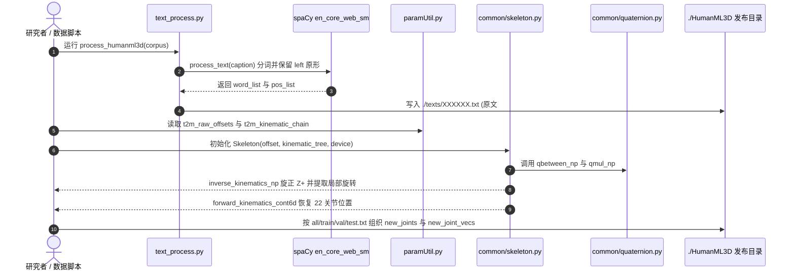

# HumanML3D（BFM 行为数据）

## 一句话定义

**HumanML3D** 是 Guo 等（University of Alberta，CVPR 2022）在论文 *Generating Diverse and Natural 3D Human Motions from Text* 中构建的 3D 人体动作-自然语言配对数据集与评测基准，也是行为基础模型（BFM）和人形文本条件动作生成的标准上游语义数据源。

## 英文缩写速查

| 缩写 | 英文全称 | 简要说明 |
|------|----------|----------|
| BFM | Behavior Foundation Model | 大规模行为数据预训练的可复用全身行为先验 |
| T2M | Text-to-Motion | 由自然语言文本描述生成对应 3D 人体运动序列的任务 |
| SMPL | Skinned Multi-Person Linear Model | 参数化人体网格与骨架表示；HumanML3D 采用其 22 个身体主关节 |
| POS | Part-of-Speech | 词性标注；HumanML3D 文本预处理用 spaCy 提取词元与词性标签 |
| VAE | Variational Autoencoder | 变分自编码器；原论文以此构造 Temporal VAE 完成随机长度运动生成 |
| R-Precision | Retrieval Precision | 在候选文本池中通过运动-文本对比特征检索真值文本的 Top-k 命中率 |
| FID | Fréchet Inception Distance | 生成动作分布与真实动作分布之间的特征距离（越低越好） |

## 为什么重要

- **填补大规模文本-3D 动作配对语料空白：** 在 HumanML3D 发布前，主流文本-动作基准主要是 [KIT-ML](https://motion-annotation.humanoids.kit.edu/dataset/)（论文 Table 1 统计为 3,911 段、6,278 条描述、10.33 h、偏重移动类动作）；HumanML3D 将规模扩大至 **14,616 段动作、44,970 条人工描述、28.59 h、5,371 词表**，覆盖日常活动、体育竞技、杂技与舞蹈。
- **确立了下游 BFM 与扩散生成模型的标准特征协议：** 其基于 22 关节 SMPL 骨架归一化的根相对速度/位置/6D 旋转 + 足地接触元组格式，以及配套对比学习 R-Precision / FID / MultiModal Distance 指标，成为后续文本条件动作生成和人形策略“文本 $\to$ 运动生成 $\to$ 重定向跟踪”管线的事实基准。
- **定位在于“语义与多样运动先验”而非物理闭环：** 与单纯提供动捕参考轨迹的数据集（如 [AMASS](amass.md)、[LaFAN1](dataset-bfm-lafan.md)）不同，HumanML3D 的核心资产在于“每段 2–10 s 动作对应 3 条自然语言描述 + POS 标注”，为行为基础模型（[BFM](../concepts/behavior-foundation-model.md)）提供语义对齐接口，但喂入人形机器人策略前必须先做动力学滤波与形态重定向（见 [BFM 技术地图](../overview/bfm-41-papers-technology-map.md)）。

## 核心原理

HumanML3D 通过**源动捕统一归一化 $\to$ AMT 多人众包文本标注 $\to$ 左右镜像成对增强 $\to$ 根相对旋转不变运动表示**四步完成编译；同一论文同时提出基于 `motion snippet code` 的两阶段生成框架（`text2length` + 三元组 Temporal VAE）验证该基准。

### 1. 数据集四维元数据与核心参数

| 字段 | 内容 |
|------|------|
| **规模** | **14,616** 段动作剪辑（镜像增强后仓库 `HumanML3D/all.txt` 共 **29,228** 条索引：`train` 23,384、`test` 4,384、`val` 1,460）；**44,970** 条自然语言描述；总时长 **28.59 h**；单段时长 **2–10 s**（平均 **7.1 s**）；词表 **5,371** 词（平均 **12** 词/句，中位数 **10** 词） |
| **模态** | **3D 人体骨架序列**（22 关节 SMPL `new_joints` 与根相对运动特征 `new_joint_vecs`，20 fps）+ **英文自然语言描述与 POS 词性标签**（`texts/*.txt`）+ 二值足地接触特征 |
| **许可证** | 仓库处理代码与注释脚本采用 **MIT License**；原始动捕主体源自 [AMASS](amass.md) 与 HumanAct12，受上游 AMASS 分发协议约束——仓库**不直接打包分发**原始/处理后动作体文件，仅限学术研究并须向原数据源申请下载重建（KIT-ML 处理版另提供网盘下载） |
| **重定向就绪度** | **非即插即用（纯运动学人体骨架）**：数据为 22 关节 SMPL 无动力学约束运动（含 20 fps 裁剪与 Z+ 标准化），缺少关节力矩、精确环境接触与机器人自碰撞约束；输入人形机器人控制策略前必须经**形态重定向（retargeting）**与**物理可行性清洗** |

### 2. 动作与文本内部表示（§4–§5 & `paramUtil.py` / `text_process.py`）

- **单帧姿态元组：** 论文 §5 将一帧动作定义为 $p = (\dot{r}^a, \dot{r}^x, \dot{r}^z, r^y, j^p, j^v, j^r, c^f)$，其中 $\dot{r}^a$ 为绕 Y 轴的根角速度，$(\dot{r}^x, \dot{r}^z)$ 为 XZ 平面根线速度，$r^y$ 为根高度，$j^p, j^v, j^r$ 分别为根空间下的局部关节位置、关节速度与 6D 连续旋转，$c^f \in \mathbb{R}^4$ 为足跟与脚尖速度阈值化后的二值足地接触标志。
- **骨架拓扑（`paramUtil.py`）：** 使用 22 关节 SMPL 骨架（5 条运动链 `t2m_kinematic_chain` 覆盖双腿、脊柱-头颈与双臂；同时预留了手部扩展链索引，但标准 HumanML3D 训练表示只取 22 身体关节），目标模板骨长参考 ID 为 `'000021'`。
- **文本格式：** 每条标注存储为四段 `#` 分隔文本：`<小写原句>#<词/POS 序列>#<start_s>#<end_s>`（整段描述时起止时间默认 `0.0#0.0`）。

## 实验与评测

原论文（CVPR 2022 Table 1 & Table 2）在同一工作内验证了 HumanML3D 作为基准的检索一致性与生成难度（20 次重复评测，95% 置信区间）：

| 数据集 / 方法 | R-Precision Top-1 ↑ | R-Precision Top-2 ↑ | R-Precision Top-3 ↑ | FID ↓ | MultiModal Dist ↓ | Diversity → | MultiModality ↑ |
|--------------|---------------------|---------------------|---------------------|-------|-------------------|-------------|-----------------|
| **Real motions (HumanML3D)** | 0.511 ± 0.003 | 0.703 ± 0.003 | 0.797 ± 0.002 | 0.002 ± 0.000 | 2.974 ± 0.008 | 9.503 ± 0.065 | — |
| `T2M (Ours w/ real length)` | 0.457 ± 0.002 | 0.639 ± 0.003 | 0.740 ± 0.003 | 1.067 ± 0.002 | 3.340 ± 0.008 | 9.188 ± 0.002 | 2.090 ± 0.083 |
| `T2M (Ours + text2length)` | 0.455 ± 0.003 | 0.636 ± 0.003 | 0.736 ± 0.002 | 1.087 ± 0.021 | 3.347 ± 0.008 | 9.175 ± 0.083 | 2.219 ± 0.074 |
| `Language2Pose [1]` | 0.246 ± 0.002 | 0.387 ± 0.002 | 0.486 ± 0.002 | 11.02 ± 0.046 | 5.296 ± 0.008 | 7.676 ± 0.058 | — |

在面向人形控制基准的横向评测中（参见 [PHUMA](dataset-bfm-phuma.md) 与 [人形参考动作数据集对比](../comparisons/humanoid-reference-motion-datasets.md)），HumanML3D 是唯一兼具万级 clips 与细粒度自然语言描述的基准源，但也集中暴露了原生 20 fps 裁切引起的地面穿模与物理违例问题，需经清洗后才适合作为 RL 跟踪训练参考。

## 源码运行时序图

核对 `EricGuo5513/HumanML3D` 官方仓库实际源码：仓库包含可独立运行的文本 POS 标注脚本 `text_process.py`（`__main__` 入口）、骨架与运动学模块 `paramUtil.py` / `common/skeleton.py` / `common/quaternion.py` 及 `human_body_prior/`；`README.md` 文档中另有 4 个面向从 AMASS 重建体数据的 Notebook（`raw_pose_processing.ipynb`、`motion_representation.ipynb`、`cal_mean_variance.ipynb`、`animation.ipynb`），但当前快照未直接随仓库检出 `.ipynb` 文件实体。下图反映仓库已检出核心模块的真实调用与数据契约：

## 工程实践

- **本地数据重建流程：** 需先从官方网站分别下载 **AMASS**、**HumanAct12** 以及 **SMPL+H** / **DMPL** 模型放入 `./body_model/`；运行文本处理请使用 `spacy==2.3.4`（或与对应词形还原规则一致的 `en_core_web_sm`），若需还原与作者发布特征完全对齐的数值，仓库 `README.md` 明确提示固定 `matplotlib==3.3.4`。
- **切分与防泄漏：** 使用仓库内置 `HumanML3D/train.txt`、`val.txt`、`test.txt` 划分时务必注意每条原样本 `XXXXXX` 均与其镜像 `MXXXXXX` 成对出现（共 29,228 条），自定义采样或划分绝不可将 `000123` 放进训练集而把 `M000123` 放进测试集。
- **用于人形机器人训练的二次加工：** 从 HumanML3D 生成或采样得到的 20 fps、22 关节 SMPL 动作应先升采样至控制器频率（如 30–50 Hz 或仿真步频）并做低通滤波，再用 [GMR](../methods/motion-retargeting-gmr.md) 等重定向器映射至目标机器人（如 [Unitree G1](unitree-g1.md) / H1），配合轨迹过滤去除倒地/悬空/脚底滑移片段后再投入 [DeepMimic](../methods/deepmimic.md) 或 [BeyondMimic](../methods/beyondmimic.md) 训练。

## 常见误区与局限

- **误区 1：直接下载 GitHub 仓库就能拿到动作特征体数据。** 受上游 AMASS 授权约束，`EricGuo5513/HumanML3D` 只托管切分列表与处理代码，不含 `.npy` 动作矩阵，必须自行申请 AMASS 后按规范脚本重建。
- **误区 2：以为包含灵巧手或全身表情自由度。** 虽然 `paramUtil.py` 中写有 `t2m_left_hand_chain` / `t2m_right_hand_chain` 常量，标准 HumanML3D 数据与评测仅包含 **22 个 SMPL 身体关节**，没有手指、面部与物体接触标注（对比 [Motion-X](dataset-bfm-motion-x.md) 的 SMPL-X 322 维全身表示）。
- **误区 3：将 20 fps、10 s 裁剪动作当作物理可执行参考。** 20 fps 下采样使高速跳跃/击打在动力学上失真，部分 AMASS 片段缺少地面接触修正，直接上真机极易引发滑步、脚部穿地或不可解扭矩（参见 [PHUMA](dataset-bfm-phuma.md) 对 HumanML3D 物理伪影的定量统计）。
- **语言与长程限制：** 文本描述全部为英文单句或短复合句（平均 12 词），且单段最长 10 s，对超过 10 s 的长序列规划或场景交互描述（人-物 / 人-地形）支持较弱。

## 关联页面

- [Behavior Foundation Model（BFM）](../concepts/behavior-foundation-model.md) — 上层行为基础模型概念与预训练数据管线
- [BFM 41 篇核心论文技术地图](../overview/bfm-41-papers-technology-map.md) — BFM 数据集与算法全景图中的数据集定位
- [AMASS](amass.md) — HumanML3D 的主要底层动捕来源
- [Generating Diverse and Natural 3D Human Motions from Textual Descriptions](paper-notebook-humanml3d.md) — 同论文的论文深读笔记入口
- [Motion Retargeting（动作重定向）](../concepts/motion-retargeting.md) — 将 22 关节 SMPL 动作映射到人形机器人自由度的必经步骤
- [扩散运动生成（Diffusion Motion Generation）](../methods/diffusion-motion-generation.md) — HumanML3D 最常服务的下游文本条件动作生成方法族
- [人形参考动作数据集对比](../comparisons/humanoid-reference-motion-datasets.md) — HumanML3D 与 AMASS、LaFAN1、Humanoid-X 等数据源的横向对比

## 参考来源

- [humanml3d_cvpr2022_reading.md](../../sources/papers/humanml3d_cvpr2022_reading.md) — CVPR 2022 原论文全文与 `EricGuo5513/HumanML3D` 仓库通读归档
- [bfm_awesome_dataset_humanml3d_cvpr_2022.md](../../sources/papers/bfm_awesome_dataset_humanml3d_cvpr_2022.md) — awesome-bfm-papers 数据集条目来源
- [bfm_awesome_41_catalog.md](../../sources/papers/bfm_awesome_41_catalog.md#数据集10) — BFM 41 篇与核心数据集总览目录
- [wechat_embodied_ai_lab_bfm_41_papers_survey.md](../../sources/blogs/wechat_embodied_ai_lab_bfm_41_papers_survey.md) — BFM 技术脉络综述来源
- 论文 PDF：<https://openaccess.thecvf.com/content/CVPR2022/papers/Guo_Generating_Diverse_and_Natural_3D_Human_Motions_From_Text_CVPR_2022_paper.pdf>
- 官方代码库：<https://github.com/EricGuo5513/HumanML3D>

## 推荐继续阅读

- [项目主页：Text-to-Motion (Guo et al., CVPR 2022)](https://ericguo5513.github.io/text-to-motion)
- [人形参考动作数据集对比](../comparisons/humanoid-reference-motion-datasets.md)
- [PHUMA（人形通用物理筛选动捕数据集）](dataset-bfm-phuma.md)
