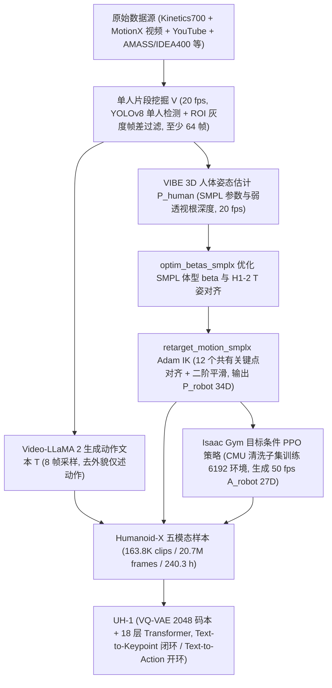
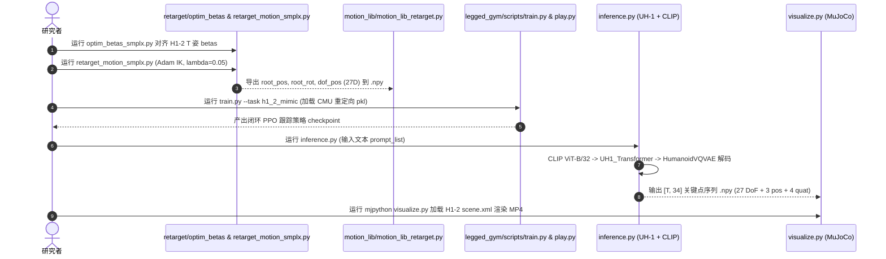

# Humanoid-X（BFM 行为数据）

## 一句话定义

**Humanoid-X** 是 Mao、Zhao 等（USC、UC Berkeley、Toyota Research Institute，[arXiv:2412.14172](https://arxiv.org/abs/2412.14172)，Humanoids 2025 录用版题为 *Universal Humanoid Robot Pose Learning from Internet Human Videos*）提出的超大规模人形机器人多模态动作数据集，直接将“互联网人类视频 $\to$ 文本语义 $\to$ SMPL 人体姿态 $\to$ 人形关键点 $\to$ 物理策略目标关节角”打通为规模化行为学习管线。

> **文献编号勘误：** 本仓库旧版索引页曾沿用清单误植将 Humanoid-X 记为 `arXiv:2501.05098`（该号实为 [Motion-X++](dataset-bfm-motion-xpp.md)）。经原文核对，Humanoid-X / UH-1 唯一对应论文为 **<https://arxiv.org/abs/2412.14172>**。

## 英文缩写速查

| 缩写 | 英文全称 | 简要说明 |
|------|----------|----------|
| BFM | Behavior Foundation Model | 大规模行为数据预训练的可复用全身行为先验 |
| UH-1 | Universal Humanoid-1 | 基于 Humanoid-X 训练的文本条件自回归人形姿态控制大模型 |
| SMPL | Skinned Multi-Person Linear Model | 参数化人体网格与骨架模型，作人类视频 3D 重建中间表示 |
| VQ-VAE | Vector Quantized Variational Autoencoder | 矢量量化自编码器；UH-1 用其将连续 34D/27D 动作离散化为动作原语 token |
| DoF | Degrees of Freedom | 机器人的关节自由度数量；UH-1 主体对应无手 Unitree H1-2 的 27 DoFs |
| PD | Proportional-Derivative | 比例-微分关节位置控制器，把目标 DoF 角度转化为底层电机力矩 |
| RL | Reinforcement Learning | 强化学习；用于从运动学重定向关键点蒸馏物理安全的闭环控制策略 |

## 为什么重要

- **将人型行为数据从万级动捕推进到十万级/两千万帧互联网视频尺度：** 传统人形控制依赖有限场景下的遥操作或昂贵动捕（如 [AMASS](amass.md)、[LaFAN1](dataset-bfm-lafan.md)）；Humanoid-X 通过自动化管线汇总 **163,800** 个单人动作片段（**20.7M** 帧、**240.3 h**），词表覆盖 **11,897** 个动词/名词/副词等词汇，使文本到人形动作生成首次在超过两千万帧规模上呈现清晰 Scaling 增益。
- **同时交付运动学关键点与物理策略可执行动作：** 每条样本不仅含人态估计 `P_human` 和重定向关键点 `P_robot`，还补充了经目标条件 RL 策略闭环落地的 50 fps `A_robot`（27 维 PD 目标关节角），并在真实 **Unitree H1-2** 上验证了文本指令控制接近满分的执行稳定性。
- **代表 BFM 数据链路“互联网视频 $\to$ 具身本体”范式的典型权衡：** 一方面显著拓展了行为语义多样性（如拉小提琴、打高尔夫、太极、哑铃健身），另一方面也暴露出单目视频 3D 估计带来的脚部滑步与地面穿模伪影（见 [PHUMA](dataset-bfm-phuma.md) 横向评测），凸显下游物理筛选与动力学闭环的重要性。

## 核心原理

Humanoid-X 采用五段全自动管线将互联网视频与学术动捕库编译为五元组样本 $\langle V, T, P_{\text{human}}, P_{\text{robot}}, A_{\text{robot}}\rangle$，并由下游 **UH-1** 以“VQ-VAE 离散化 + CLIP 条件 Transformer 自回归”或“文本生成关键点 $\to$ 闭环 RL 跟踪策略”两种控制模式驱动真机。

### 1. 数据集四维元数据与五模态规范（Appendix B–C）

| 字段 | 内容 |
|------|------|
| **规模** | **163,800** 段单人动作样本（Kinetics700 68.6K、MotionX Video 40.6K、YouTube Online Video 17.8K、AMASS 13.4K、IDEA400 12.5K、Charades 9.3K、HAA500 5.2K、AIST 1.5K、GRAB 1.3K、EgoBody 1.0K、HuMMan 0.7K）；**20.7M** 帧；**240.3 h**；描述词表 **11,897** 词（其中动词 3,206、名词 6,048、形容词 1,526、副词 590） |
| **模态** | **5 模态对齐：** ①单人视频 `V`（MP4, 20 fps，**版权限制不公开发布原互联网视频**）；②单句动作文本 `T`（`.txt`）；③SMPL 人体姿态 `P_human`（20 fps `.npy`）；④人形机器人关键点状态 `P_robot`（20 fps `.npy`，每帧 34D = 27 DoFs + 3 根位置 + 4 根四元数）；⑤物理可执行 PD 目标关节角 `A_robot`（50 fps `.npy`，每帧 27 DoFs） |
| **许可证** | 代码仓库根目录**未附独立 `LICENSE`**，其 `legged_gym/` 与 `rsl_rl/` 子模块遵循 `BSD-3-Clause`；数据集与权重托管于 HuggingFace（`USC-GVL/Humanoid-X` / `UH-1`），论文附录 A 声明互联网视频相关数据**仅限非商业学术研究**且继承上游视频与 SMPL/AMASS 授权条款 |
| **重定向就绪度** | **面向 Unitree H1-2（27 DoF）半就绪、跨本体仍需重解算：** `P_robot`（34D）与 `A_robot`（27D）已直接绑定无手版 H1-2 关节拓扑，可用作 H1-2 跟踪训练/策略蒸馏输入；但因源自单目视频 3D 估计且迁移至 Unitree G1 等异构本体，部署前仍需做 **形态重定向（retargeting）** 与接触稳定性筛选 |

### 2. 数据集中 12 关键点重定向与 RL 策略设计

- **二阶段重定向（§3.2 & Appendix B.5）：** 选取人体与人形机器人共有的 **12 关键点**（左右髋、膝、踝、肩、肘、腕）。第一阶段固定标准 T 姿优化 SMPL 体型 $\beta$（限制 $|\beta_i| < 5$ 防过度畸变）使骨长贴合 H1-2；第二阶段用 Adam 以 L1 位置偏差加时间二阶平滑项（$\lambda = 0.05$）反解 27 个机器人 DoF 与根状态。
- **目标条件 PPO 跟踪器（Appendix B.6）：** 训练时为避免单目视频噪声干扰稳定性，仅采用 AMASS 的 **CMU MoCap** 子集（剔除物理交互/重物/崎岖地形动作），观测含本体角速度、姿态角、航向误差与关节状态，特别对硬件易损的**左右踝滚转（ankle roll）动作每步强制置零**。

## 实验与评测

原论文（§5，Table 1–4）从文本对齐质量、数据规模效应与真机成功率三方面完成评测：

| 评测维度 | 核心对比与结果 |
|----------|----------------|
| **HumanoidML3D 基准（Table 1）** | UH-1：FID `0.445 ± 0.078`，MM Dist `3.249 ± 0.016`，Diversity `10.157 ± 0.106`，R-Precision Top-3 `0.761 ± 0.003`；显著优于先生成人体动作再重定向的 `MDM`（FID `0.582`）与 `T2M-GPT`（FID `0.667`） |
| **Humanoid-X 预训练增益（Table 2）** | 先在 Humanoid-X 预训练再在 HumanoidML3D 微调，FID 从 `0.445` 降至 `0.379`，MM Dist 从 `3.249` 降至 `3.232` |
| **数据规模 Scaling（Fig. 7）** | 训练数据比例从 1% 提升至 100%，FID 由 `0.689` 单调降至 `0.463`，Diversity 由 `5.900` 升至 `6.149`；动作词表从 512 扩到 2048，FID 由 `0.539` 降至 `0.463` |
| **Transformer vs. Diffusion（Table 4）** | 同数据集下 18 层自回归 Transformer 在 FID（`0.379` vs `5.536`）与 R-Precision（`0.761` vs `0.630`）显著优于对照扩散模型 |
| **Unitree H1-2 真机部署（Table 3）** | 12 类语言指令（拳击、鼓掌、拉小提琴、高尔夫推杆等，各 10 次试次）：闭环 **Text-to-Keypoint 平均成功率 94.33%**；开环上肢 + 独立下肢行走策略 **Text-to-Action 平均 89.83%** |

## 源码运行时序图

核对 `sihengz02/UH-1` 官方仓库实际源码：仓库完整开源了 **UH-1 推理/可视化脚本**（`inference.py`、`visualize.py`）、**SMPL/SMPL-X 到 H1-2 重定向脚本**（`retarget/optim_betas_smplx.py`、`retarget/retarget_motion_smplx.py`）与 **Isaac Gym 目标条件跟踪训练脚本**（`legged_gym/legged_gym/scripts/train.py`、`play.py`）；而上游**视频切段、VIBE 姿态估计与 Video-LLaMA 2 打标流水线**在 `README-Humanoid-X.md` 中标注为 *Work in progress* 尚未发布。下图还原已开源核心流程与数据流转：

## 工程实践

- **两套独立 Conda 环境隔离：** 仓库 `README.md` 与 `README-Humanoid-X.md` 明确将推理/可视化（Python 3.8.11 + `mujoco` + `clip`）和重定向（`smplx` + `pytorch_kinematics` + 私有版权 `SMPL/SMPL-X` + `PoseLib`）同 Isaac Gym RL（`torch==1.13.1+cu117` + `numpy==1.23.0` + `rsl_rl`）拆开配置，避免 `numpy` / `mujoco` / `isaacgym` 版本冲突。
- **文本控制模式选型：** 对纯上肢交互或手势任务（如挥手、鼓掌、拉琴），`Text-to-Action` 配合现成下肢站立/行走控制器即可工作；若涉及躯干大幅俯仰、转向或下肢协同，应走 `Text-to-Keypoint` 输出 34D 参考并交由闭环全身控制（[Whole-Body Control](../concepts/whole-body-control.md)）执行以保证抗摔倒稳定性。
- **跨本体复用路径：** 若目标机器人不是 Unitree H1-2（例如 [Unitree G1](unitree-g1.md)），不可直接套用数据集内的 `A_robot` 27D 电机角；需读取 `P_human`（SMPL 参数），用 `optim_betas` + [GMR](../methods/motion-retargeting-gmr.md) 重新拟合目标机器人的 URDF/MJCF 模型后再行物理筛选（可参照 `README-Humanoid-X.md` 提及的 `retarget2humanoid` G1 扩展）。

## 常见误区与局限

- **误区 1：误将 Humanoid-X 与 Motion-X++ 的 arXiv 编号混同。** 旧清单把二者均标注为 `arXiv:2501.05098`，实际 `2501.05098` 为 [Motion-X++](dataset-bfm-motion-xpp.md)，Humanoid-X / UH-1 的正确论文编号为 **`arXiv:2412.14172`**（2025 年录用于 IEEE-RAS Humanoids）。
- **误区 2：以为开源仓库已包含全部视频爬虫、VIBE 推理与 RL 训练出的 163.8K 动作体。** `sihengz02/UH-1` 现阶段将“视频切分、3D 人体姿态估计、视频标注”脚本标注为 *Work in progress*，原视频片段受版权与隐私限制不释放，RL 示例仓库仅链接了 CMU 重定向样本 `motion_data_cmu_sample.pkl`，全量数据须从 HuggingFace `USC-GVL/Humanoid-X` 获取。
- **单目视频 3D 估计物理伪影偏高：** 因主要来自单目网络视频（Kinetics700 / YouTube / MotionX Video 占比超七成），根平移深度依赖弱透视假设、缺少地面接触约束；在 [PHUMA](dataset-bfm-phuma.md) 的物理合规性基准统计中，Humanoid-X 存在约 11.69% 地面穿模帧与 12.15% 滑步比例，用于高质量全身跟踪前建议进一步做物理滤波与接触投影。
- **无手与无物体操作覆盖：** `P_robot` 与 `A_robot` 采用 27 DoF 无灵巧手 H1-2 骨架，原论文第 6 节明确声明不涉及人-物接触操作（loco-manipulation），视频生成中诸如“拿起杯子”“挥球拍”等文本对应的只是上肢空挥运动学近似。

## 关联页面

- [Behavior Foundation Model（BFM）](../concepts/behavior-foundation-model.md) — 大规模视频数据与通用行为模型缩放主线
- [BFM 41 篇核心论文技术地图](../overview/bfm-41-papers-technology-map.md) — BFM 技术图谱中的数据来源坐标
- [Motion Retargeting（动作重定向）](../concepts/motion-retargeting.md) — Humanoid-X 从 SMPL 映射到 12 共有关键点再求 IK 的理论背景
- [PHUMA（人形通用物理筛选动捕数据集）](dataset-bfm-phuma.md) — 对 Humanoid-X 物理穿透与滑步指标进行定量审计的后续物理清洗数据集
- [Motion-X（全身表现力 3D 人体动作数据集）](dataset-bfm-motion-x.md) — 为 Humanoid-X 贡献了 40.6K 片段（72.9h）视频动捕源的上游多模态数据集
- [AMASS](amass.md) — 为 Humanoid-X 重定向片段与目标条件 RL 策略提供高质量 CMU MoCap 训练基础的动捕库
- [人形参考动作数据集对比](../comparisons/humanoid-reference-motion-datasets.md) — Humanoid-X 与 AMASS、LaFAN1、HumanML3D 等的横评定位

## 参考来源

- [humanoid_x_uh1_arxiv_2412_14172.md](../../sources/papers/humanoid_x_uh1_arxiv_2412_14172.md) — arXiv:2412.14172 原论文正文与附录全篇通读归档
- [uh1_humanoid_x.md](../../sources/repos/uh1_humanoid_x.md) — `sihengz02/UH-1` 官方仓库脚本核对归档
- [bfm_awesome_dataset_humanoid_x_arxiv_2501_05098.md](../../sources/papers/bfm_awesome_dataset_humanoid_x_arxiv_2501_05098.md) — 旧清单条目（保留溯源；其标明的 `2501.05098` 为上游清单误植）
- [bfm_awesome_41_catalog.md](../../sources/papers/bfm_awesome_41_catalog.md#数据集10) — BFM 数据集总览清单
- [wechat_embodied_ai_lab_bfm_41_papers_survey.md](../../sources/blogs/wechat_embodied_ai_lab_bfm_41_papers_survey.md) — BFM 技术综述背景
- 论文原文：<https://arxiv.org/abs/2412.14172>
- 项目主页：<https://usc-gvl.github.io/UH-1/>
- HuggingFace 数据集：<https://huggingface.co/datasets/USC-GVL/Humanoid-X>
- 官方代码库：<https://github.com/sihengz02/UH-1>

## 推荐继续阅读

- [UH-1 官方项目主页（演示视频与模型链接）](https://usc-gvl.github.io/UH-1/)
- [机器人论文阅读笔记：UH-1](https://imchong.github.io/Robot_Learning_Paper_Notebooks/papers/03_High_Impact_Selection/UH-1_Learning_from_Massive_Human_Videos_for_Universal_Humanoid_Pose_Control/UH-1_Learning_from_Massive_Human_Videos_for_Universal_Humanoid_Pose_Control.html)
- [人形参考动作数据集对比](../comparisons/humanoid-reference-motion-datasets.md)
