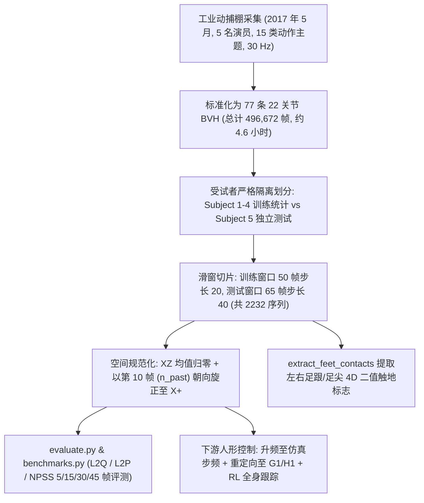
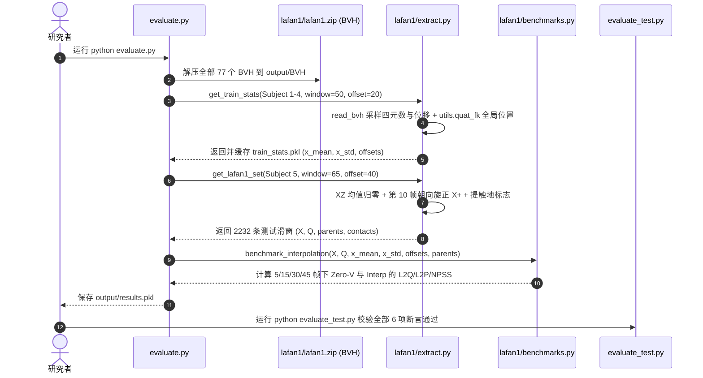

# LaFAN1（BFM 行为数据）

## 一句话定义

**LaFAN1**（Ubisoft La Forge Animation Dataset）是 Harvey 等（Ubisoft Montreal、Polytechnique Montréal、McGill University、Mila，ACM TOG 2020，[arXiv:2102.04942](https://arxiv.org/abs/2102.04942)）随 *Robust Motion In-betweening* 一同开源的 30 Hz 工业级角色动捕数据集，涵盖大范围全局位移与多动作过渡，是运动补间基准及行为基础模型（BFM）物理模仿训练的高保真动作源之一（本库另有综合实体页 [LaFAN1（Ubisoft La Forge 动捕数据集）](lafan1-dataset.md)）。

## 英文缩写速查

| 缩写 | 英文全称 | 简要说明 |
|------|----------|----------|
| LaFAN1 | Ubisoft La Forge Animation Dataset 1 | 育碧 La Forge 发布的第 1 版 30 Hz 工业动捕公开数据集 |
| BVH | Biovision Hierarchy | 层级骨架运动文件格式；LaFAN1 原生采用 22 关节 BVH 存储全局位移与局部旋转 |
| L2Q / L2P | L2 Quaternion / Position Error | LaFAN1 基准评测全局四元数（L2Q）与归一化全局关节位置（L2P）平均 L2 误差 |
| NPSS | Normalized Power Spectrum Similarity | 归一化功率谱相似度，通过频域地球移动距离衡量运动平滑性与真实感 |
| FK | Forward Kinematics | 前向运动学，由根节点位置与各关节局部四元数逐级推算全局关节位姿 |
| BFM | Behavior Foundation Model | 大规模行为数据预训练的可复用全身行为先验 |

## 为什么重要

- **填补大空间位移与多风格串联动捕稀缺：** 早期动捕与预测基准（如 Human3.6M）多为原地局部重复动作且常把首帧根变换重置为单位阵；LaFAN1 在商业级动捕棚完成 15 类主题采集，保留真实全球空间位移、急转急停、越障、匍匐、攀爬与战斗动作，贴合游戏与机器人运动模仿（Motion Imitation）中的真实转移挑战。
- **确立了开源运动补间（In-betweening）标准评测协议：** 伴随论文 `arXiv:2102.04942` 发布的 `evaluate.py` 与 `lafan1` 提取模块，将 Subject 1–4 定为训练集统计来源、Subject 5 定为 2,232 个 65 帧滑窗测试集，并提供零速度与 SLERP/LERP 插值基线复现与 L2Q / L2P / NPSS 单元测试验收体系。
- **广泛承接人形机器人全身跟踪与 Sim2Real：** 由于 30 Hz BVH 采样质量高、物理滑步极少，LaFAN1 成为 [DeepMimic](../methods/deepmimic.md)、[AMP](../methods/amp-reward.md)、[BeyondMimic](../methods/beyondmimic.md) 及 Unitree G1 / H1 等高动态追踪与 BFM 蒸馏管线的经典高质量精调源（相比百万帧但噪声偏多的视频数据集，常作为高精动作种子或评测集）。

## 核心原理

LaFAN1 在数据设计上围绕**多动作自然过渡、全球位移保留与足地接触可提取性**构建：2017 年 5 月在商业级动捕棚录制，经过面向角色动画的标准 BVH 清洗，随后按固定窗口与朝向对齐规则切分为可复现评测集。

### 1. 数据集四维元数据与 15 类动作构成

| 字段 | 内容 |
|------|------|
| **规模** | **77** 条 BVH 序列，**496,672** 帧 @ **30 Hz**（约 **4.6 小时**）；**5 名受试者**（`subject1`–`subject4` 用于训练，`subject5` 独占测试产生 **2,232** 个测试窗口）；覆盖 **15 类动作主题**（`aiming` 6 / 39,144 帧、`dancing` 8 / 62,155、`fallAndGetUp` 7 / 39,652、`fightAndSports` 5 / 35,347、`fight` 2 / 14,910、`ground` 6 / 36,936、`jumps` 5 / 38,940、`multipleActions` 1 / 12,184、`obstacles` 6 / 47,269、`run` 5 / 35,969、`sprint` 4 / 23,604、`walk` 9 / 58,950、`push` 7 / 13,294、`dance` 4 / 26,645、`pushAndFall` 2 / 11,673） |
| **模态** | **3D 骨架光学动捕**（22 关节 BVH 格式，含根全局平移与关节局部四元数，仓库另附 Git LFS `lafan1.zip` 137 MB、部分 `.c3d` 原始标记与 `.fbx` 参考角色）；可脚本提取 4D 左右足地接触信号；**不含自然语言文本标注** |
| **许可证** | **CC BY-NC-ND 4.0（Attribution-NonCommercial-NoDerivatives）**：严格限**非商业用途**且**不得公开分发衍生改编产物**（`license.txt` 第 2 节允许内部制作技术适配但不允许 Share 衍生数据集），商用于实体机器人产品或再发布衍生动作包须留意法务边界 |
| **重定向就绪度** | **非即插即用（Ubisoft 22 关节动画 BVH 骨架）**：运动学洁净度显著高于网络视频姿态估计，但 BVH 骨长与关节自由度分布有别于电机驱动人形机器人，需经 [动作重定向](../concepts/motion-retargeting.md)（如 IK / [GMR](../methods/motion-retargeting-gmr.md)）与动力学可执行性检查后方能喂入强化学习训练 |

### 2. 基准提取与规范化细节（`lafan1/extract.py` & `§3.1`）

- **前向朝向规范：** 每个切片窗口取前 `npast = 10` 帧作为历史上下文，通过 `utils.rotate_at_frame` 绕 Y 轴（Up）将第 10 帧的水平面朝向统一旋正至 **X+ 方向**，并扣除整段窗口所有关节在 XZ 平面的均值实现水平居中。
- **足地接触提取：** `extract_feet_contacts(x, [3, 4], [7, 8], velfactor=0.02)` 按左脚/右脚末两关节全局位置帧间位移平方速度阈值 `0.02` 生成 `contacts_l` 与 `contacts_r`（各 `(B, T, 2)`，合计 4D 触地标签，供运行时 IK 修脚或下游控制参考）。
- **归一化与全局评价：** 使用训练集 50 帧/步长 20 窗口的前向运动学（FK）全局关节位置均值 `x_mean` 与标准差 `x_std` 归一化后计算 **L2P**；结合直接比较全局四元数的 **L2Q** 与时间傅里叶幂谱 EMD 距离 **NPSS** 避免只看位置而忽视骨骼朝向扭曲。

## 实验与评测

原论文 Table 3 与仓库复现基线验收测试 `evaluate_test.py` 在 `subject5` 的 2,232 个测试切片（10 帧过去 + 5/15/30/45 帧中间缺口 + 1 帧未来目标关键帧）上给出标准定量基准：

| 方法 / 指标 | 5 帧 | 15 帧 | 30 帧 | 45 帧 |
|-------------|------|-------|-------|-------|
| **Zero-Velocity（L2Q / L2P / NPSS）** | ~0.56 / 1.523 / 0.0053 | ~1.10 / 3.694 / 0.0522 | ~1.51 / 6.600 / 0.2318 | ~1.81 / 9.329 / 0.4918 |
| **Interpolation LERP+SLERP（L2Q / L2P / NPSS）** | 0.22 / 0.37 / 0.0023 | 0.62 / 1.25 / 0.0391 | 0.98 / 2.32 / 0.2013 | 1.25 / 3.45 / 0.4493 |
| **TGrec（仅重建损失，L2Q / L2P / NPSS）** | 0.21 / 0.32 / 0.0025 | 0.48 / 0.85 / 0.0304 | 0.83 / 1.82 / 0.1608 | 1.20 / 3.89 / 0.4547 |
| **TGcomplete（+ z_tta + z_target + 滑窗 GAN，L2Q / L2P / NPSS）** | **0.17 / 0.23 / 0.0020** | **0.42 / 0.65 / 0.0258** | **0.69 / 1.28 / 0.1328** | **0.94 / 2.24 / 0.3311** |

*注：上表同时对照原论文 Table 3 与仓库 `evaluate_test.py` 数值；在 LaFAN1 高动态位移场景下，即使 5 帧极短过渡窗口，带时间到达编码 `z_tta` 与对抗判别器的 `TGcomplete` 也已显著超越线性/球面插值基线（完整基线范围断言见 `evaluate_test.py`）。*

## 源码运行时序图

核对 `ubisoft/ubisoft-laforge-animation-dataset` 官方仓库：仓库未包含神经网络模型训练源码（论文模型与 MotionBuilder 插件未开源），但完整提供了**数据解压、训练统计计算、测试滑窗提取、插值/零速度基准评测及单元测试验收**的可运行 Python 入口 `evaluate.py` 与 `evaluate_test.py`：

## 工程实践

- **Git LFS 依赖提醒：** 克隆 `ubisoft-laforge-animation-dataset` 后需确认安装并拉取 **Git LFS**（`lafan1/lafan1.zip` 体积 137 MB、`c3d/` 与 `fbx/` 也由 LFS 追踪），否则 `evaluate.py` 解压会因指针文件报错。
- **高频控制重采样与重定向：** 原生 BVH 帧率为 **30 Hz**，用于 50 Hz 控制策略或 200–1000 Hz 物理仿真（Isaac Gym / Isaac Lab / MuJoCo）前需经四元数球面插值（SLERP）与根位置样条插值升频；参考 [GMR](../methods/motion-retargeting-gmr.md) 与 [BeyondMimic](../methods/beyondmimic.md) 实践时，应先对足底接触与高度偏移做地面零点对齐，再将 Ubisoft 骨架（22 关节，Z/Y 轴定义依 BVH 解析顺序）映射至目标机器人模型。
- **训练/测试受试者严格分离：** 为避免动作风格记忆泄漏，复现基准或作 RL 泛化测试时请严格沿用 `train_actors = ['subject1'..'subject4']` 与 `test_actors = ['subject5']` 划分，并以 `evaluate_test.py` 数值区间校验本地前处理流水线是否正确。

## 常见误区与局限

- **误区 1：将 LaFAN1 当成带语言标注或可自由二次分发的公开数据集。** LaFAN1 **没有任何自然语言描述或动作分类标签文件**（仅通过 BVH 文件名主题前缀区分，如 `dance1_subject2.bvh`），且遵循 **CC BY-NC-ND 4.0（非商业-禁止演绎共享）**，在公开新基准时不得直接打包再分发修改后的 LaFAN1 子集衍生体（许多后续开源仓库因此只提供重定向脚本而不附带 LaFAN1 重定向产物）。
- **误区 2：以为官方仓库包含论文的 LSTM+GAN 补间网络训练代码。** 仓库仅公开数据本身与零速度/插值基线评测代码（`evaluate.py`、`benchmarks.py`），原论文 `TGcomplete` 模型权重及 Autodesk MotionBuilder 插件并未开源。
- **数据规模与主题覆盖局限：** 总时长约 **4.6 小时**（77 段），虽然单段运动学质量极高且覆盖摔倒爬起、攀越障碍等稀缺动作，但演员仅有 5 人、且缺少手部灵巧操作与人-物物理交互记录；跨主题泛化或语义条件生成必须与 [AMASS](amass.md)、[HumanML3D](dataset-bfm-humanml3d.md) 或 [Motion-X](dataset-bfm-motion-x.md) 配合使用。

## 关联页面

- [LaFAN1（Ubisoft La Forge 动捕数据集）](../entities/lafan1-dataset.md) — 本知识库内面向通用动捕与人形 RL 训练侧的互补实体页
- [Behavior Foundation Model（BFM）](../concepts/behavior-foundation-model.md) — 上层行为基础模型概念与预训练/精调数据源管线
- [BFM 41 篇核心论文技术地图](../overview/bfm-41-papers-technology-map.md) — BFM 论文与数据集全景坐标
- [DeepMimic](../methods/deepmimic.md) — 经典单片段/多片段物理跟踪模仿基线，常直接以 LaFAN1 作为高动态参考动作源
- [AMP（Adversarial Motion Priors）](../methods/amp-reward.md) — 利用无标签动捕数据风格判别器驱动机器人学习自然步态与过渡的代表方法
- [Motion Retargeting（动作重定向）](../concepts/motion-retargeting.md) — 从 22 关节 Ubisoft BVH 转换到真实人形自由度的必备管线
- [人形参考动作数据集对比](../comparisons/humanoid-reference-motion-datasets.md) — LaFAN1 与 AMASS、PHUMA、Humanoid-X 等的数据质量与用途对比

## 参考来源

- [ubisoft-laforge-animation-dataset.md](../../sources/repos/ubisoft-laforge-animation-dataset.md) — `ubisoft/ubisoft-laforge-animation-dataset` 官方仓库通读与 `evaluate.py` 核对归档
- [robust_motion_inbetweening_acm_tog_2020.md](../../sources/papers/robust_motion_inbetweening_acm_tog_2020.md) — ACM TOG 2020 (`arXiv:2102.04942`) 原论文通读归档
- [bfm_awesome_dataset_lafan_tog_2020.md](../../sources/papers/bfm_awesome_dataset_lafan_tog_2020.md) — awesome-bfm-papers 数据集条目来源
- [bfm_awesome_41_catalog.md](../../sources/papers/bfm_awesome_41_catalog.md#数据集10) — BFM 核心数据集目录来源
- [wechat_embodied_ai_lab_bfm_41_papers_survey.md](../../sources/blogs/wechat_embodied_ai_lab_bfm_41_papers_survey.md) — BFM 技术脉络综述来源
- 论文原文：<https://arxiv.org/abs/2102.04942>
- 官方代码库：<https://github.com/ubisoft/ubisoft-laforge-animation-dataset>

## 推荐继续阅读

- [LaFAN1 官方代码库 README 与 15 动作主题明细](https://github.com/ubisoft/ubisoft-laforge-animation-dataset)
- [BeyondMimic（高动态全身跟踪闭环实践）](../methods/beyondmimic.md)
- [人形参考动作数据集对比](../comparisons/humanoid-reference-motion-datasets.md)
