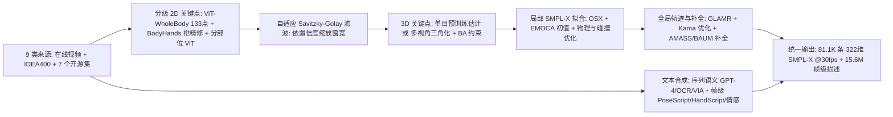
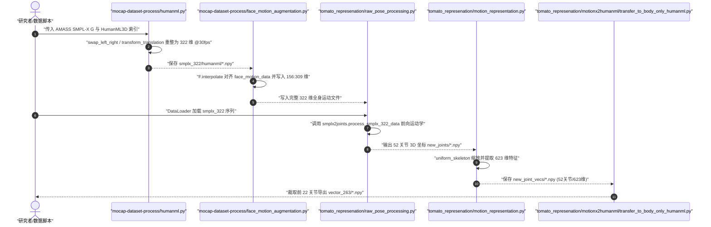

# Motion-X（BFM 行为数据）

## 一句话定义

**Motion-X**（NeurIPS 2023 Datasets and Benchmarks）是首个面向全身表现力（身体、双手灵巧手指与面部表情）的大规模 3D 人体运动与双粒度文本数据集，汇集 9 类来源的 **81,084** 段序列（**15.6M 帧、144.2 小时 @30fps**），并以统一的 **322 维 SMPL-X** 参数化表示和自动视觉–语言标注管线连接文本、视频与人体运动先验。

## 英文缩写速查

| 缩写 | 英文全称 | 简要说明 |
|------|----------|----------|
| SMPL-X | SMPL eXpressive | 同时表达身体、双手（MANO）与面部表情（FLAME）的统一 3D 人体参数网格模型 |
| OSX | One-Stage eXpressive | 单阶段 3D 全身网格恢复网络，用于 Motion-X 局部身体与手部姿态初始化 |
| EMOCA | Emotion Driven Monocular Face Capture and Animation | 单目情感驱动人脸重建模型，用于面部表情参数提取与情感分类 |
| GLAMR | Global Occlusion-Aware Human Mesh Recovery | 面向动态相机视频的全局遮挡感知人体轨迹恢复框架 |
| MPVPE / PA-MPVPE | (Procrustes-Aligned) Mean Per-Vertex Error | 网格表面顶点平均误差 / 刚体对齐后的顶点平均误差（单位 mm） |
| PoseScript / HandScript | Rule-based Body / Hand Pose Description Scripts | 从 3D 关键点几何关系自动合成帧级身体与手势描述文本的规则脚本 |

## 为什么重要

1. **填补全身表达空白：** 在 Motion-X 之前，主流大规模文本–动作数据集（如 [AMASS](amass.md)、[HumanML3D](dataset-bfm-humanml3d.md)）普遍只有 22 个身体主关节，缺少精细手势与面部表情，限制了社交交互、灵巧操作与高表现力人形策略预训练的泛化边界。
2. **打破室内光学动捕规模天花板：** 单纯依赖室内光捕难采集滑雪、高空作业、器乐演奏与传统武术等场景；Motion-X 通过自动化分级视觉标注管线融合在线视频、自采动作集 `IDEA400` 与既有数据集，把文本–动作数据体量推升至 HumanML3D（14.6K clips / 28.6h）的数倍。
3. **机器人 BFM 与灵巧重定向材料：** 322 维 SMPL-X 与配套的 HumanTOMATO `623` 维 / `263` 维导出管线，既可用于人形全身运动先验预训练，也为后续向带灵巧手的人形机器人执行 [运动重定向](mocap-retarget.md) 提供了包含手部关节的统一运动素材（见 [BFM 技术地图](../overview/bfm-41-papers-technology-map.md)）。

## 核心原理

### 数据规模、模态与发布规格

| 维度 | 核心事实（以 `arXiv:2307.00818v2` 与官方仓库核对为准） |
|------|------|
| 规模 | **81,084** 段序列（`81.1K`；仓库 `datasets/all.txt` 共 `81,079` 条，按 80/5/15 分为 `train 64,867 / val 4,046 / test 12,167`）、**15.6M 帧**、**144.2 小时**（统一 30fps）；含 7 个改造外部集（`AMASS 26.3K/5.4M`、`HAA500 5.2K/0.3M`、`AIST++ 1.4K/0.3M`、`HuMMan 0.7K/0.1M`、`GRAB 1.3K/0.4M`、`EgoBody 1.0K/0.4M`、`BAUM 1.4K/0.2M`）与 2 个自采/收集子集（`IDEA400* 12.5K/2.6M`、`Online Videos* 32.5K/6.0M`） |
| 模态 | **动作：** 逐帧 **322 维 SMPL-X**（`root_orient 3 + pose_body 63 + pose_hand 90 + pose_jaw 3 + face_expr 50 + face_shape 100 + trans 3 + betas 10`）及 HumanTOMATO `52` 关节 / `623` 维表示；**文本：** `81.1K` 序列级语义标签（`S`）+ `15.6M` 帧级全身姿态描述（`P`）；原始 RGB 与音频不在首版主数据集中直接分发 |
| 许可证 | 数据集受 **IDEA 非商业科学研究许可（CC BY-NC-SA 4.0）** 约束，严禁商业/军事/监控用途；外部子集沿用原许可（AMASS/GRAB/HumanML3D 仅限学术非商业且不二次分发原动作；HAA500 为 MIT；AIST++/BAUM 为 CC-BY 4.0；HuMMan 为 S-Lab v1.0） |
| 重定向就绪度 | **需二次对齐：** 原生为人体 SMPL-X 网格/参数坐标系且含视觉伪真值估计误差，喂给人形机器人策略前需经过缩放归一化、地面接触抑滑过滤以及面向特定 URDF/MJCF 骨架与灵巧手的 [运动重定向](mocap-retarget.md) |

### 自动全身动作与文本标注管线

Motion-X 通过三阶段视觉拟合 + 双粒度文本合成将非动捕视频、多视角视频与纯身体动捕数据统一到 322 维 SMPL-X 空间：

1. **分级 2D 关键点与自适应平滑：** 先由在 COCO-WholeBody 训练的 `ViT-WholeBody` 输出全局 `133×2` 关键点与置信度，据此裁出并结合 `BodyHands` 的 IoU 匹配修正手部与面部包围框，再分别送入专精 `ViT-Body`、`ViT-Hand`、`ViT-Face` 更新关键点，以克服远景/遮挡下手脸过小丢失的难题；随后按各点置信度自适应调节 Savitzky-Golay 半窗宽 `w`，高置信点保留高频动作细节，低置信点加大平滑抑制抖动。
2. **渐进式局部 SMPL-X 拟合与全局对齐：** 利用 `OSX`（身体/双手）与 `EMOCA`（下颌/表情）提供高质量初值，联合 `L_joint`（3D/2D 重投影与参数先验）、一阶平滑 `L_smooth`、自穿模惩罚 `L_pen` 和 PhysCap 物理约束 `L_phy` 进行迭代优化；在全局阶段借助 `GLAMR` 与 `Kama` 优化动态相机与人体根轨迹。针对纯上半身视频（如 UBody 类片段）借助 AMASS 匹配补全下半身，针对纯身体动捕集（AMASS/HumanML3D、EgoBody、GRAB）用来自 BAUM 的 EMOCA 表情序列做线性插值增强。
3. **双粒度语言标注：** 序列语义标签整合动作类别、GPT-4 改写、EasyOCR 屏幕字幕与 VIA 人工标注；帧级姿态描述分别由基于 [PoseScript](dataset-bfm-posescript.md) 几何规则的身体脚本、覆盖 6 类手指弯曲角/指距关系的 `HandScript` 与 AffectNet 预训练 `EMOCA` 情感分类器自动生成。

## 实验与评测

基于原文第 5 节（Table 3–5 与文本消融实验）的关键量化验证结果：

1. **全身 3D 网格标注精度（EHF 基准，Table 3）：** Motion-X 标注管线取得 `PA-MPVPE = 31.8 mm`、`MPVPE = 44.7 mm`、`PA-MPJPE = 33.5 mm`；若引入真值 3D 关键点监督，`PA-MPVPE` 可进一步降至 `19.7 mm`、`MPVPE` 降至 `30.7 mm`，相对当时主流单阶段全网拟合基线误差降幅超过 30%。
2. **全身文本驱动动作生成基准（Table 4，20 次运行均值）：**
   - `MotionDiffuse`：`R-Precision Top-1 = 0.559`、`Top-3 = 0.842`、`FID = 0.457`、`Diversity = 13.576`、`MModality = 1.620`；
   - `T2M-GPT`：`R-Precision Top-1 = 0.502`、`FID = 0.699`、`Diversity = 13.132`、`MModality = 2.510`；
   - `MLD`：`R-Precision Top-1 = 0.440`、`FID = 0.914`、`Diversity = 13.001`、`MModality = 2.558`；
   - **细粒度姿态描述消融：** 仅用语义标签时 MLD 的 `FID = 0.914`，叠加脸部、身体与手部帧级 `pose description` 后依次降至 `0.784`、`0.671`，全部结合时降至 `0.565`（下降 38%）。
3. **跨数据集泛化能力（MLD，Table 5）：** 在 Motion-X 上训练的 MLD 直接在 HumanML3D 测试集上取得 `R-Precision = 0.695`、`FID = 0.999`，优于仅在 HumanML3D 本身训练得到的 `0.657` 与 `1.579`（Real GT Diversity：Motion-X 为 `13.174`，HumanML3D 为 `9.837`）。

## 源码运行时序图

核对官方仓库 `IDEA-Research/Motion-X` 可运行脚本：`mocap-dataset-process/` 负责外部动捕重定位与表情增强，`tomato_represenation/` 负责从 322 维 SMPL-X 构建 52 关节 623 维与向后兼容的 HumanML3D 263 维表示：

## 工程实践

1. **Mocap 子集需自行合并：** 下载 Motion-X 授权链接前须注意，AMASS（含 HumanML3D）、GRAB 与 EgoBody 的原始动作文件并不包含在下载包内；需先在原站点获批下载后，严格按 `mocap-dataset-process/README.md` 与 `datasets/README.md` 的目录树（`../datasets/motion_data/smplx_322/`）运行 `humanml.py`、`egobody.py`、`grab.py` 及 `face_motion_augmentation.py` 完成拼接。
2. **AIST 非动捕缩放与坐标系坑：** 仓库 `non-mocap-dataset-process/aist.py` 明确对 AIST `trans` 做 `/ 94.0` 与 Z 轴反转处理，切勿直接将未校准的 AIST 平移与其他子集混用。
3. **263 维 vs 623 维与 PoseText 路径检查：**
   - `tomato_represenation/` 处理依赖预下载 `body_models/{smplx,smplh,dmpls}`；若下游模型仅需身体 22 关节（复用 [HumanML3D](dataset-bfm-humanml3d.md) 代码），可直接运行 `transfer_to_body_only_humanml.py` 转出 `263` 维兼容特征。
   - `PoseText/PoseText_README.md` 示例中读取 `hand_f` 时仍误写了 `body_text_name`；工程读取逐帧手势 JSON 时务必修正为 `hand_texts/` 路径。
4. **物理可行性与版本升级：** 单目伪真值存在约 30 mm 级的局部姿态误差与静态相机轻微飘移风险；若任务依赖同步 RGB 视频、音频或更精细的手部/全球轨迹精度，应优先考察同仓库后续发布的 [Motion-X++](dataset-bfm-motion-xpp.md)。

## 常见误区与局限

- **误区 1：下载 Motion-X 压缩包就能拿到 81K 段原始 RGB 视频。** 首版 Motion-X 主要发布 322 维 SMPL-X 动作与文本标签（RGB 视频与音频处于 `README.md` TODO 状态），带有同步视频、音频和 GPT-4V 字幕的数据发布归属升级版 [Motion-X++](dataset-bfm-motion-xpp.md)。
- **误区 2：Motion-X 的全身动作精度等同于实验室光学动捕真值。** 原文 §6 明确承认，来自网络单目视频的无标记伪真值（EHF 上约 `31.8 mm` PA-MPVPE）在绝对几何精度上弱于多相机光学动捕；且上半身视频补全与 AMASS 表情增强属跨域拼接而非真实原始表情/步态配对。
- **误区 3：可以直接按 MIT 许可用于商业机器人产品研发。** 仓库 `LICENSE` 明确为非商业科研许可，且 AMASS / GRAB / HumanML3D / EgoBody 均带严格的非商业学术限制，商用必须单独与原始版权方重新签约。
- **指标局限：** 原文 §6 同时指出当前生成指标（如 FID）与人类主观视觉自然度并非总一致，且 SMPL-X 参数本身未必是长时程、高表现力动作建模的最优表征。

## 关联页面

- [Motion-X++（升级版多模态全身动作集）](dataset-bfm-motion-xpp.md)
- [HumanML3D（身体级文本-动作基准与 263 维表示源头）](dataset-bfm-humanml3d.md)
- [PoseScript（规则化身体姿态语言描述方法来源）](dataset-bfm-posescript.md)
- [AMASS（Motion-X 核心 Mocap 上游底座）](amass.md)
- [动作重定向 Mocap Retarget](mocap-retarget.md)
- [Behavior Foundation Model 概念页](../concepts/behavior-foundation-model.md)
- [BFM 41 篇技术地图](../overview/bfm-41-papers-technology-map.md)

## 参考来源

- [motion_x_arxiv_2307_00818_reading.md](../../sources/papers/motion_x_arxiv_2307_00818_reading.md)（arXiv:2307.00818v2 原文通读存档）
- [idea_research_motion_x.md](../../sources/repos/idea_research_motion_x.md)（`IDEA-Research/Motion-X` 官方仓库与脚本核对存档）
- [bfm_awesome_dataset_motion_x_neurips_2023.md](../../sources/papers/bfm_awesome_dataset_motion_x_neurips_2023.md)
- [bfm_awesome_41_catalog.md](../../sources/papers/bfm_awesome_41_catalog.md#数据集10)
- [wechat_embodied_ai_lab_bfm_41_papers_survey.md](../../sources/blogs/wechat_embodied_ai_lab_bfm_41_papers_survey.md)
- 论文原文：<https://arxiv.org/abs/2307.00818> · 项目主页：<https://motion-x-dataset.github.io>

## 推荐继续阅读

- [Motion-X++ 实体页](dataset-bfm-motion-xpp.md)（对比 Masked DROID-SLAM、HAMER/SMPLer-X 与音视频模态扩展）
- [WHAM：世界坐标系人体运动恢复](wham-world-human-motion.md) 与 [TRAM：全球人体轨迹估计](paper-tram-global-human-motion.md)（与 Motion-X++ 全局轨迹模块直接对比）
