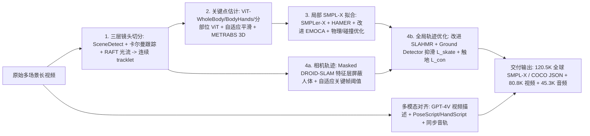
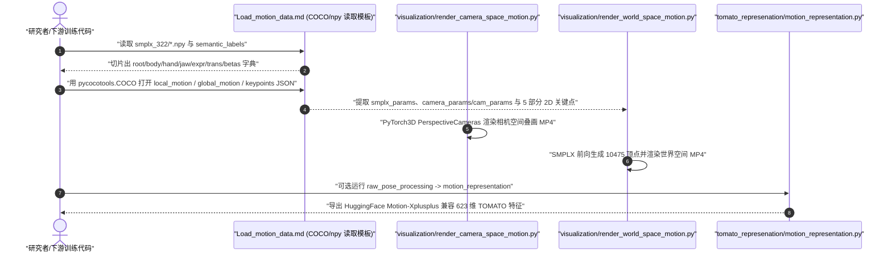

# Motion-X++（BFM 行为数据）

## 一句话定义

**Motion-X++**（`arXiv:2501.05098`）是 [Motion-X](dataset-bfm-motion-x.md) 的多模态与高精度扩充版本：通过三层镜头切分、`SMPLer-X + HAMER + 改进 EMOCA` 全身局部拟合、`Masked DROID-SLAM` 相机轨迹与脚部触地约束全局优化，将数据集扩增至 **120,462** 条序列（**19.5M 帧、180.9 小时 @30fps**），首次补齐 **80.8K** 段 RGB 视频、**45.3K** 条同步音频、**GPT-4V** 长文本字幕与全身 2D 关键点。

## 英文缩写速查

| 缩写 | 英文全称 | 简要说明 |
|------|----------|----------|
| SMPLer-X | Scaling Up Expressive Human Pose and Shape Estimation | 大规模预训练全身姿态形状估计器，替代 OSX 作为 Motion-X++ 身体局部初值 |
| HAMER | Hand Mesh Recovery with Transformers | 基于 Transformer 的 3D 手部网格恢复模型，解决前代复杂手势错位问题 |
| SLAHMR | Simultaneous Localization and Human Mesh Recovery | 结合视觉 SLAM 与人体运动先验的全局人类与相机联合优化框架 |
| Masked DROID-SLAM | Human-Masked DROID-SLAM | Motion-X++ 改进版 SLAM，在特征与光流层屏蔽动态人体以防静/动相机飘移 |
| ATE / RTE | Absolute Trajectory Error / Root Trajectory Error | 全局相机轨迹绝对误差与人体根轨迹误差（单位 m，在 EMDB 上评测） |
| PFC | Physical Foot Contact Score | 音乐驱动舞蹈生成中衡量脚部接地物理一致性与抑滑程度的指标 |

## 为什么重要

1. **打通五模态统一训练材料：** 前代 [Motion-X](dataset-bfm-motion-x.md) 以 SMPL-X 动作与文本为主；Motion-X++ 同时交付 **动作 + 文本 + RGB 视频 + 同步音频（45.3K） + 2D 全身关键点**，把支持任务由 2 类（Mesh Recovery、T2M）扩展到 **音驱动舞蹈（A2M）、全身 2D 关键点估计、视频生成与多模态运动理解**。
2. **修复原版野外单目重建痛点：** 原版 `OSX + GLAMR` 在多镜头剪辑视频、严重手部交互和静止相机背景上容易出现跳变、手势失真与相机飘移；Motion-X++ 在镜头切分、局部手/脸重建与世界系防脚滑全局优化上做了系统级替换。
3. **跨具身参考运动价值提升：** 世界系轨迹误差降低与脚部零速触地约束（`L_skate`、`L_con`），直接改善了野外单目视频作为人形/灵巧手机器人 [运动重定向](mocap-retarget.md) 来源时的足底打滑与根飘移问题（参见 [BFM 技术地图](../overview/bfm-41-papers-technology-map.md)）。

## 核心原理

### 数据规模、模态与版本对比

| 维度 | Motion-X++ 核对规格（`arXiv:2501.05098` 表 1–3 与 `Load_motion_data.md`） |
|------|------|
| 规模 | **120,462** 条序列（`120.5K`）、**19.5M 帧**、**180.9 小时**（30fps）；较 Motion-X 新增 `UBC Fashion (0.5K/0.2M)`，扩充 `HAA500 (6.9K/0.4M)`、`HuMMan (0.9K/0.2M)`，并将 `Online Videos*`（含 Music/Singer/Dance/Fitness/Game Motion 等）扩展到 **68.3K / 9.4M** |
| 模态 | **动作：** 局部/全局 322 维 SMPL-X（COCO JSON 与 `.npy`）、HumanTOMATO `623` 维格式；**视频与音频：** `80.8K` RGB 视频（120.5K 序列对应视频片段）、`45.3K` 同步音频；**语言与关键点：** `120.5K` 序列语义（GPT-4V + EasyOCR + VIA）+ `19.5M` 帧级 PoseScript/HandScript/EMOCA 文本 + `COCO-WholeBody` 风格全身 2D 关键点 JSON |
| 许可证 | 与 [Motion-X](dataset-bfm-motion-x.md) 同仓库统一受 **IDEA 非商业科学研究许可（CC BY-NC-SA 4.0）** 制约（禁止商业/军事/监控）；外部动捕与音视频子集保留原数据源授权 |
| 重定向就绪度 | **优于前代但仍需重定向与物理校验：** 引入世界系相机配准与脚底触地零速约束后，全局根轨迹和足滑显著减轻；但属人体 SMPL-X 参数空间且仍含约 30mm 级单目伪真值误差，喂给机器人控制前须经骨架重定向与动力学滤波 |

### 四阶段升级版自动标注管线

Motion-X++ 在 §4 中用四段级联模块替换并强化了 Motion-X 原管线（对应论文 Table 1 与 Fig. 6）：

1. **三层跨镜头连续性切分（§4.1）：** 先以 `SceneDetect` 剔除硬切转场，再用卡尔曼滤波跟踪（MMTracking）捕获人物在画面中瞬间位移，最后计算包围框内 `RAFT` 光流均值范数切分姿势突变片段，避免跨镜头错误插值。
2. **局部全身重建替换（§4.2–4.3）：** 2D 沿用分层 `ViT-WholeBody + BodyHands + 分部位 ViT` 与置信度自适应 Savitzky-Golay 平滑，3D 引入重训的 `METRABS` 估计器；初始参数由 `OSX` 升级为 `SMPLer-X`（身体）、`HAMER`（精细双手 `θ_h`）与防表情塌陷的改进 `EMOCA`，再用 `L_joint + L_smooth + L_pen + L_phy` 渐进优化对齐 2D/3D 关键点。
3. **特征级人像屏蔽 SLAM 与脚部接地约束（§4.4）：** 与 [TRAM](paper-tram-global-human-motion.md) 仅屏蔽图像/权重不同，**Masked DROID-SLAM** 直接在 DBA 层同步屏蔽人体框内的像素坐标 `p_i` 与 2D 修正光流 `r_ij`，并引入面积自适应因子 $\lambda_{kf} = 1 - S_{bbox}/S_{frame}$ 调节关键帧阈值，防止静相机因前景大面积运动误判为相机移动；人体轨迹阶段在 [SLAHMR](wham-world-human-motion.md) 基础上加入地面接触概率检测器 `c_t(j)`，用脚部接触零速损失 `L_skate` 与距地面阈值损失 `L_con` 抑制脚滑。
4. **GPT-4V 长文本增强（§4.5）：** 将均匀采样视频帧与粗描述输入 `GPT-4V`，生成富含节奏、重心转移与动作步骤的序列语义说明，并与全全身 `PoseScript / HandScript / AffectNet` 帧级标注对齐。

## 实验与评测

基于 `arXiv:2501.05098` §5（Table 4–11）与同平台复现对比数据：

1. **标注管线本体精度（Table 4–5）：**
   - **2D 全身关键点（COCO-WholeBody）：** Whole-body `AP = 73.5`、`AR = 80.3`（相比强基线 RTMPose-L `63.2 / 69.4` 分别提升 `+16.3%` 与 `+15.7%` 相对幅度；Hand `AP = 64.9`，Face `AP = 74.0`）。
   - **3D 网格重建（EHF）：** 渐进拟合达到 `PA-MPJPE = 33.5 mm`、`PA-MPVPE = 31.8 mm`、`MPVPE = 44.7 mm`（相对 PyMAF-X `64.9 mm` 降低 `30.1%`；配合 GT 3D 关键点降至 `PA-MPVPE = 19.7 mm`、`MPVPE = 30.7 mm`）。
   - **全球相机与人体轨迹（EMDB，64/60 序列）：** 相机 `ATE = 0.202 m`（优于 DROID-SLAM `0.217`、WHAM `0.305`、TRAM `0.314`）；人体全局 `RTE = 3.006 m`（优于 DROID-SLAM+SLAHMR `4.773`、WHAM `3.917`，接近 TRAM `2.943`）。
2. **四大下游任务验证（Table 6–11）：**
   - **音乐驱动舞蹈生成（A2M，Annotated AIST + FineDance，SMPL-H）：** `FineDance` 取得 `PFC = 1.120`（接近 Real `1.023`）、`Diversity_k = 11.39`、`Beat-Align = 0.12`；`EDGE` 取得 `Beat-Align = 0.14`、`PFC = 2.876`。
   - **3D 网格恢复训练增效（Hand4Whole，混入 10% Motion-X++ 单视角数据）：** EHF 全身 `MPVPE` 从 `79.2` 降至 `73.0 mm`（`-7.8%`，手 `43.2 -> 41.0`、脸 `25.0 -> 22.6`），AGORA val 同步由 `185.6` 降至 `184.1 mm`。
   - **2D 全身关键点训练增效（COCO-WholeBody）：** 按 `Motion-X++ : COCO-WholeBody : UBody = 2 : 1 : 1.5` 下采样率 5 混合训练 `RTMPose-L*`（270 epochs），Whole-body `AP` 提升至 `0.712`（较基线 `0.700` 提升逾 1 个百分点）。
   - **文本驱动动作生成（T2M）：** 与同源实验基准一致（MotionDiffuse `R-Precision Top-1 = 0.559 / FID = 0.457`），MLD 在叠加全身 pose description 后 `FID` 下降 38%（`0.914 -> 0.565`）。

## 源码运行时序图

核对官方仓库 `IDEA-Research/Motion-X` 中与 Motion-X++ 多模态数据加载及可视化对应的实际脚本（`non-mocap-dataset-process/Load_motion_data.md` 与 `visualization/render_*.py`）：

## 工程实践

1. **版本与数据入口辨别：** `IDEA-Research/Motion-X` 仓库同时承载 Motion-X（v1）与 Motion-X++（2024.04 起增量更新、2025.03.01 在 HuggingFace `YuhongZhang/Motion-Xplusplus` 发布模态一致整理版与 TOMATO 格式）；2024.09 官方曾披露早期 Motion-X++ 新标注存在部分一致性问题并在 2025.03 修复，下载使用前应优先拉取 2025.03 整理版并运行 `visualization/render_world_space_motion.py` 抽检音/画/网格同步性。
2. **注意 JSON 键名差异：** 核对 `non-mocap-dataset-process/Load_motion_data.md` 可见，Motion-X++ 的 `local_motion/*.json` 与 `global_motion/*.json` 同用 COCO 读取器但字段键名并不完全相同——前者使用 `img['image_id']`、`camera_params`、`body_pose/lhand_pose/rhand_pose/expr/shape`，后者使用 `ann['id']`、`cam_params`、`pose_body/face_expr/betas`；解析脚本切忌混用同一套字段映射。
3. **音乐舞蹈子集表示差异：** 论文 §5.2.2 评测音乐驱动舞蹈（A2M）时采用 **SMPL-H** 与 `90/5/5` 划分（不同于 T2M 基准的 SMPL-X 与 `80/5/15`），跨任务复用划分与骨架前须核对关节拓扑与手部自由度。

## 常见误区与局限

- **误区 1：混淆 Motion-X 与 Motion-X++ 的规模与论文编号。** `arXiv:2307.00818`（NeurIPS 2023）为原版 **Motion-X**（81.1K 序列 / 15.6M 帧 / 144.2h）；`arXiv:2501.05098`（2025）才是 **Motion-X++**（120.5K 序列 / 19.5M 帧 / 180.9h，含 80.8K 视频与 45.3K 音频），二者共享 GitHub 仓库但在数据规模、多模态内容和标注器架构上均不相同。
- **误区 2：以为所有 120.5K 序列都配有音频。** 论文原文摘要与 §3.2 明确指出，**45.3K** 条音频仅来自 Music、Singer、Dance 与 AIST 等有声子集，其余普通日常动作与老牌光捕子集并无配套音轨。
- **误区 3：单目流水线已可完全替代光学动捕做接触敏感机器人策略真值。** 尽管引入了 `Masked DROID-SLAM` 与 `L_skate / L_con`，原文第 6 节仍明确指出无标记单目伪真值质量低于多相机光学动捕系统（EHF 约 `31.8 mm` PA-MPVPE），且现有动作评估指标与视觉感知仍存在错位。

## 关联页面

- [Motion-X（前代基础版本与 SMPL-X 322 维管线）](dataset-bfm-motion-x.md)
- [WHAM：世界坐标系人体运动恢复](wham-world-human-motion.md)
- [TRAM：全球人体轨迹估计](paper-tram-global-human-motion.md)
- [HumanML3D（T2M 评测基线与 263 维格式来源）](dataset-bfm-humanml3d.md)
- [PoseScript（帧级姿态描述规则来源）](dataset-bfm-posescript.md)
- [动作重定向 Mocap Retarget](mocap-retarget.md)
- [Behavior Foundation Model 概念页](../concepts/behavior-foundation-model.md)
- [BFM 41 篇技术地图](../overview/bfm-41-papers-technology-map.md)

## 参考来源

- [motion_xpp_arxiv_2501_05098_reading.md](../../sources/papers/motion_xpp_arxiv_2501_05098_reading.md)（arXiv:2501.05098v1 原文通读存档）
- [idea_research_motion_x.md](../../sources/repos/idea_research_motion_x.md)（`IDEA-Research/Motion-X` 官方仓库与 Motion-X++ 加载/可视化脚本核对存档）
- [bfm_awesome_dataset_motion_xpp_arxiv_2501_05098.md](../../sources/papers/bfm_awesome_dataset_motion_xpp_arxiv_2501_05098.md)
- [bfm_awesome_41_catalog.md](../../sources/papers/bfm_awesome_41_catalog.md#数据集10)
- [wechat_embodied_ai_lab_bfm_41_papers_survey.md](../../sources/blogs/wechat_embodied_ai_lab_bfm_41_papers_survey.md)
- 论文原文：<https://arxiv.org/abs/2501.05098> · 仓库主页：<https://github.com/IDEA-Research/Motion-X>

## 推荐继续阅读

- [Motion-X（81.1K 初代版本与 HumanTOMATO 623 维/263 维管线细节）](dataset-bfm-motion-x.md)
- [TRAM：全球人体轨迹估计](paper-tram-global-human-motion.md) 与 [WHAM](wham-world-human-motion.md)
- [PoseScript（规则化几何姿态编码与检索生成基线）](dataset-bfm-posescript.md)
