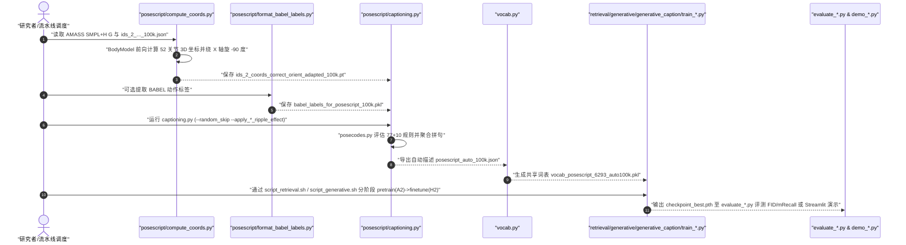

# PoseScript（BFM 行为数据）

## 一句话定义

**PoseScript**（ECCV 2022 · IEEE TPAMI 2024，`arXiv:2210.11795`）是一个连接 **3D 静态人体姿态** 与 **细粒度空间语义自然语言** 的多模态数据集与规则化描述生成引擎：从 [AMASS](amass.md) 最远点采样出 **100,000** 帧多样化 `SMPL-H` 姿态，配对 **6,283** 条（`v2` 仓库共 `6,293` 条）众包人工描摹（`PoseScript-H`）以及通过 **87 类几何 PoseCode** 合成的 **300,000** 条自动文本（`PoseScript-A`）。

## 英文缩写速查

| 缩写 | 英文全称 | 简要说明 |
|------|----------|----------|
| SMPL-H | Skinned Multi-Person Linear model with Hands | 含 52 个关节（身体 + 双手）的 3D 参数化人体网格与骨架模型 |
| MPJE | Mean Per-Joint Error | 平均每关节位置误差，PoseScript 用作最远点多样性采样距离度量 |
| PoseCode | Elementary Geometric Pose Code | 从 3D 关节几何关系提取的角度、距离、轴向相对位置、俯仰翻滚与触地离散编码 |
| BBC Loss | Batch-Based Classification Loss | 跨模态检索采用的批内对比分类损失，用于对齐文本与姿态联合嵌入空间 |
| CondTextPoser | Text-Conditioned Pose Variational Autoencoder | 基于 VPoser 潜空间的文本条件 3D 姿态生成 VAE 模型 |
| BABEL | Bodies, Action and Behavior with English Labels | 为 AMASS 动作序列提供动作类别文本标签的外部数据集，用于 PoseScript 辅助语句生成 |

## 为什么重要

1. **把语言粒度从“做什么动作”推进到“四肢怎么摆”：** 相比仅描述序列宏观动作的 [HumanML3D](dataset-bfm-humanml3d.md) 或 BABEL，PoseScript 聚焦单帧内精细的肢体空间几何关系（平均每条描述涵盖 `6.2` 个身体部位、`86%` 采用人称视角空间方位），是训练具身姿态理解、指令纠偏（如 PoseFix）与文本先验约束的关键语料。
2. **验证了“低成本规则合成预训练 + 少量人工精标微调”范式：** 10 分钟生成 300K 条自动 PoseCode 文本并用于预训练后，微调至人工真实语料可令检索、生成和描述三大下游任务性能近乎翻倍。
3. **成为 Motion-X 系列帧级标注的核心组件：** 后续大规模全身数据集 [Motion-X](dataset-bfm-motion-x.md) 与 [Motion-X++](dataset-bfm-motion-xpp.md) 直接移植并扩展了 PoseScript 的几何 PoseCode 生成器（连同手指版 `HandScript`），自动为 `15.6M–19.5M` 帧视频序列生成身体姿态描述。

## 核心原理

### 数据规模、模态与发布规格

| 维度 | 核心事实（以 `arXiv:2210.11795v3` 与 `naver/posescript` `v2` 核对为准） |
|------|------|
| 规模 | **100,000 帧静态 3D 姿态**（来自 `14,096` 条 AMASS 序列去首尾 25 帧、每隔 25 帧做 MPJE 最远点采样，其中 `DanceDB 28%`、`CMU 20%`、`BioMotionLab 13%`）；无连续视频或时长（`- h`）；**6,283** 条论文报告人工标注（`v2` 仓库 `posescript_human_6293.json` 含 `6,293` 条；`PoseScript-H`，测试集 `1,234`）+ **300K** 条自动描述（`posescript_auto_100k.json`，每姿态 3 条，测试集 `19,990`）；按源 AMASS 序列不泄露划分为 **70% train / 10% val / 20% test** |
| 模态 | **姿态：** 标准中性体型（`n_betas = 16`）、全球朝向沿 y 轴归一化的 `52` 关节 `SMPL-H` 轴角 `(52, 3)` 与 3D 关节坐标（生成输出使用连续 6D 旋转）；**文本：** 人工自由描摹（平均 `54.2 tokens`、词表 `1,866` 词）与规则合成自然语言描述 |
| 许可证 | 数据集与 `text2pose` 源码统一遵循 **CC BY-NC-SA 4.0**（非商业科研、署名、相同方式共享）；同时须分别遵守上游 `AMASS`、`BABEL`、`SMPL-H` 与 `VPoser` 的非商业许可条款 |
| 重定向就绪度 | **静态人体单帧姿态参考，需重定向与时序插值：** 仅含标准中性 SMPL-H 运动学姿态，**不含速度、接触力或动作轨迹**；用作人形机器人关键帧目标前需做 [运动重定向](mocap-retarget.md) 与动力学可到达性/平衡校验 |

### 自动几何 PoseCode 合成与多模态学习框架

1. **两步歧视性人工采集（PoseScript-H）：** 标注员先在交互式 3D 视角下完整描述蓝色目标网格，再于第二步展示 3 个特征接近但至少有 15 项 PoseCode 差异的灰色“混淆干扰姿态”，促使标注员补充易混淆部位细节同时避免只写差分偷懒。
2. **五类基础 PoseCode 与主观容差随机化：** 在标准化 y 轴朝前坐标下计算 **4 个弯曲角**（左右膝/肘，分 6 档）、**22 组关节间距**（分 4 档）、**34 组 X/Y/Z 相对位置**（含交叉手脚判定）、**13 组肢段俯仰/翻滚垂直度与水平度**，以及 **4 组相对最低点的触地距离**（共 77 项，外加 `kneeling`、`torso horizontal` 等 10 项二值 Super-PoseCode）。每次分类在阈值 $\tau$ 前加入均匀抖动 $\epsilon \in [-\eta_\tau, \eta_\tau]$，使边界姿态天然产生多样化表达。
3. **消冗（Ripple Effect）与聚合：** 基于统计频度把占比 $\ge 60\%$ 的显而易见关系（如左臂在右臂左侧）标为忽略、把 `<6%` 稀有特征标为不可跳过，其余随机跳过 15%；再按传递律（$a<b$ 且 $b<c$ 时删 $a<c$）和频繁关联规则 `X => Y` 删除冗余描述，最后以 95% 概率应用实体、对称、同关键点与同解释四类聚合规则拼接成句。

## 实验与评测

基于 `arXiv:2210.11795v3` 论文第 IV–VIII 节及 Appendix C（Table II–IV, X）：

1. **Text-to-Pose / Pose-to-Text 跨模态检索（Table II，3 次运行均值）：**
   - 仅用 `PoseScript-A` 训后直接测 `PoseScript-H` 的 `mRecall` 仅为 `5.9%`；仅用 `PoseScript-H` 从头训练为 `23.0%`；
   - **先在 `PoseScript-A` 预训练再于 `PoseScript-H` 微调，mRecall 跃升至 `40.9%`**（若仅加载 VPoser VAE 权重为 `34.2%`，双编码器联合语义预训练增益达 `+78%`）；
   - 将文本编码器从 `GloVe + BiGRU` 升级为冻结 `DistilBERT + 4 层 Transformer` 升至 `43.3%`，叠加上下文左右镜像增强达到 **`45.3%`**（Text-to-Pose：`R@1 = 22.1%`、`R@5 = 51.4%`、`R@10 = 63.1%`；同期渲染图像输入 `CLIP` 在同测试集上的 `mRecall` 仅约 `1.6%`）。模型还成功零样本迁移至 `MS COCO-EFT` 的 `74,834` 帧图片伪真值检索。
2. **文本条件 3D 姿态生成（Table III，`CondTextPoser`）：**
   - 加入先验标准高斯正则 `L_reg` 后在 `PoseScript-A` 上 `FID = 0.07`；
   - 在 `PoseScript-H` 上，不经预训练直接训练 `FID = 0.29`、`mR R/G = 20.5%`，经过 `PoseScript-A` 预训练后 **`FID` 降至 `0.04`**，结合 Transformer 与左右镜像后 **`FID = 0.03`**、`ELBO vert. = 1.75`、`mR R/G = 45.2%`、`mR G/R = 37.5%`；同时该模型替代 VPoser 作为 `SMPLify` 文本条件姿态先验时能有效跳出图像遮挡造成的局部极小。
3. **自动姿态描述生成（Table IV，`DescriptionGenerator`）：**
   - 在 `PoseScript-H` 测试集上，从头训练仅取得文本–姿态检索重建 `R@1 = 24.39%`、`MPJE = 324`；
   - 经 `PoseScript-A` 预训练 + 左右镜像增强后，**`R@1` 提升至 `88.98%`**、`R@3 = 96.14%`、`BLEU-4 = 13.22`、`ROUGE-L = 34.07`、`METEOR = 33.09`、生成模型闭环重建 `MPJE = 200`（与真实人工文本的闭环重建水平 `203` 相当）。

## 源码运行时序图

核对官方仓库 `naver/posescript` (`src/text2pose/`) 实际脚本与执行链路（包含自动语料生成、词表构建与三任务 `.sh` 入口）：

## 工程实践

1. **依赖上游多份资产且有各自许可：** 复现流水线前须独立下载 `posescript_release_v2.zip`、`AMASS`（`SMPL+H G` 格式 17 个子集）、扩展 `SMPL+H` 模型、`BABEL v1.0`、`GloVe 840B 300d` 或缓存 `distilbert-base-uncased`，并在 `src/text2pose/config.py` 中集中配置 `POSESCRIPT_LOCATION`、`AMASS_FILE_LOCATION` 与 `SMPLH_BODY_MODEL_PATH`。
2. **版本记号区分（`v1/A/H` vs `v2/A2/H2`）：** 官方仓库 `README.md` 与 `script_*.sh` 默认使用 100K/6,293 版数据集键名 `posescript-A2` 与 `posescript-H2`（而 ECCV 2022 原分支保存在 git branch `posescript`）；同仓 `posefix/`（PoseFix, ICCV 2023）与 `PoseEmbroider`（ECCV 2024）扩展新增了 `posecodes` 标记（如 `ADDED_FOR_MODIFIERS` 与基于 `selfcontact` 的 `format_contact_info.py`）。
3. **镜像增强必须同步文本左右替换：** 在 `DataAugmentation`（`--apply_LR_augmentation`）开启左右翻转时，脚本不仅镜像骨架姿态，还会严格对调文本中的 `left`/`right` 词汇并要求对应 `vocab.py --make_compatible_to_side_flip` 参数，自建词表时不可省略。

## 常见误区与局限

- **误区 1：以为 PoseScript 是连续视频/时序动作语言数据集。** PoseScript 聚焦 **单帧静态 3D 姿态**（100K 孤立帧），不提供时序速度与动作起止文本；时序全身运动请参考 [HumanML3D](dataset-bfm-humanml3d.md) 与 [Motion-X](dataset-bfm-motion-x.md)。
- **误区 2：PoseCode 可直接无损描述手腕内旋/手臂自转或环境物体交互。** 论文 Appendix B 明确指出，基于 3D 关节坐标的 PoseCode **无法显式捕捉肢段绕轴自转（limb twist/orientation）**，且自动脚本刻意排除了否定句（`<5%` 人工描述含否定）与环境交互（如“扶着门”）、仅保留极少比例的自接触和倒立姿态；因此模型在倒立姿态和人体自接触场景上仍易出错（§X）。
- **误区 3：PoseScript 可免费用于商业产品微调。** 数据集与全部 `text2pose` 代码严格采用 **CC BY-NC-SA 4.0** 非商业协议，商业场景需重新采集授权骨架并核查 `SMPL-H`/`AMASS` 商业条款。

## 关联页面

- [AMASS（PoseScript 100K 静态姿态源数据库）](amass.md)
- [Motion-X（直接复用 PoseScript 规则标注 15.6M 帧身体描述）](dataset-bfm-motion-x.md)
- [Motion-X++（19.5M 帧全身模态扩展与 PoseScript 继承）](dataset-bfm-motion-xpp.md)
- [HumanML3D（互补的连续时序文本-动作基准）](dataset-bfm-humanml3d.md)
- [动作重定向 Mocap Retarget](mocap-retarget.md)
- [Behavior Foundation Model 概念页](../concepts/behavior-foundation-model.md)
- [BFM 41 篇技术地图](../overview/bfm-41-papers-technology-map.md)

## 参考来源

- [posescript_arxiv_2210_11795_reading.md](../../sources/papers/posescript_arxiv_2210_11795_reading.md)（arXiv:2210.11795v3 论文全文与 `naver/posescript` 官方仓库脚本通读存档）
- [bfm_awesome_dataset_posescript_eccv_2022.md](../../sources/papers/bfm_awesome_dataset_posescript_eccv_2022.md)
- [bfm_awesome_41_catalog.md](../../sources/papers/bfm_awesome_41_catalog.md#数据集10)
- [wechat_embodied_ai_lab_bfm_41_papers_survey.md](../../sources/blogs/wechat_embodied_ai_lab_bfm_41_papers_survey.md)
- 论文原文：<https://arxiv.org/abs/2210.11795> · 项目主页：<https://europe.naverlabs.com/research/computer-vision/posescript/> · 官方源码：<https://github.com/naver/posescript>

## 推荐继续阅读

- [Motion-X 实体页](dataset-bfm-motion-x.md) 与 [Motion-X++ 实体页](dataset-bfm-motion-xpp.md)（了解 PoseScript 如何融入 `HandScript`/`EMOCA` 实现帧级全身标注）
- [HumanML3D 实体页](dataset-bfm-humanml3d.md)（对比静态姿态空间描摹与动态动作时序文本表征）
