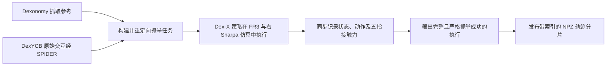
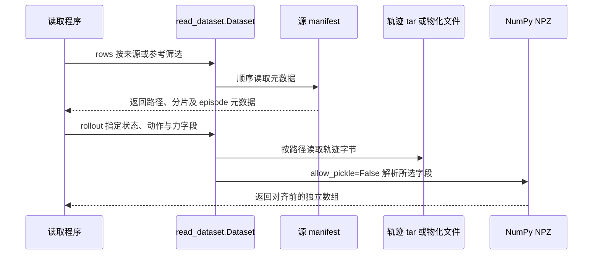

# Dex-X Force：带接触力标签的灵巧操作轨迹 | Force-Labeled Dexterous Manipulation Rollouts

## 一句话定义

Dex-X Force 是 Dex-X 多任务策略在仿真中执行抓取和抬升任务留下的数据。力标签来自物理引擎的碰撞与接触，而不是从人类视频中量出来的触觉，也不是 FR3 真机传感器数据。

## 英文缩写速查

| 缩写 | 英文 | 本页含义 |
| --- | --- | --- |
| FR3 | Franka Research 3 | 七关节机械臂；加右侧 Sharpa 手 22 关节共 29 列 |
| NPZ | NumPy compressed archive | 每条轨迹的压缩数组 |
| BC | Behavior Cloning | 用动作和对应的前状态学习行为 |
| HOI | Hand–Object Interaction | 手与物体交互；本次发布只覆盖单臂抓举 |

## 为什么重要

一般参考轨迹只记录手和物体怎么动。这份数据同步给出目标物体与指尖之间的三维力、全碰撞体力及物体运动，可研究何时发生接触、动作之后力如何变化。它不能代替真机传感器校准，也不能把世界坐标下的合力直接当作触觉阵列测量。

## 数据集速查

| 项目 | 固定版本核查 |
| --- | --- |
| 规模与模态 | 10,343 条轨迹、13.14 小时、1,429,216 状态帧；关节、连杆、物体状态、执行动作、逐指三维力 |
| Dexonomy | 10,028 条，2,954 个参考、767 个源物体 |
| DexYCB | 315 条，82 个序列参考、19 个归一化 YCB 身份 |
| 物体覆盖 | 两来源口径相加是 786；不是跨来源统一归一化、去重后的计数 |
| 拆分与获取 | 暂无 train / val / test 拆分；`strict_grasp` 是索引分组。开放访问；索引 Parquet、清单 JSONL、主体为 tar 内 NPZ，可不下网格读取 |
| 许可 | Hub 标为继承上游条款。Dexonomy 与 DexYCB 来源为 CC BY-NC 4.0；机器人与物体资产各自按 [SOURCES](https://huggingface.co/datasets/Ruoqu/DexX-Force/blob/248e2192d8ac9f346d8397595f5c34e824da3e2a/docs/SOURCES.md) |

## 核心机制与流程

作者以 120 Hz 进行物理仿真，约 30 Hz 保存状态。筛选要求从首帧完整执行，无记录的交互失败，最终物体误差低于 3 cm / 30°，抬升超过 3 cm 且无记录的抬升后掉落。此门槛用于选公开样本，不代表策略成功率。

## 工程实践

| 字段 | 对齐与解释 |
| --- | --- |
| `joint_pos` / `joint_vel` | `(T+1,29)`；按 `joint_names` 对齐，位置为 rad |
| `action_policy` / `action_applied` | `(T,29)`；记录策略输出与实际施加的动作两条链，按任务选择监督 |
| `tactile_object_force_w` | `(T+1,5,3)`；仅目标物体，世界对齐轴，单位 N |
| `tactile_net_force_w` / `tactile_net_force_palm` | 都包含桌面等其他碰撞体，分别是世界轴和掌心轴，不可直接相混 |
| `tactile_contact_pos_valid` | 只用有效位置；指序以 `tactile_body_names` 为准。若用模长转换二值接触，阈值属下游选择，不是原始标签 |
| `timestamps_s`、`reference_frame` | 轨迹、参考与策略缓存不保证同索引；按时戳及参考元数据对齐。位置以环境原点为基准、轴与世界对齐，四元数为 wxyz |

同一条记录有 `state[k] → action[k] → state[k+1]`。BC 的前状态应取 `joint_pos[:-1]`，预测下一状态则取 `joint_pos[1:]`；勿用后状态的力作为当前观测，勿把平滑/延迟后的 `tactile_actor_force_norm` 当原始力真值。

### 官方 reader 运行时序

已用官方 reader 从 DexYCB tar 读一条轨迹：状态 `(49,29)`、动作 `(48,29)`、目标物体力 `(49,5,3)`；另检查 6 个官方 ZIP 示例的形状、力有限值和记录间距。没有全量下载轨迹，也没有重放仿真或训练。CPU 读取不需要网格；要看同款物体几何，先用六例 ZIP，Dexonomy 几何按指南单独准备。

## 局限与数据划分

- 成功样本经筛选，不适合直接估失败率、掉落率或覆盖长尾负例。把同一参考的不同 checkpoint、seed 执行放在同一划分，并按归一化物体做更强的留出。单看 `training_reference` 不等于有作者固定测试集。
- 公开的是单臂抓举轨迹，不是论文的原始视频和完整重定向、训练集或六类任务合集。更大抓举、双手和纯手 HOI 在发布路线图上，不能写成已下载。
- 三维指尖力并非像素级压力图、真实触觉真值或接触扭矩。用于真机迁移还要核对传感器轴定义、滤波、时延和任务接触面。

## 关联页面

- [Dex-X 方法论文](./paper-dex-x.md) · [DexYCB 源数据](./dataset-dexycb.md)
- [行为克隆](../methods/behavior-cloning.md) · [操作任务](../tasks/manipulation.md)
- [具身数据纵深路线](../../roadmap/depth-embodied-data.md)：Stage 4 仿真产生监督，Stage 3 对齐与拆分。

## 参考来源

- [一手数据卡、字段与样本核验归档](../../sources/datasets/dexx-force.md)
- [Dex-X 预印本 v3](https://arxiv.org/abs/2609.07747v3)：框架出处，不是 10K 发布包统计来源。

## 推荐继续阅读

先读数据卡 FORMAT 的坐标与时序，再用六例 ZIP 对比目标力与全碰撞体力，最后按父参考及物体身份确定正式训练拆分。
