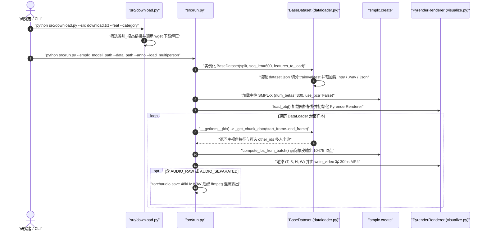

# Embody 3D

## 一句话定义

**Embody 3D**（Meta Codec Avatars Lab，[arXiv:2510.16258](https://arxiv.org/abs/2510.16258)）是在 80 相机、640 通道球形麦克风阵列的消声舞台采集的大型多模态三维人体动作与行为数据集，涵盖 439 名参与者、500 个人小时、超 5,400 万帧 30 fps 的高精度 SMPL-X 动作（含手部与体型）、说话人分离音频及多粒度文本标注。

## 英文缩写速查

| 缩写 | 英文全称 | 简要说明 |
|---|---|---|
| SMPL-X | Skinned Multi-Person Linear eXpressiveness | 统一身体、双手关节及个体体型参数（300 维 `betas`）的三维人体网格参数模型 |
| MEMS | Micro-Electro-Mechanical Systems | 微机电麦克风单元；采集舞台采用 5 组 128 通道 MEMS 球形阵列共 640 通道 |
| RANSAC | Random Sample Consensus | 用于多视角 2D 关键点射线三角化剔除离群点的鲁棒几何拟合 |
| XRCIA | Cross-Reality Collection / Institutional Access Agreement（数据集主页发布协议） | Embody 3D 数据集本体的官方非公开表单授权协议名 |
| MoCap | Motion Capture | 通过多相机系统捕获真实三维人体运动轨迹的技术 |

## 为什么重要

1. **填补「大规模 + 高保真手部/体型 + 真实社交音频」交集空缺：** 现有大规模动作集多依赖单目视频提升（手部模糊、无统一世界坐标与多人尺度一致），而光学动捕集往往体量有限、缺乏手部细节或同步多麦语音；Embody 3D 用 80 台 2,447 万像素全局快门相机同时保证手部细粒度精度与 500 个人小时规模。
2. **原生面向多人交互与声-动联合学习：** 提供两人对话（Dyadic）、多人讨论（Multi-Person）、协作/对抗任务（Scenarios）以及 3–4 人公寓合居长程日常（Day in the Life），配套波束成形分离后的逐人 48 kHz `.wav` 音轨，支撑社交行为生成、语音驱动动作与具身人-人/人-物协调策略。
3. **跨人偶模型重定向与世界模型训练原料：** 完整 SMPL-X 体型（300 维 `betas`）与中性顶视角伴随视频，可直接经 [运动重定向管线](../concepts/motion-retargeting-pipeline.md) 映射至人形机器人或用于人体交互先验预训练。

## 核心原理

### 数据集速查与七大子集

- **采集环境：** 6m × 6m × 3.6m 消声处理工作室（有效追踪区域 3.6m × 3.6m），14 块 LED 面板（约 650 lux）；64 台身体相机（8–15 mm F4，4 ms 曝光）+ 16 台面部特写相机（35 mm F1.4，2 ms 曝光），5320×4600 分辨率、30 fps 硬件同步；5 组 128 通道 MEMS 球形麦阵（共 640 通道，支持 10 阶球谐波声场）。
- **统计口径：** 「个人小时（individual hours）」按人时累计（2 人共处 1 小时计为 2 个人小时），总计 500 个人小时（各子集加总约 501.4 h）。

| 子集类别 | 时长（人时） | 参与者数 | 体型 & 手部 | 分离音频 | 文本标注粒度 | 多人同场 |
|---|---:|---:|---|---|---|---|
| Charades | 88.9 h | 221 | 有 | 无 | 高层/提示词（文件名/片段标签） | 单人 |
| Hand Interactions | 111.3 h | 137 | 有 | 无 | 无 | 单人 |
| Locomotion | 21.0 h | 46 | 有 | 无 | 高层/提示词 | 单人 |
| Dyadic Conversations | 59.4 h | 86 | 有 | 有 | 无 | 2 人 |
| Multi-Person Conversations | 125.2 h | 210 | 有 | 有 | 高层情绪/主题 | 多人 |
| Scenarios | 49.2 h | 77 | 有 | 有 | 细粒度交互文本 | 多人 |
| Day in the Life | 46.4 h | 77 | 有 | 有 | 整体主题 + 每 10 秒细粒度文本 | 3–4 人 |

### 采集、标定与 SMPL-X 重建流水线

## 实验与评测

1. **几何标定与追踪精度：** 定制基准标定车实现重投影误差中位数（p50）低于 `0.2 px`，p99 约 `0.8 px`；RANSAC 三角化结果进一步用于训练前馈姿态编码器并结合 Procrustes 与能量最小化残差细化，相比单阶段拟合减轻手部遮挡抖动。
2. **质量过滤标准：** 数据发布前经过人工质检按 Likert 1–5 分制评分，仅保留评分 `>= 2.5` 的序列，并为每帧提供 `missing/` 二值掩码（`0` 表示该帧跟踪失效勿用，`1` 表示有效跟踪），以保证下游加载器可显式掩蔽坏帧。

## 源码运行时序图

基于官方仓 [facebookresearch/embody-3d](https://github.com/facebookresearch/embody-3d) 中的 `src/download.py`、`src/run.py`、`src/dataloader.py`、`src/enums.py`、`src/visualize.py` 与 `src/load_obj.py`：

## 工程实践

- **按子集与模态按需拉取：** 获取 Meta release form 返回的 21 条下载链接写入 `download.txt` 后，可用 `python src/download.py --src download.txt --feat smplx text --category charades locomotion` 避开全量视频拉取。
- **跨多子目录合并与多人加载：** 许多分类（如 `multiperson`）解压后会拆分为 `emotions`、`location`、`polyadic`、`icebreakers` 等独立目录并各自携带 `dataset.json`，向 `--data_path` 传入多个目录列表即可自动合并；加载多人场景须加 `--load_multiperson`。
- **帧级有效性掩蔽：** 训练前必须读取每个受试者目录下的 `missing/*.npy` 二值掩码过滤 `0` 值损坏帧；此外注意 48 kHz 音频按每帧 `1600` 采样点（`48000 / 30`）切片对齐，10 秒间隔文本通过帧号向后向下取整索引。
- **SMPL-X 资产依赖：** 官方代码不包含 `SMPL-X` 模型参数文件，需另行从 SMPL-X 官网获取 `.npz` 资产及 `smplx_mesh.obj` 拓扑并设置 `num_betas=300` 与 `use_pca=False`。

## 常见误区与局限

- **未提供全部 80 路原始高清图像流：** 数据集仅附带单路高架俯视伴随参考视频（`videos/`），未对外发布 80 路原始同步 RGB 视频，因此**不能直接用于训练多视角图像端到端 2D→3D 视觉估计器**。
- **不包含真实环境物体 6-DoF 位姿真值：** 即便 `Scenarios` 与 `Day in the Life` 包含家具与日常道具交互，标注仅覆盖人体 SMPL-X 与文本/音频，**不提供物体网格或物体位姿跟踪真值**（如需物体真值需搭配 [FORM-HOI](./dataset-form-hoi.md) 或 [HO-3D](./dataset-ho-3d.md)）。
- **标注覆盖在子集间并不均等：** 如 `Hand Interactions` 既无音频也无文本，`Dyadic` 无文本标注，`acting` 与 `daylife` 以外的子集 `text` 字段多为文件名解析出的高层动作类别而非逐 10 秒细粒度描述；直接跨全集混训文本条件模型会收到大量空字典或类别词。
- **「500 个人小时」非物理墙钟时长：** 3–4 人同场录制 1 小时会被累计为 3–4 个人小时，评估场景多样性与总时长时应区分墙钟时长与人时口径；同时数据集受 XRCIA 许可限制，须审核商业用途边界。

## 关联页面

- [人形动作与视频语料跨集对照](../comparisons/humannet-table1-human-video-corpora.md)
- [具身数据集全景对比（2026-10）](../overview/embodied-dataset-panorama-2026-10.md)
- [SMPL-X](../concepts/smpl-x.md)
- [运动重定向管线](../concepts/motion-retargeting-pipeline.md)
- [Motion-X](./dataset-bfm-motion-x.md)
- [FORM-HOI](./dataset-form-hoi.md)

## 参考来源

- [Embody 3D 论文与源码主读归档（arXiv:2510.16258）](../../sources/papers/embody3d_arxiv_2510_16258.md) — 本文主要技术细节、hardware 参数、七子集统计及 `src/*.py` 接口均核对自此一次来源。
- [具身数据集全景综述（2026-10-19）](../../sources/datasets/wechat-embodied-dataset-panorama-2026-10-19.md) — 初始收录线索。

## 推荐继续阅读

- [HumanML3D](./dataset-bfm-humanml3d.md)：文本驱动全身运动生成经典小规模基准，可与 Embody 3D 的文本-动作长程规模形成对照。
- [Human Motion Scaling Laws](../concepts/embodied-scaling-laws.md)：理解多模态动作语料规模化时的质量掩蔽与覆盖度权衡。
