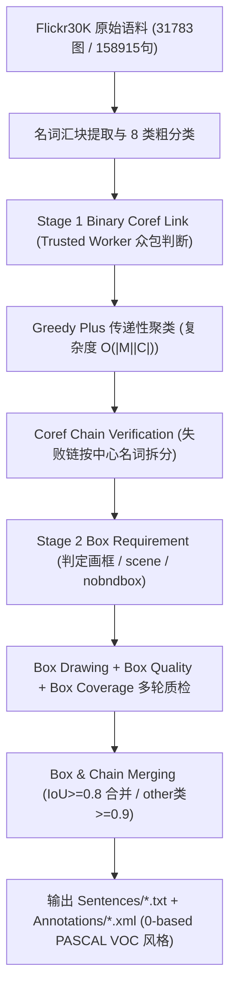
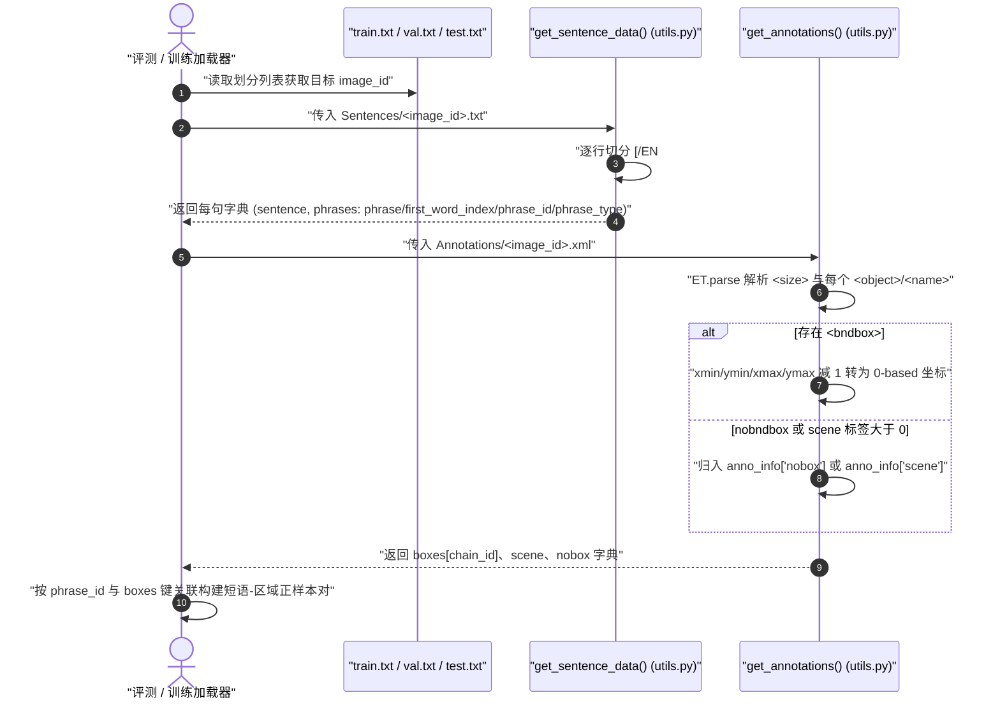

# Flickr30K Entities

## 一句话定义

**Flickr30K Entities**（Plummer et al., [arXiv:1505.04870](https://arxiv.org/abs/1505.04870) / IJCV 2017）在 Flickr30K 图像的 158,915 条英文描述上补充了 **244,035 条跨句共指链** 与 **275,775 个人工标注边界框**，首次在大规模开放词汇描述中建立短语到图像区域（region-to-phrase）的显式对应与短语定位（phrase localization）评测标准。

## 英文缩写速查

| 缩写 | 英文全称 | 简要说明 |
|---|---|---|
| AMT | Amazon Mechanical Turk | 构建共指链与边界框的众包平台，论文设计 Trusted Worker 质控流水线 |
| NP | Noun Phrase | 从图像描述中切分出的名词汇块实体指代（mention）单元 |
| CCA | Canonical Correlation Analysis | 原论文用于将区域特征与短语特征映射到同一嵌入空间检索的线性多模态基线 |
| IoU | Intersection over Union | 评测短语定位召回（IoU ≥ 0.5）及 Stage 2 框合并（≥0.8 / 0.9）的重叠比指标 |
| R@K | Recall@K | 短语定位标准指标：给定短语在候选框中 Top-K 预测内至少有一个 IoU ≥ 0.5 的比例 |

## 为什么重要

1. **从整句粗对齐推进到实体短语精确定位：** 传统 Flickr30K 与早期 [COCO](./dataset-coco.md) 仅提供「整图-整句」弱对齐，而真实图像往往同时包含多个同类对象或细粒度服饰/身体部位；Flickr30K Entities 将同一图像的 5 条独立描述按实体共指归并为唯一链 ID，并一对一或一对多绑定像素框。
2. **暴露跨句共指消解与细粒度局部定位难点：** 统计表明平均每图含 7.7–7.8 条共指链与 16.6 个指代短语；同图不同描述常使用不同颗粒度措辞（如 `a man` 与 `the guitarist in red`），检验开放词汇指代与多义词消歧能力。
3. **现代 VLM / 开放词汇检测基准基石：** 该集及其划分习惯（1,000 验证 / 1,000 测试）成为 GLIP、Grounding DINO、MDETR 等视觉定位模型（visual grounding）的标准零样本与微调对照集，与面向具身场景感知的 [2D 到 3D 语义提升落差](../concepts/2d-to-3d-semantic-lifting-gap.md) 研究直接衔接。

## 核心原理

### 数据集速查与标注统计

- **基础语料：** 沿用 Flickr30K（Young et al., 2014）全部 **31,783 张图像**（每图 5 句，共 **158,915 句**）；划分固定为 **Train 29,783 / Val 1,000 / Test 1,000**（`train.txt`、`val.txt`、`test.txt`）。
- **共指与框分布：** **244,035 条共指链**（513,644 个 mention），**275,775 个边界框**（平均 8.7 框/图）。其中 **59.1%** 共指链对应 1 个框，**20.0%** 对应 ≥2 个框（群组单人多框或复数实体群框），其余 **20.9%** 无框（标注为 `scene` 场景全貌或 `nobndbox` 不可见/抽象词；句中 `notvisual` 短语使用链 ID `0` 并作为独立单链处理）。
- **8 个粗语义类别：** `people`（59,766 链 / 116k+ 框）、`body parts`、`animals`、`clothing/color`、`instruments`、`vehicles`、`scene`、`other`。
- **训练输入与具身适配：** 作为二维图像-短语共指基准可直接作视觉定位与开放词汇检测模型的**训练输入**（图像受 Flickr Terms of Use 非商用教育科研约束）；不提供 3D 几何或动作轨迹，迁移至具身任务须结合深度感知做空间**适配**。

### 两阶段众包构建管线

## 实验与评测

1. **标注质量抽样评估：** 作者抽样核验显示名词汇块切分误差 `< 1%`，共指归并误差 `< 1%`，约 **8%** 图像存在某种程度的人工标注瑕疵（集中在小物体遗漏或复数框边界）。
2. **短语定位基准结果（Test 集，200 个 EdgeBox 候选，ground-truth NP chunks，IoU ≥ 0.5）：**
   - 纯文本-区域 CCA 嵌入基线（4096D HGLMM+word2vec 与 VGG-19 Fast R-CNN 区域特征，N=10 重采样）叠加 PASCAL 20 类检测器、区域面积先验与 11 类微调颜色分类器后，取得 **Recall@1 = 50.89%**、**Recall@5 = 71.09%**、**Recall@10 = 75.73%**。
   - **细分类别不均衡与任务解耦现象：** `body parts`（R@1 仅 **17.21%**）及多人物场景下的动作/衣物消歧显著困难；同时将该强定位模型融入整图-整句检索时，相比全局 CCA 嵌入仅带来约 **1–2%** 提升，表明局部短语匹配尚未充分转化为句子级组合语义理解。

## 源码运行时序图

基于官方仓 [BryanPlummer/flickr30k_entities](https://github.com/BryanPlummer/flickr30k_entities) 的 `flickr30k_entities_utils.py` 与官方划分索引 `train.txt` / `val.txt` / `test.txt`：

## 工程实践

- **图像与标注分离获取：** GitHub 仓库仅分发 `annotations.zip` 与划分/解析脚本；Flickr 原始图片需前往 UIUC DenotationGraph 页面填表申请（受 Flickr Terms of Use 约束）。
- **坐标零基偏移与复数框约定：** `get_annotations()` 在读取 XML 时会自动对 `xmin/ymin/xmax/ymax` 减 1 转为 0-based 坐标（对应 Matlab 1-based）；此外复数名词可能对应多个独立框（如 `two men` 既可能分别标单框也可能因重叠合并为群框），评测标准做法通常取该短语所有框的并集或按任一真值框匹配协议，复现时须核对论文具体协议。
- **跳过无关描述与零号链：** 仓库提供 `UNRELATED_CAPTIONS` 列出与画面不符的异常描述；句子中链 ID 为 `0` 且类型为 `notvisual` 的短语不应强制关联视觉边界框。

## 常见误区与局限

- **误将所有 `phrases` 视为必须有框目标：** 约 20.9% 共指链本身指向背景整体（`scene`）或无可视化载体实体（`nobndbox`），直接要求模型对所有短语强制回归唯一框会引入假阴性监督噪声。
- **短语定位与检测任务混淆：** 标准评测默认使用 ground-truth NP chunks，若从原始文本重新做 NLP 分块或把多义复数框当作单一类别检测，无法直接对齐原始 Recall@K 口径。
- **场景与语言单一偏置：** 原图像继承自 Flickr 街头与日常摄影且仅含英文描述，较少出现室内机器人桌面近景微物与多语种专有名词，后者更适合结合 [WIT](./dataset-wit.md) 或室内 3D 数据集。

## 关联页面

- [Transformer 视觉课程笔记](../entities/transformer-cv-curriculum.md)
- [视觉骨干网络](../concepts/vision-backbones.md)
- [目标检测](../methods/object-detection.md)
- [2D 到 3D 语义提升落差](../concepts/2d-to-3d-semantic-lifting-gap.md)
- [MS-COCO](./dataset-coco.md)
- [WIT](./dataset-wit.md)
- [具身评测与基准选择闭环](../queries/embodied-eval-benchmark-selection-loop.md)

## 参考来源

- [Flickr30K Entities 论文与源码归档（arXiv:1505.04870 / IJCV 2017）](../../sources/papers/flickr30k_entities_arxiv_1505_04870.md) — 本文规模统计、两阶段众包流程、实验结论及 `flickr30k_entities_utils.py` 接口均核对自此一次来源。
- [Transformer CV 应用课程大纲](../../sources/courses/transformer_cv_applications_syllabus.md) — 课程目录初始索引来源。

## 推荐继续阅读

- [WIT](./dataset-wit.md)：多语言维基百科长尾实体图文数据集，可对照 Flickr30K Entities 的日常描述分布。
- [MS-COCO](./dataset-coco.md)：通用实例分割与整句描述集，可对比短语级共指对齐的设计差异。
