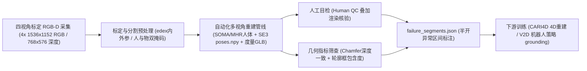
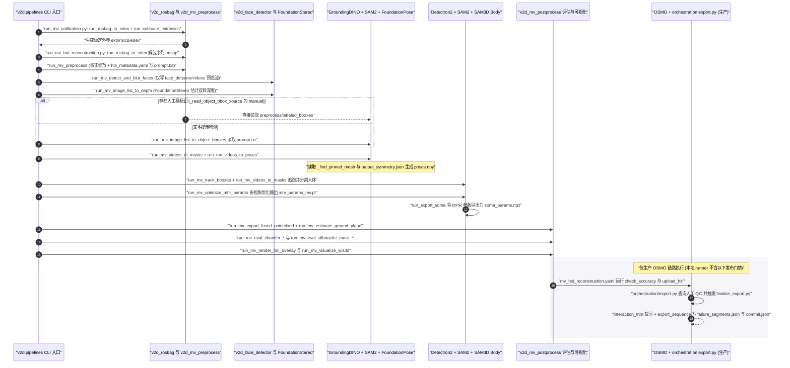

# FORM-HOI（Foundry for Reconstruction from Multiview HOI）

## 一句话定义

**FORM-HOI**（NVIDIA，Hugging Face `nvidia/form-hoi` v0.1.0，CC BY 4.0）是一个四视角标定 RGB-D 人–物交互（HOI）多模态数据集，其清洗发布集包含 **4,135 段**（约 **29.144 小时**）、**61 个物体 ID** 与 **22 名参与者**，提供 SOMA/MHR 人体姿态、逐帧 SE(3) 物体位姿、度量尺度 GLB 物体网格及逐区间质检标记。

## 英文缩写速查

| 缩写 | 英文全称 | 简要说明 |
|---|---|---|
| HOI | Human-Object Interaction | 人与物体协同运动与接触交互 |
| SOMA / SOMA-X | SOMA-X Human Motion Format（V2D 导出人体格式） | 经 `run_export_soma` 转换为 `soma_params.npz` 的标准化人体姿态与体型参数，可直接接入 `robotic_grounding` |
| MHR | SAM3D-Body MHR（SAM3D-Body 输出人体表示） | 经 `run_mv_optimize_mhr_params` 多视角优化生成并存为 `mhr_params_mv.pt` 的人体关节与网格参数 |
| SE(3) | Special Euclidean Group in 3D | 三维空间刚体旋转与平移群，数据集中以 `(N, 4, 4)` 矩阵 `poses.npy` 表示逐帧物体变换 |
| QC / HITL | Quality Control / Human-in-the-Loop | 人工渲染叠加复核（`upload_hitl` / Kratos DRS）与自动化几何一致性筛查（`check_accuracy`）的统称 |
| V2D | Video to Data | NVIDIA Isaac 开源的「演示视频 → 4D 重建 → 机器人策略对齐」管线仓库（`nvidia-isaac/video_to_data`） |

## 为什么重要

1. **补齐商用友好的多视角 4D HOI 全身-物体联合标注：** 相比传统单目视频伪标注（尺度不确定）或仅限非商业学术许可的早期手-物集（如 [HO-3D](./dataset-ho-3d.md)），FORM-HOI 采用 **CC BY 4.0** 协议，允许商业与非商业使用，且每段均包含 4 路标定相机内外参与度量尺度物体网格。
2. **连接单目 4D 重建模型与机器人操作策略底座：** 数据卡明确指出该集直接面向训练 [CARI4D](./paper-cari4d.md) 类 HOI 重建模型（CARI4D 原论文于 2025 年训练于 BEHAVE/HODome，FORM-HOI 在 2026 年补齐更大规模 NVIDIA 多视角语料）以及面向机器人策略训练的 grounding（接入 [CHORD](./paper-chord-contact-wrench-dexterous-manipulation.md) 所在的 V2D 管线）。
3. **显式公开自动化重建的伪真值风险区间：** 并非假装自动重建 100% 完美，而是每段附带 `failure_segments.json` 同时给出人工复核与深度/轮廓两项自动化指标告警，便于下游训练器按置信区间动态过滤或降权。

## 核心原理

### 数据集速查与模态规格

- **清洗发布集量化统计（不含 held-out 物体序列）：** **4,135 episodes**，累计约 **29.144 小时**（按段长计一次，不重复乘以 4 视角），覆盖 **61 个唯一物体 ID** 与 **22 名唯一参与者**，压缩打包总体积约 **~4.504 TB**（十进制 TB，不含发布索引 manifests）。
- **每段文件结构（`nvidia/form-hoi` 数据卡核对）：**
  - **4 路 RGB：** `1536×1152` H.264 编码 MP4 视频。
  - **4 路 Depth：** `768×576` HDF5 压缩深度数组。
  - **4 路 Masks：** `1536×1152` 黑白 HDF5 人体掩码与物体掩码。
  - **相机标定与环境：** `edex` JSON 相机内外参；`ground_plane.json`（地面平面 `Ax+By+Cz+D=0` 系数）。
  - **人体与物体 4D 状态：** `soma_params.npz`（SOMA 人体参数）、`mhr_params_mv.pt`（MHR 人体参数）、`poses.npy`（`(N, 4, 4)` 逐帧物体 SE(3) 位姿）、`output_aligned.glb`（度量尺度带纹理物体网格）、`output_symmetry.json`（主轴离散/连续旋转对称性）。
  - **质量与裁剪元数据：** `failure_segments.json`（半开帧区间列表）；据 `video_to_data` 导出源码，生产导出同时依据硬件采集（NVIDIA Nova Orin + 4 组 Leopard Imaging Hawk 立体相机，原始 8 路 1920×1200 流经 `v2d_mv_preprocess` 校正缩放，`export_sequence.py` 按 `LEFT_CAMERAS` 四视角导出深度与人/物掩码）生成 `interaction_trim.json`（接触窗口裁剪清单）与校验清单 `commit.json`（`v2d.mv_hoi.export_commit.v3`）。

### 采集、混合标注与下游使用流程

## 实验与评测

- **公开质检与混合评估机制：** `nvidia/form-hoi` 截至 v0.1.0 数据卡发布日标注「Technical report is in progress」，尚未公开单独的基线训练精度表格；数据质量通过三类信号共同刻画并写入 `failure_segments.json`：
  1. **Human QC：** 审校人员直接查看渲染网格重投影叠加图像，人工标出与观测明显不符的伪真值帧区间；
  2. **Chamfer distance：** 比较重建人体/物体表面与观测深度点云的几何偏差（数据卡指出实践中高频触发多由原始深度图噪声引起，未必代表姿态错误）；
  3. **Silhouette bounding box containment：** 检验三维投影轮廓与分割掩码外接框是否越界失配（可能受掩码噪声或重建误差双重影响）。

## 源码运行时序图

基于官方仓 [nvidia-isaac/video_to_data](https://github.com/nvidia-isaac/video_to_data) 的 `docs/form-hoi/README.md`、`reconstruction/docs/mv_hoi_local_pipeline.md`、`reconstruction/modules/v2d_pipelines/{run_mv_calibration.py,run_mv_hoi_reconstruction.py}`、`reconstruction/workflows/mv_hoi/{osmo/mv_hoi_reconstruction.yaml,orchestration/export.py}` 及 `reconstruction/modules/v2d_mv_postprocess/lib/{finalize_export.py,export_sequence.py}`：宿主机 Python 仅执行零 ML 依赖的 `docker run` 封装，按文件契约依次驱动 11 个容器镜像；其中本地 `run_mv_hoi_reconstruction.py` 为单序列顺序诊断入口，生产发布另由 OSMO 与 `orchestration/export.py` 衔接质检门禁、人工复核与裁剪提交。

## 工程实践

- **多模态分流下载与存储预算：** 全量发布集约 4.504 TB（十进制），训练纯视频重建模型或仅做运动重定向时，应先按 Hugging Face release manifest 筛选所需视角、掩码或参数文件，避免一次性拉满全部 HDF5 深度流。
- **正确解读 `failure_segments.json`：** 训练单帧/短窗模型或筛选机器人演示片段时，**强建议过滤 `Human QC` 标记区间**；而对于 `Chamfer distance` 和 `Silhouette bounding box containment` 标记区间，应先在少量样本上核验是深度传感噪点还是实际漂移再决定是否丢弃，避免过度损失有效交互动作。
- **利用对称性与地面先验：** 物体姿态（`poses.npy`）配对 `output_symmetry.json` 可在训练位姿损失（如对称物体 ADD-S 类目标）时避免旋转等价性梯度冲突；导入 [Isaac Lab](./isaac-lab.md) 做接触力或运动重定向时，可直接读取 `ground_plane.json` 将场景对齐地面坐标系。
- **本地复现 MV-HOI 管线的 GPU 与非断点重跑约束：** 容器推理目前仅允许 CUDA 计算能力 `sm_80` / `sm_86` / `sm_89` / `sm_90`（不支持 Blackwell `sm_120`；OSMO 生产已在 H100 / L40 / L40S 上验证），RTX 4090 热启动单段 30 秒序列约耗时 1 小时；且 `run_mv_hoi_reconstruction.py` 不支持跳过已完成阶段，部分失败后必须使用全新的空 `output_dir` 重跑，并确保源网格目录不与 `output_dir` 重叠、`hoi_metadata.yaml` 含非空 `object.prompt`（非人工框模式）且已完成 SAM3D Body 门控权重的 `hf auth login` 授权。
- **下游 SOMA-X 到宇树 G1 重定向目录契约：** 依据 `robotic_grounding/README.md`，将 FORM-HOI 序列接入 `scripts/retarget/soma_to_g1.py` 进行全身重定向时，输入目录须同时包含 `soma_params.npz`、`poses.npy` 与 `reconstructed_mesh/output_aligned.glb`（进而衔接 [CHORD](./paper-chord-contact-wrench-dexterous-manipulation.md) 所在的 V2D 策略训练链）。

## 常见误区与局限

- **误将自动化指标警报当成确认的真值错误：** 数据卡明确声明 `Metric-based flags indicate potential quality issues and should not be interpreted as confirmed annotation errors`，其中 Chamfer 异常往往源自 768×576 深度传感器噪点与运动模糊。
- **把 CARI4D 论文训练数直接套用为 FORM-HOI 统计：** 虽二者在多视角 4D HOI 生态内紧密关联且 Hugging Face 数据卡列出了 [CARI4D](./paper-cari4d.md)，但 CARI4D（arXiv:2512.11988）原论文主体实验训练在 BEHAVE 与 HODome、评测在 InterCap，不可将 FORM-HOI 的 4,135 段数据误写为 CARI4D 原文实验数字。
- **本地诊断 runner 并不直接生成与发布集等价的导出包：** `reconstruction/docs/mv_hoi_local_pipeline.md` 明确指出，本地 `run_mv_hoi_reconstruction.py` **不执行** OSMO 生产链中的 `validate_labeled_bboxes`、`check_accuracy`（聚合阈值门禁）、`upload_hitl`、Kratos DRS 人工 QC 查表、`interaction_trim` 接触裁剪及 `finalize_export.py` 校验提交（生产运行还依赖内部 PostgreSQL、CSS/Swift 与 AWS S3 基础设施）。
- **技术报告在研与稀疏检出范围边界：** 截至 v0.1.0，FORM-HOI 数据卡标注专属技术报告仍处于 `in progress`；本轮已完成 `docs/form-hoi/`、`reconstruction/modules/v2d_pipelines/`、`workflows/mv_hoi/` 与 `v2d_mv_postprocess/lib/` 导出源码核对，但稀疏检出未包含 `robotic_grounding/scripts/retarget/soma_to_g1.py` 源码本体，该脚本内部数值求解细节仍有待后续完整检出补核。

## 关联页面

- [CARI4D](./paper-cari4d.md)
- [HOI-Retarget](./paper-hoi-retarget.md)
- [CHORD（接触力旋量引导灵巧操作）](./paper-chord-contact-wrench-dexterous-manipulation.md)
- [Isaac Lab](./isaac-lab.md)
- [HO-3D](./dataset-ho-3d.md)
- [Embody 3D](./dataset-embody-3d.md)
- [富接触操作](../concepts/contact-rich-manipulation.md)
- [运动重定向管线](../concepts/motion-retargeting-pipeline.md)

## 参考来源

- [FORM-HOI 数据集来源归档（NVIDIA Hugging Face v0.1.0）](../../sources/datasets/form_hoi_nvidia.md) — 本文规模统计、模态契约、质检规则与发布边界核对自此一次来源。
- [nvidia-isaac/video_to_data 官方管线来源归档（MV-HOI 重建与导出）](../../sources/repos/video_to_data_form_hoi.md) — 本文两阶段入口、18 步容器调用时序、OSMO 生产门禁与本地诊断边界核对自此官方源码。
- [CARI4D 项目页归档](../../sources/sites/cari4d-project-page.md) — 用于交叉界定下游 4D HOI 重建模型与数据集的关联关系（而非混淆二者身份）。

## 推荐继续阅读

- [CARI4D](./paper-cari4d.md)：理解相机坐标系下的人–物联合 4D 重建如何消费多视角标定与掩码监督。
- [HOI-Retarget](./paper-hoi-retarget.md)：了解如何将包含 SOMA/MHR 姿态与 SE(3) 物体位姿的 HOI 数据在物体系内约束接触并重定向到人形机器人。
