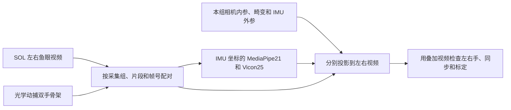
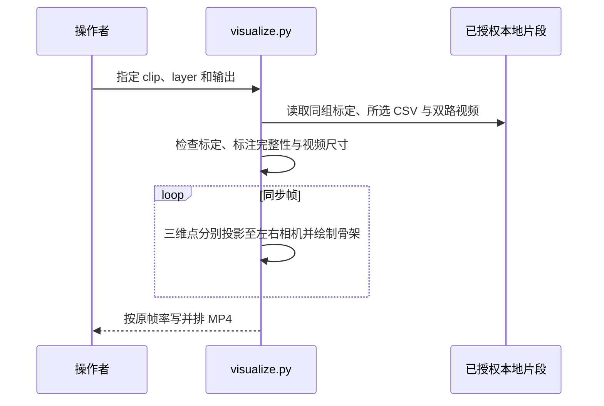

# HiPHI-Hand：双鱼眼第一视角手部动捕数据 | HiPHI-Hand: Stereo Egocentric Hand Motion Capture

## 一句话定义

Noitom Robotics 把头显的同步双鱼眼视频与光学动捕测得的双手三维骨架按帧对齐，使同一手部姿势有图像观测和独立的 3D 参考。它适合检查手姿态重建和为下游训练提供手部监督，不直接给机器人控制指令。

## 英文缩写速查

| 缩写 | 英文全称 | 本页含义 |
|---|---|---|
| IMU | Inertial Measurement Unit | 数据卡以头显 IMU 坐标表达三维关节 |
| MoCap | Motion Capture | 提供独立于视频估计的手部空间参考 |
| RGB | Red, Green, Blue | 左右鱼眼相机的彩色视频 |

## 为什么重要

只看头戴视频时，手指可能被物体或另一只手挡住。同步动捕提供独立的 3D 参考，可用来区分视觉模型的失败和视频—标注对齐错误。逐组标定也让同一 3D 参考能投影到两个真实视角。

## 数据集速查

| 维度 | 内容 |
|---|---|
| 发布与规模 | 2026-11-09，5 个采集组、794 段（按数据卡分组求和），发布方报告约 11 小时；Hub 在核对日显示 69.5 GB |
| 模态 | 左右鱼眼 RGB、双手 3D 关节点、Vicon25 关节取向、每组双目标定、可视化叠加视频 |
| 规格 | 每路 1360×1360、30 fps、硬件同步；两个 CSV 和两路视频共享片段内帧号 |
| 许可证与访问 | ModalityNet Open Research License v1.0；申请制，非商业用途，商用另需许可；不得镜像原始数据 |
| 重定向就绪度 | 人手标注不是机器人动作。要映射到特定灵巧手，仍需关节对应、运动约束与可执行性检查；公开文档未提供机器人动作、接触标注或对象 6D 轨迹 |

## 核心原理：采集与对齐流程

每组的片段号从头编号，跨组比较用 `(dataset_id, clip_id)`。`mediapipe21.csv` 每帧 42 行；`vicon25.csv` 每帧 50 行，另有 `xyzw` 全局取向。Vicon 的 `Hand`（1）和 MediaPipe 的 `WRIST`（0）对应同一 3D 点。手侧按佩戴者定义，不按画面左右定义。

## 工程实践

1. 先申请访问，只取一个片段及同组 `calibration.json`。核对左右视频和 CSV 帧号、每帧左右手的行数及坐标有限性。
2. 标注坐标为米，IMU 正轴分别是佩戴者右、上、后。用每只相机的 `T_camera_imu` 把三维点转入相机，再应用该相机的 OpenCV 等距鱼眼模型；不能直接把 IMU 的 z 当作相机深度。
3. 按[数据卡](https://huggingface.co/datasets/noitomrobotics/HiPHI-Hand#visualization-script)的方法在有权限后重绘，先检查少量帧再批处理。叠加能发现对齐或标定错误，但不是精度独立评测。

### 可视化运行时序（据公开数据卡，未实跑）

## 局限与风险

- [全身 HiPHI](./paper-hiphi.md) 的规模、BVH 和物体轨迹不是 HiPHI-Hand 的内容。
- 发布方说明 HiPHI-Hand 是 [EgoHand-v1](https://huggingface.co/nvidia/EgoHand-v1) 的训练数据来源之一；同一数据不宜直接当该模型的独立泛化测试。EgoHand 是单目推理模型且许可独立，不能把模型的 OpenMDW 许可套到门控数据。
- 公开文档和文件树可读，未下载样本或直接检查门控脚本正文。公开卡未给出可复用的跨受试者训练/测试划分。

## 关联页面

- [HiPHI 全身动捕与人–物交互基准](./paper-hiphi.md)
- [第一视角人手转动作监督](../methods/macrodata-egocentric-hand-action.md)
- [灵巧手交互保持重定向](../methods/toporetarget-interaction-preserving-dexterous-retargeting.md)
- [机器人操作](../tasks/manipulation.md)

## 参考来源

- [HiPHI-Hand 官方数据卡归档](../../sources/datasets/hiphi-hand.md)

## 推荐继续阅读

- [ModalityNet 随库许可](https://huggingface.co/datasets/noitomrobotics/HiPHI-Hand/blob/main/LICENSE.md)：确认研究使用与成果发布的边界。
- [NVIDIA EgoHand-v1 模型卡](https://huggingface.co/nvidia/EgoHand-v1)：对照训练数据来源、单目输入和三维输出。
