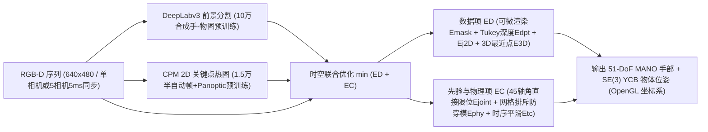
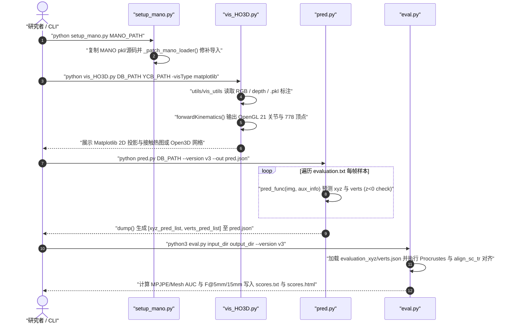

# HO-3D（含 H2O-3D、HO-3D v3）

## 一句话定义

**HO-3D**（Hampali et al., CVPR 2020 [arXiv:1907.01481](https://arxiv.org/abs/1907.01481)）是由自动标注算法 **HOnnotate** 对多视角或单视角 RGB-D 交互视频做时空联合优化后生成 3D MANO 手部与 YCB 物体位姿真值的真实手-物数据集（v1 共 77,558 帧、68 段序列，v3 扩展至 103,462 帧，并衍生双手互动集 **H2O-3D**）。

## 英文缩写速查

| 缩写 | 英文全称 | 简要说明 |
|---|---|---|
| MANO | hand Model with Articulated and Non-rigid deFormation | 3D 手部参数化网格模型（778 顶点），HO-3D 中使用 51 维姿态（45 轴角 + 6 手腕）与 10 维体型 β |
| YCB | Yale-CMU-Berkeley Object and Model Set | 提供已知高精度 3D 网格的标准日用物体套件，HO-3D 选用 YCB-Video 中 10 类物体 |
| CPM | Convolutional Pose Machines | HOnnotate 中先在 1.5 万半自动帧预训练、用于输出 21 关节 2D 热图先验的检测器 |
| AUC | Area Under the Curve | 随阈值（如 0–5 cm）变化的 PCK 曲线下面积，HO-3D 官方核心位姿评估指标之一 |
| MPJPE | Mean Per Joint Position Error | 平均单关节三维位置误差（论文与评测常按 cm 或 mm 汇报，含未对齐与 Procrustes 对齐口径） |

## 为什么重要

1. **攻克严重手-物互遮挡下的真实 RGB-D 3D 标注难题：** 早期单视图手部集（如 FreiHAND 无物体复杂操作、Dexter 无连续复杂抓取）要么缺乏物体联合真值，要么依赖人工逐帧点云标注而难以扩大规模；HOnnotate 证明通过可微渲染轮廓、深度与物理防穿模约束跨帧联合优化，可在无需磁传感/光学标记点干扰图像外观的前提下实现 `< 8 mm` 自动标注精度。
2. **评测跨物体与跨受试者泛化的长期标准基准：** HO-3D 测试集中包含训练集未见受试者与未见物体序列，经过 v2、v3（`arXiv:2107.00887`）和 2024-11-03 测试集 GT 公开，仍广泛用于单目 RGB 3D 手部网格与手-物联合位姿估计评测，与多视高精度捕捉集 [DexYCB](./dataset-dexycb.md) 和双手交互集 [H2O](./dataset-h2o.md) 形成互补对照。

## 核心原理

### 数据集演进与版本速查

- **HO-3D v1（CVPR 2020）：** **77,558 帧**（66,034 训练 / 11,524 测试，13 段测试序列含未见人/物），**68 段序列**（16 段单相机刚性/近刚性抓取 + 52 段 5 相机约 5 ms 同步采集），**10 名参与者**、**10 个 YCB-Video 物体**，分辨率 `640×480` RGB-D。
- **HO-3D v3（2021-07，[arXiv:2107.00887](https://arxiv.org/abs/2107.00887)）：** 扩展至 **103,462 帧**，进一步提升手-物位姿精度；RGB 由 PNG 转为 JPG 以压缩存储，目录结构兼容 v2。
- **H2O-3D v1（CVPR 2022）：** 沿用 HOnnotate 管线采集双手与物体交互，共 **76,340 帧**，支持 `vis_H2O3D.py` 同格式解析。
- **2024-11-03 更新：** 官方首次公开 HO-3D v2 与 v3 测试集真值压缩包，无需依赖 CodaLab 线上队列即可在本地直接运行 `eval.py`。
- **重定向就绪度与训练输入：** 提供 51-DoF MANO 手部与 YCB 物体位姿，可用于单目手-物位姿估计**训练输入**，但无力传感器/触觉读数；驱动机器人灵巧手前需经手型与关节**重定向**及物理可行性过滤。

### HOnnotate 自动标注联合优化流程

## 实验与评测

1. **HOnnotate 自动标注误差基准：** 在人工 3D 点云标注验证帧上，多相机序列的平均手部关节误差 `< 8 mm`（具体为 `0.77 cm`，AUC = `0.79`）；把 5 相机序列退化为单相机优化再与多相机真值对比，手部网格差异仅 `0.77 cm`、物体网格差异 `0.45 cm`，验证了恒定抓取假设与联合优化的稳健性。
2. **官方提交校验基准与指标：** 仓库 `README.md` 给出全零基线在 CodaLab 验证基准上的参考读数（未对齐关节误差 56.87 cm、Procrustes 对齐后 5.19 cm、`F@5mm=0.0`、`F_aligned@15mm=0.017`），说明未对齐指标主要检验根部三维定位与 OpenGL 负 z 轴坐标系对齐，而 Procrustes 与尺度-平移对齐（`align_sc_tr`）重点评估局部手型与手指弯曲恢复。

## 源码运行时序图

基于官方仓 [shreyashampali/ho3d](https://github.com/shreyashampali/ho3d) 中的 `setup_mano.py`、`vis_HO3D.py`、`pred.py`、`eval.py` 与 `utils/vis_utils.py`：

## 工程实践

- **OpenGL 坐标系与外部资产前置准备：** 使用 `vis_HO3D.py` 和提交评测前必须自行从 MPI 下载 `MANO` 模型并通过 `setup_mano.py` 打补丁、从 PoseCNN 下载 `YCB-Video` 3D 模型；同时 `pred.py` 会强制校验预测关节与顶点的 `z < 0`（相机光学中心原点、手沿负 z 轴的 OpenGL 右手系），否则直接抛出异常中止。
- **充分利用 2024 年公开的本地真值评测：** 若此前仅因依赖 CodaLab 提交排期而受限，可按 `README.md` 下载 2024-11-03 放出的 `v2` / `v3` 测试集真值文件并本地运行 `eval.py` 进行消融实验。
- **区分评估划分仅提供的字段：** 在 `evaluation` 划分中，标注文件仅公开手腕根关节三维坐标与手部 2D 检测框（供裁剪与单帧定位参考），而不向测试模型直接暴露完整手部 21 关节坐标。

## 常见误区与局限

- **把 HO-3D 当作非刚性或灵巧工具双边动态交互集：** 单相机序列依赖 20 帧子集上「手-物相对刚性抓取」先验才能稳定求解，对剧烈换手重抓、非刚性物体形变或极高速滑移动作较容易受限于平滑与刚性假设。
- **忽略商用许可与衍生版本差异：** `ho3d` 数据条款严格限制为**非商业学术研究（不可商用与再分发）**；跨论文对比时务必对齐 `HO-3D v2` 与 `HO-3D v3` 版本（v3 帧数增至 103,462 且位姿重算），直接跨版本比较厘米级误差会产生错位。
- **老旧 Python 2.7 生态遗留依赖：** 原始可视化脚本依赖 `chumpy`、早期 `open3d` 及 `numpy` 已废弃别名（如 `np.int`），在现代 Python 3.10+ 环境中直接运行常需小幅兼容改写或隔离环境。

## 关联页面

- [具身数据集全景对比（2026-10）](../overview/embodied-dataset-panorama-2026-10.md)
- [DexYCB](./dataset-dexycb.md)
- [H2O](./dataset-h2o.md)
- [HOI4D](./dataset-hoi4d.md)
- [FORM-HOI](./dataset-form-hoi.md)
- [操作任务](../tasks/manipulation.md)
- [富接触操作](../concepts/contact-rich-manipulation.md)

## 参考来源

- [HO-3D / HOnnotate 论文与源码归档（arXiv:1907.01481 / CVPR 2020）](../../sources/papers/ho3d_arxiv_1907_01481.md) — 本文 HOnnotate 优化公式、版本统计、精度验证与脚本时序均核对自此一次来源。
- [具身数据集全景综述（2026-10-19）](../../sources/datasets/wechat-embodied-dataset-panorama-2026-10-19.md) — 初始收录线索。

## 推荐继续阅读

- [DexYCB](./dataset-dexycb.md)：8 台硬件同步 RGB-D 相机捕获的手持 YCB 物体抓取数据集，可与 HO-3D 的 HOnnotate 标注管线对比。
- [FORM-HOI](./dataset-form-hoi.md)：支持商用（CC BY 4.0）的四视角全身与物体联合 4D 重建数据集。
